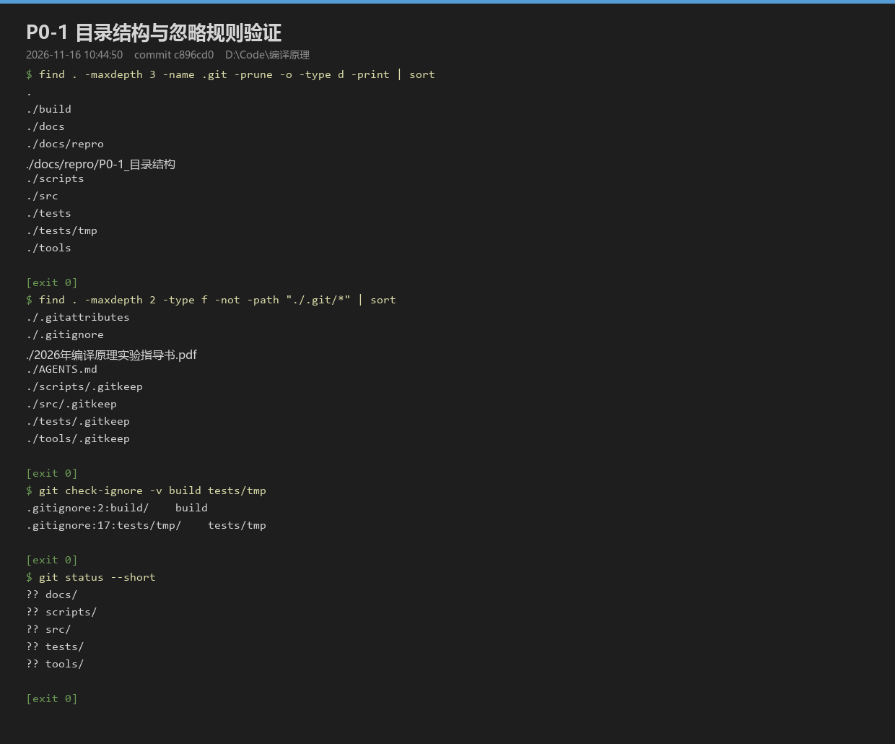

# P0-1 目录结构

## 1. 目的

建立项目的基础目录骨架（`src/ scripts/ tools/ tests/ docs/ build/`），并用 `.gitignore` 排除构建产物与测试临时目录，对应 AGENTS.md §2.2 与 TODO P0-1。

## 2. 环境

- 日期：2026-11-16
- 系统：Windows 11
- 工具链：Git 2.53.0（Git Bash）、Python 3.14 + Pillow 12.2
- 代码版本：`c896cd0` 之后的工作区（本功能提交见 `git log --oneline --grep=P0-1`）

## 3. 前置条件

- 已克隆仓库并进入仓库根目录；
- 已安装 Git Bash（`find`、`touch`、`mkdir` 均来自 Git Bash）；
- `.gitignore` 中已包含 `build/` 与 `tests/tmp/`。

## 4. 复现步骤

1. 创建目录与占位文件：

```bash
mkdir -p src scripts tools tests docs/repro build tests/tmp
touch src/.gitkeep scripts/.gitkeep tools/.gitkeep tests/.gitkeep
```

2. 查看目录结构、文件与忽略规则：

```bash
find . -maxdepth 3 -name .git -prune -o -type d -print | sort
find . -maxdepth 2 -type f -not -path "./.git/*" | sort
git check-ignore -v build tests/tmp
git status --short
```

3. 预期：`build/` 与 `tests/tmp/` 被 `.gitignore` 命中；`git status` 只列出待提交的目录。

## 5. 预期输出

```text
$ find . -maxdepth 3 -name .git -prune -o -type d -print | sort
.
./build
./docs
./docs/repro
./docs/repro/P0-1_目录结构
./scripts
./src
./tests
./tests/tmp
./tools
[exit 0]

$ find . -maxdepth 2 -type f -not -path "./.git/*" | sort
./.gitattributes
./.gitignore
./2026年编译原理实验指导书.pdf
./AGENTS.md
./scripts/.gitkeep
./src/.gitkeep
./tests/.gitkeep
./tools/.gitkeep
[exit 0]

$ git check-ignore -v build tests/tmp
.gitignore:2:build/    build
.gitignore:17:tests/tmp/    tests/tmp
[exit 0]

$ git status --short
?? docs/
?? scripts/
?? src/
?? tests/
?? tools/
[exit 0]
```

## 6. 截图



## 7. 备注

- `build/` 与 `tests/tmp/` 是本地目录，不纳入版本库；其余空目录用 `.gitkeep` 占位。
- 本截图由真实命令输出渲染生成，原始日志见 [run.log](run.log)；正式截图工具将在 P0-4 提供（`tools/capture.py`）。
- 截图中的 `commit c896cd0` 是生成时的 HEAD，本功能提交后该值会变化，属正常现象。
