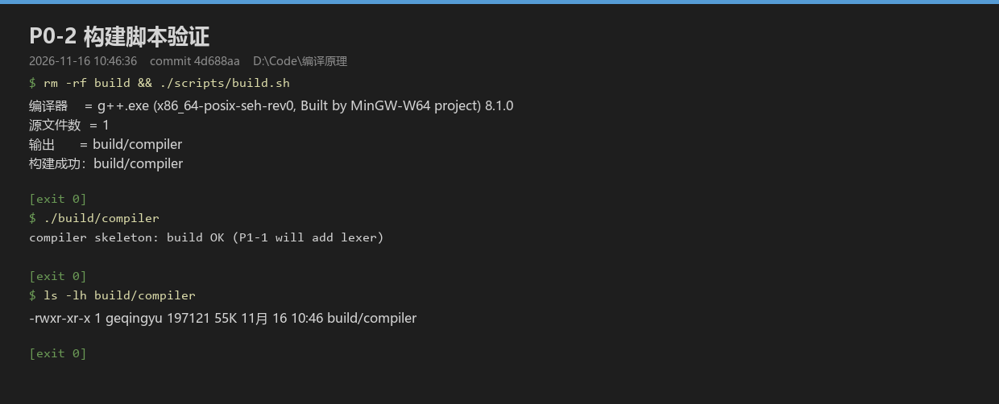

# P0-2 构建脚本

## 1. 目的

提供统一的构建入口 `scripts/build.sh`：自动收集 `src/` 下全部 `.cpp`，用 `g++ -std=c++17` 编译为 `build/compiler`。对应 AGENTS.md §2.1 与 TODO P0-2。

## 2. 环境

- 日期：2026-11-16
- 系统：Windows 11
- 工具链：g++ 8.1.0（MinGW-w64，x86_64-posix-seh）、Git Bash 2.53.0
- 代码版本：`4d688aa` 之后的工作区（本功能提交见 `git log --oneline --grep=P0-2`）

## 3. 前置条件

- 已进入仓库根目录；
- 已安装 Git Bash 与 MinGW-w64 g++；
- `src/` 下至少有一个 `.cpp` 文件。

## 4. 复现步骤

1. 清理旧构建并执行构建：

```bash
rm -rf build && ./scripts/build.sh
```

2. 运行生成的可执行文件：

```bash
./build/compiler
```

3. 查看产物大小：

```bash
ls -lh build/compiler
```

4. 可选：覆盖编译器或编译参数。

```bash
CXX=g++ CXXFLAGS="-std=c++17 -Wall -Wextra -Werror" ./scripts/build.sh
```

## 5. 预期输出

```text
$ rm -rf build && ./scripts/build.sh
编译器    = g++.exe (x86_64-posix-seh-rev0, Built by MinGW-W64 project) 8.1.0
源文件数  = 1
输出      = build/compiler
构建成功：build/compiler
[exit 0]

$ ./build/compiler
compiler skeleton: build OK (P1-1 will add lexer)
[exit 0]

$ ls -lh build/compiler
-rwxr-xr-x 1 geqingyu 197121 55K 11月 16 10:46 build/compiler
[exit 0]
```

## 6. 截图



## 7. 备注

- `src/main.cpp` 当前是占位桩，仅用于验证构建链路；P1-1 会把它替换为词法分析入口。
- 构建脚本内部先 `cd` 到仓库根目录，源文件使用相对路径，避免中文路径直接传给 g++ 时可能出现的编码问题。
- `build/` 已被 `.gitignore` 排除，不纳入版本库；构建产物大小与时间戳因机器而异，属正常现象。
- 截图由真实命令输出渲染生成，原始日志见 [run.log](run.log)。
