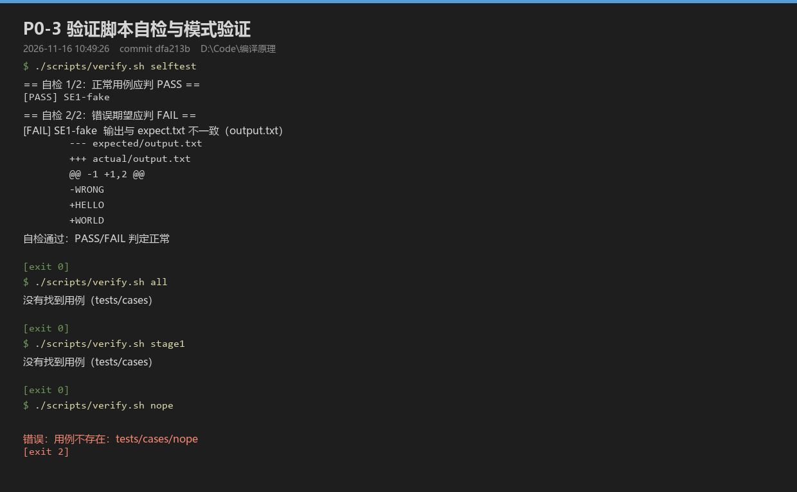

# P0-3 验证脚本

## 1. 目的

提供统一的功能验证入口 `scripts/verify.sh`：构建、复制用例到临时目录、以该目录为工作目录运行编译器、把结果文件与期望值逐字节比较，并输出 `PASS` / `FAIL` 与 diff 摘要。对应 AGENTS.md §9 与 TODO P0-3。

## 2. 环境

- 日期：2026-11-16
- 系统：Windows 11
- 工具链：Git Bash 2.53.0、g++ 8.1.0、GNU diff/cmp
- 代码版本：`dfa213b` 之后的工作区（本功能提交见 `git log --oneline --grep=P0-3`）

## 3. 前置条件

- 已进入仓库根目录；
- P0-2 的 `scripts/build.sh` 可用；
- 用例放在 `tests/cases/<ID>/`，至少包含 `testfile.txt` 与 `expect.txt`（当前阶段尚未有用例）。

## 4. 复现步骤

1. 脚本自检（不依赖真实编译器）：

```bash
./scripts/verify.sh selftest
```

2. 查看全部用例 / 某一阶段用例：

```bash
./scripts/verify.sh all
./scripts/verify.sh stage1
```

3. 运行单个用例（P1-10 之后可用）：

```bash
./scripts/verify.sh P1-1
```

4. 非法用例 ID 应报错并以退出码 2 结束：

```bash
./scripts/verify.sh nope
```

## 5. 预期输出

```text
$ ./scripts/verify.sh selftest
== 自检 1/2：正常用例应判 PASS ==
[PASS] SE1-fake
== 自检 2/2：错误期望应判 FAIL ==
[FAIL] SE1-fake  输出与 expect.txt 不一致（output.txt）
        --- expected/output.txt
        +++ actual/output.txt
        @@ -1 +1,2 @@
        -WRONG
        +HELLO
        +WORLD
自检通过：PASS/FAIL 判定正常
[exit 0]

$ ./scripts/verify.sh all
没有找到用例（tests/cases）
[exit 0]

$ ./scripts/verify.sh stage1
没有找到用例（tests/cases）
[exit 0]

$ ./scripts/verify.sh nope
错误：用例不存在：tests/cases/nope
[exit 2]
```

## 6. 截图



## 7. 备注

### 用例约定

```text
tests/cases/<ID>/
├── testfile.txt    必需，输入源程序
├── expect.txt      必需，期望的结果文件内容（UTF-8、LF）
├── stdin.txt       可选，标准输入
└── meta.conf       可选，覆盖默认行为（每行 KEY=VALUE）
```

`meta.conf` 支持的键：

| 键 | 含义 | 示例 |
|---|---|---|
| `OUTPUT` | 结果文件名 | `OUTPUT=output.txt` |
| `ARGS` | 传给编译器的参数（按空格拆分，不支持引号） | `ARGS=--dump-lexer` |
| `STDIN` | 标准输入文件名 | `STDIN=stdin.txt` |
| `ALLOW_NONZERO` | 允许非零退出码 | `ALLOW_NONZERO=1` |

结果文件默认按用例 ID 前缀推断：`P1-*`/`P2-*` → `output.txt`，`P3-*` → `error.txt`，`P4-*` → `pcoderesult.txt`。

### 退出码

- `0`：全部通过（或没有用例）；
- `1`：存在失败用例；
- `2`：参数错误或用例不存在。

### 其他

- 自检使用临时假编译器与假用例，结束后自动清理，不会污染 `tests/cases`。
- 设置环境变量 `COMPILER=<路径>` 可指定编译器并跳过构建，便于调试脚本本身。
- 每个用例的运行目录为 `tests/tmp/<ID>/`，其中保留 `_stdout.txt`、`_stderr.txt` 便于排查。
- 当前没有正式用例，`all` / `stage1` 返回“没有找到用例”；P1-10 起会加入真实用例。
- 截图由真实命令输出渲染生成，原始日志见 [run.log](run.log)。
