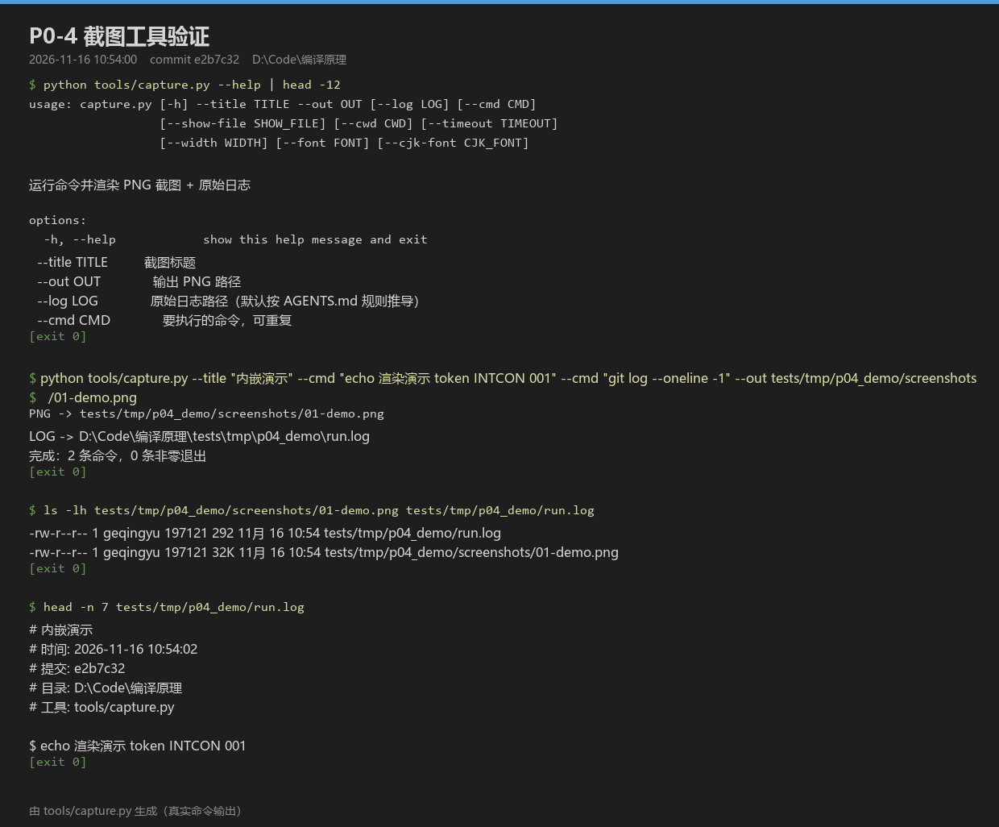

# P0-4 截图工具

## 1. 目的

提供统一的截图生成工具 `tools/capture.py`：真实执行命令，把标题、时间、提交号、命令、输出、退出码渲染为 PNG，并同步写出原始日志。对应 AGENTS.md §7 与 TODO P0-4。

## 2. 环境

- 日期：2026-11-16
- 系统：Windows 11
- 工具链：Python 3.14、Pillow 12.2、Git Bash 2.53.0
- 字体：Consolas（ASCII）、微软雅黑（中文）
- 代码版本：`e2b7c32` 之后的工作区（本功能提交见 `git log --oneline --grep=P0-4`）

## 3. 前置条件

- 已进入仓库根目录；
- Python 已安装 Pillow（`python -c "import PIL"` 可验证）；
- 已安装 Git Bash（命令通过 `bash -lc` 执行）。

## 4. 复现步骤

1. 生成一张基本截图：

```bash
python tools/capture.py \
  --title "P0-4 截图工具自测" \
  --cmd "echo 中文与 ASCII 混排：token INTCON" \
  --cmd "git log --oneline -1" \
  --out tests/tmp/p04_demo/screenshots/01-demo.png
```

2. 展示结果文件内容（实验截图要求包含 `output.txt` / `error.txt` / `pcoderesult.txt`）：

```bash
python tools/capture.py \
  --title "展示结果文件" \
  --cmd "scripts/verify.sh P1-3" \
  --show-file tests/tmp/P1-3/output.txt \
  --out tests/tmp/p04_demo/screenshots/02-file.png
```

3. 查看帮助与全部参数：

```bash
python tools/capture.py --help
```

4. 验证非零退出与超时的渲染（可选）：

```bash
python tools/capture.py \
  --title "边界测试" \
  --out tests/tmp/p04_edge/out.png \
  --cmd "echo before; exit 3" \
  --cmd "sleep 3" \
  --timeout 1
```

## 5. 预期输出

```text
$ python tools/capture.py --help | head -12
usage: capture.py [-h] --title TITLE --out OUT [--log LOG] [--cmd CMD]
                  [--show-file SHOW_FILE] [--cwd CWD] [--timeout TIMEOUT]
                  [--width WIDTH] [--font FONT] [--cjk-font CJK_FONT]

运行命令并渲染 PNG 截图 + 原始日志

options:
  -h, --help            show this help message and exit
  --title TITLE         截图标题
  --out OUT             输出 PNG 路径
  --log LOG             原始日志路径（默认按 AGENTS.md 规则推导）
  --cmd CMD             要执行的命令，可重复
[exit 0]

$ python tools/capture.py --title "内嵌演示" --cmd "echo 渲染演示 token INTCON 001" --cmd "git log --oneline -1" --out tests/tmp/p04_demo/screenshots/01-demo.png
PNG -> tests/tmp/p04_demo/screenshots/01-demo.png
LOG -> D:\Code\编译原理\tests\tmp\p04_demo\run.log
完成：2 条命令，0 条非零退出
[exit 0]

$ ls -lh tests/tmp/p04_demo/screenshots/01-demo.png tests/tmp/p04_demo/run.log
-rw-r--r-- 1 geqingyu 197121 292 11月 16 10:54 tests/tmp/p04_demo/run.log
-rw-r--r-- 1 geqingyu 197121 32K 11月 16 10:54 tests/tmp/p04_demo/screenshots/01-demo.png
[exit 0]

$ head -n 7 tests/tmp/p04_demo/run.log
# 内嵌演示
# 时间: 2026-11-16 10:54:02
# 提交: e2b7c32
# 目录: D:\Code\编译原理
# 工具: tools/capture.py

$ echo 渲染演示 token INTCON 001
[exit 0]
```

## 6. 截图



## 7. 备注

### 参数

| 参数 | 说明 |
|---|---|
| `--title` | 截图标题，必填 |
| `--out` | 输出 PNG 路径，必填 |
| `--log` | 原始日志路径；默认：若 `--out` 在 `screenshots/` 下，则写到上一级 `run.log`，否则与 PNG 同名的 `.log` |
| `--cmd` | 要执行的命令，可重复 |
| `--show-file` | 在截图中展示文件内容，可重复 |
| `--cwd` | 命令工作目录，默认当前目录 |
| `--timeout` | 单条命令超时秒数，默认 120；超时记为退出码 124 |
| `--width` | 图片宽度，默认 1240，上限 1400 |
| `--font` / `--cjk-font` | 手动指定 ASCII 等宽字体 / 中文字体 |

### 行为约定

- 工具退出码 `0` 表示截图与日志生成成功，**不表示**被执行的命令成功；命令的退出码会显示在图片和日志中。
- 中英文混排按行自动切换字体；制表符展开为 4 个空格；超长行按字符换行，命令续行缩进两个空格。
- 图片包含：标题、时间、提交短哈希、工作目录、每条命令、stdout、stderr（红色）、退出码、展示的文件内容、页脚“由 tools/capture.py 生成”。
- 本次截图由工具自身生成，其中内嵌了一次完整调用（内层截图写往 `tests/tmp/p04_demo/`），证明工具可重复执行。
- 截图中的 `commit e2b7c32` 是生成时的 HEAD，本功能提交后该值会变化，属正常现象。
