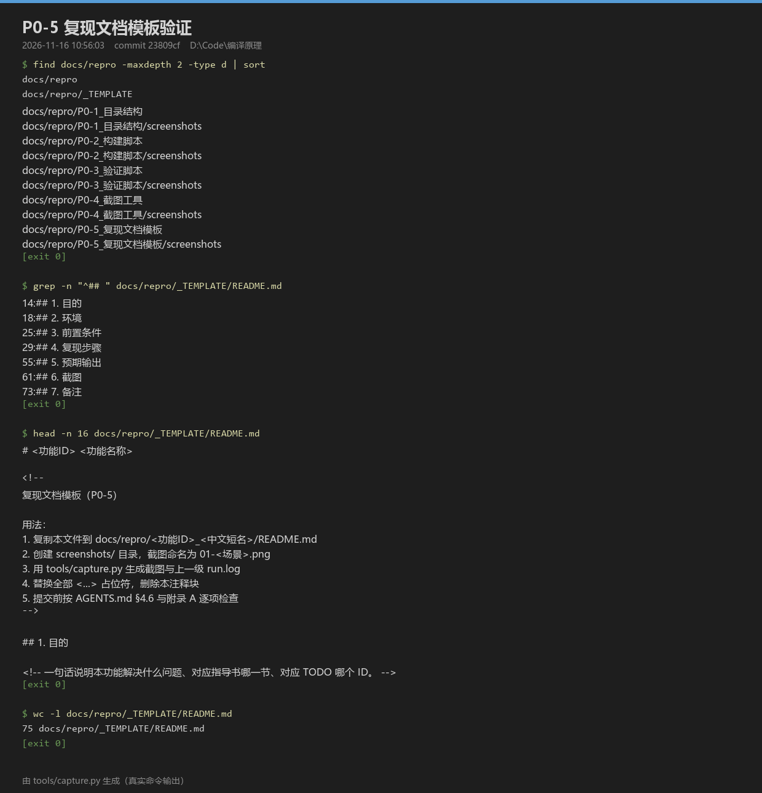

# P0-5 复现文档模板

## 1. 目的

提供统一的复现文档模板，保证每个功能的文档结构一致、可检查。对应 AGENTS.md §7.4 与 TODO P0-5。本文件本身就是按该模板填写的，可作为模板可用性的验证。

## 2. 环境

- 日期：2026-11-16
- 系统：Windows 11
- 工具链：Python 3.14、Pillow 12.2、Git Bash 2.53.0
- 代码版本：`23809cf` 之后的工作区（本功能提交见 `git log --oneline --grep=P0-5`）

## 3. 前置条件

- 已进入仓库根目录；
- 已存在 `docs/repro/`；
- 截图工具 `tools/capture.py` 可用（P0-4）。

## 4. 复现步骤

1. 新建功能文档目录并复制模板：

```bash
mkdir -p docs/repro/<功能ID>_<中文短名>/screenshots
cp docs/repro/_TEMPLATE/README.md docs/repro/<功能ID>_<中文短名>/README.md
```

2. 替换全部 `<...>` 占位符，删除模板中的 HTML 注释。

3. 检查模板自身的章节完整性：

```bash
grep -n "^## " docs/repro/_TEMPLATE/README.md
grep -c "^## " docs/repro/_TEMPLATE/README.md
```

预期为 7 个章节，名称与顺序依次为：目的、环境、前置条件、复现步骤、预期输出、截图、备注。

4. 生成截图与日志：

```bash
python tools/capture.py \
  --title "<功能ID> <功能名称>" \
  --cmd "scripts/verify.sh <功能ID>" \
  --out docs/repro/<功能ID>_<中文短名>/screenshots/01-verify.png
```

## 5. 预期输出

```text
$ find docs/repro -maxdepth 2 -type d | sort
docs/repro
docs/repro/_TEMPLATE
docs/repro/P0-1_目录结构
docs/repro/P0-1_目录结构/screenshots
docs/repro/P0-2_构建脚本
docs/repro/P0-2_构建脚本/screenshots
docs/repro/P0-3_验证脚本
docs/repro/P0-3_验证脚本/screenshots
docs/repro/P0-4_截图工具
docs/repro/P0-4_截图工具/screenshots
docs/repro/P0-5_复现文档模板
docs/repro/P0-5_复现文档模板/screenshots
[exit 0]

$ grep -n "^## " docs/repro/_TEMPLATE/README.md
14:## 1. 目的
18:## 2. 环境
25:## 3. 前置条件
29:## 4. 复现步骤
55:## 5. 预期输出
61:## 6. 截图
73:## 7. 备注
[exit 0]

$ head -n 16 docs/repro/_TEMPLATE/README.md
# <功能ID> <功能名称>

<!--
复现文档模板（P0-5）

用法：
1. 复制本文件到 docs/repro/<功能ID>_<中文短名>/README.md
2. 创建 screenshots/ 目录，截图命名为 01-<场景>.png
3. 用 tools/capture.py 生成截图与上一级 run.log
4. 替换全部 <...> 占位符，删除本注释块
5. 提交前按 AGENTS.md §4.6 与附录 A 逐项检查
-->

## 1. 目的

<!-- 一句话说明本功能解决什么问题、对应指导书哪一节、对应 TODO 哪个 ID。 -->
[exit 0]

$ wc -l docs/repro/_TEMPLATE/README.md
75 docs/repro/_TEMPLATE/README.md
[exit 0]
```

## 6. 截图



## 7. 备注

- 模板固定 7 个章节：目的、环境、前置条件、复现步骤、预期输出、截图、备注。
- AGENTS.md §7.4 原文写的是“六个部分”，实际列出了 7 个章节，已在本功能中修正为“七个部分”。
- 模板中的 HTML 注释只用于填写指引，复制后应删除。
- 预期输出中的目录列表会随后续新增功能而变化，属正常现象。
- 模板目录以 `_TEMPLATE` 开头，按字母序排在功能目录之前，便于查找。
