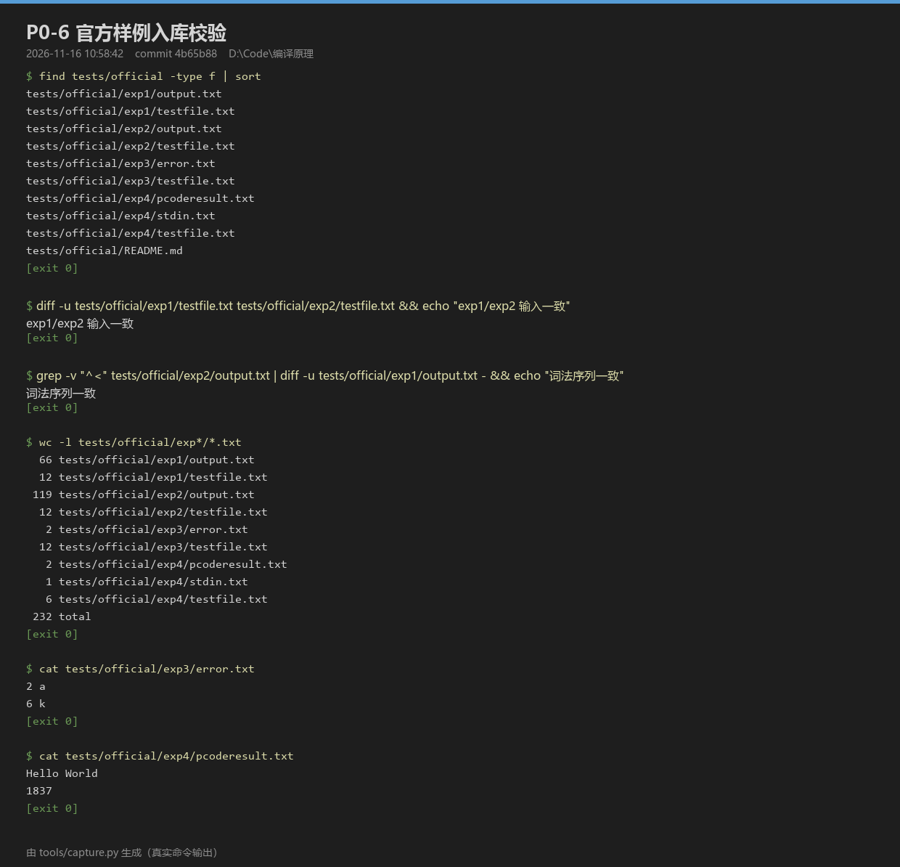

# P0-6 官方样例

## 1. 目的

把指导书四个实验的官方样例（输入与期望输出）录入仓库，作为各阶段验收的最终标准。对应 AGENTS.md §6 与 TODO P0-6。

## 2. 环境

- 日期：2026-11-16
- 系统：Windows 11
- 工具链：Git Bash 2.53.0、Python 3.14、Pillow 12.2
- 代码版本：`4b65b88` 之后的工作区（本功能提交见 `git log --oneline --grep=P0-6`）

## 3. 前置条件

- 已进入仓库根目录；
- 已存在 `tests/official/`（本功能创建）；
- 指导书 PDF 可在仓库根目录查阅，用于核对来源页码。

## 4. 复现步骤

1. 查看样例文件清单：

```bash
find tests/official -type f | sort
```

2. 验证实验一与实验二使用同一份输入：

```bash
diff -u tests/official/exp1/testfile.txt tests/official/exp2/testfile.txt && echo "exp1/exp2 输入一致"
```

3. 验证实验二的词法序列与实验一一致（去掉 `<成分名>` 行后比对）：

```bash
grep -v "^<" tests/official/exp2/output.txt | diff -u tests/official/exp1/output.txt - && echo "词法序列一致"
```

4. 查看各文件行数：

```bash
wc -l tests/official/exp*/*.txt
```

5. 查看实验三、实验四的期望输出：

```bash
cat tests/official/exp3/error.txt
cat tests/official/exp4/pcoderesult.txt
```

## 5. 预期输出

```text
$ find tests/official -type f | sort
tests/official/exp1/output.txt
tests/official/exp1/testfile.txt
tests/official/exp2/output.txt
tests/official/exp2/testfile.txt
tests/official/exp3/error.txt
tests/official/exp3/testfile.txt
tests/official/exp4/pcoderesult.txt
tests/official/exp4/stdin.txt
tests/official/exp4/testfile.txt
tests/official/README.md
[exit 0]

$ diff -u tests/official/exp1/testfile.txt tests/official/exp2/testfile.txt && echo "exp1/exp2 输入一致"
exp1/exp2 输入一致
[exit 0]

$ grep -v "^<" tests/official/exp2/output.txt | diff -u tests/official/exp1/output.txt - && echo "词法序列一致"
词法序列一致
[exit 0]

$ wc -l tests/official/exp*/*.txt
  66 tests/official/exp1/output.txt
  12 tests/official/exp1/testfile.txt
 119 tests/official/exp2/output.txt
  12 tests/official/exp2/testfile.txt
   2 tests/official/exp3/error.txt
  12 tests/official/exp3/testfile.txt
   2 tests/official/exp4/pcoderesult.txt
   1 tests/official/exp4/stdin.txt
   6 tests/official/exp4/testfile.txt
 232 total
[exit 0]

$ cat tests/official/exp3/error.txt
2 a
6 k
[exit 0]

$ cat tests/official/exp4/pcoderesult.txt
Hello World
1837
[exit 0]
```

## 6. 截图



## 7. 备注

- 样例来源页码：exp1 第 2–4 页、exp2 第 5–9 页、exp3 第 12 页、exp4 第 13 页；详见 [tests/official/README.md](../../../tests/official/README.md)。
- PDF 文字层有字体映射错误，样例内容已按页面渲染逐页核对后录入。
- 样例缩进统一为 4 个空格；缩进不属于单词，不影响期望输出，但实验三依赖行号，行号保持与指导书一致。
- 实验二输出行数（119）= 实验一词法行数（66）+ 53 个 `<成分名>` 行，一致性已由第 3 步校验。
- 当前样例尚未接入 `scripts/verify.sh`；P1-10 起会建立 `tests/cases/` 用例并纳入回归。
- **禁止修改期望输出来让测试通过**；如指导书版本变化，需单独提交并注明页码。
