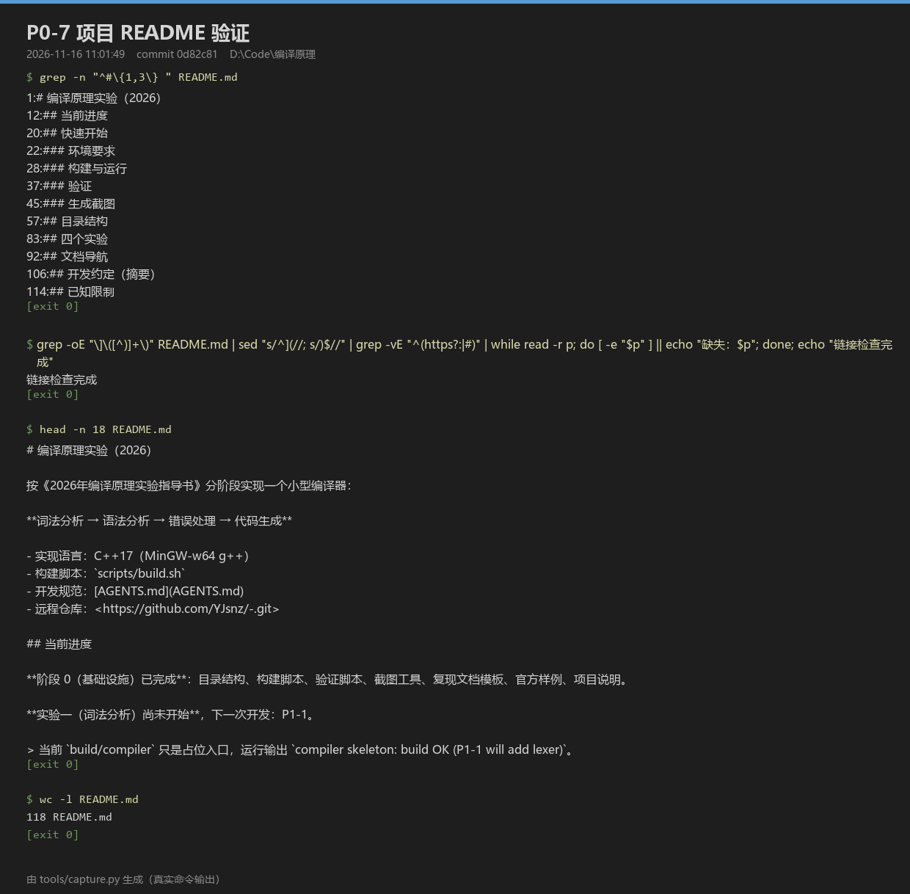

# P0-7 项目说明

## 1. 目的

编写仓库根目录的 `README.md`，说明项目目标、构建与运行方式、目录结构、四个实验、文档导航与当前进度。对应 TODO P0-7，是阶段 0 的最后一项。

## 2. 环境

- 日期：2026-11-16
- 系统：Windows 11
- 工具链：Git Bash 2.53.0、g++ 8.1.0、Python 3.14、Pillow 12.2
- 代码版本：`0d82c81` 之后的工作区（本功能提交见 `git log --oneline --grep=P0-7`）

## 3. 前置条件

- 已进入仓库根目录；
- 阶段 0 的其余功能（P0-1～P0-6）已完成；
- `docs/repro/P0-7_项目说明/` 目录已存在（根 README 的文档导航需要链接到本文件）。

## 4. 复现步骤

1. 查看 README 的章节结构：

```bash
grep -n "^#\{1,3\} " README.md
```

2. 检查所有相对链接是否存在（跳过 `http(s)` 与 `#` 锚点）：

```bash
grep -oE "\]\([^)]+\)" README.md | sed "s/^](//; s/)$//" | grep -vE "^(https?:|#)" | while read -r p; do [ -e "$p" ] || echo "缺失：$p"; done; echo "链接检查完成"
```

3. 查看开头内容与总行数：

```bash
head -n 18 README.md
wc -l README.md
```

## 5. 预期输出

```text
$ grep -n "^#\{1,3\} " README.md
1:# 编译原理实验（2026）
12:## 当前进度
20:## 快速开始
22:### 环境要求
28:### 构建与运行
37:### 验证
45:### 生成截图
57:## 目录结构
83:## 四个实验
92:## 文档导航
106:## 开发约定（摘要）
114:## 已知限制
[exit 0]

$ grep -oE "\]\([^)]+\)" README.md | sed "s/^](//; s/)$//" | grep -vE "^(https?:|#)" | while read -r p; do [ -e "$p" ] || echo "缺失：$p"; done; echo "链接检查完成"
链接检查完成
[exit 0]

$ head -n 18 README.md
# 编译原理实验（2026）

按《2026年编译原理实验指导书》分阶段实现一个小型编译器：

**词法分析 → 语法分析 → 错误处理 → 代码生成**

- 实现语言：C++17（MinGW-w64 g++）
- 构建脚本：`scripts/build.sh`
- 开发规范：[AGENTS.md](AGENTS.md)
- 远程仓库：<https://github.com/YJsnz/-.git>

## 当前进度

**阶段 0（基础设施）已完成**：目录结构、构建脚本、验证脚本、截图工具、复现文档模板、官方样例、项目说明。

**实验一（词法分析）尚未开始**，下一次开发：P1-1。

> 当前 `build/compiler` 只是占位入口，运行输出 `compiler skeleton: build OK (P1-1 will add lexer)`。
[exit 0]

$ wc -l README.md
118 README.md
[exit 0]
```

## 6. 截图



## 7. 备注

- 代码块围栏额外检查为 8 个（偶数，成对），未在截图中展示。
- 相对链接检查覆盖 `AGENTS.md`、`tests/official/README.md`、`docs/repro/_TEMPLATE/README.md` 及 P0-1～P0-7 的复现文档；当前全部有效。
- README 的“当前进度”需在每次完成 TODO 时同步更新，与 `AGENTS.md` 顶部保持一致。
- 本功能顺带修复了 `tools/capture.py` 的一个显示问题：命令换行续行会重复绘制 `$` 提示符。该修复单独提交，不改变截图内容与日志。
- 阶段 0 至此全部完成，下一次开发进入实验一（P1-1 主程序骨架）。
