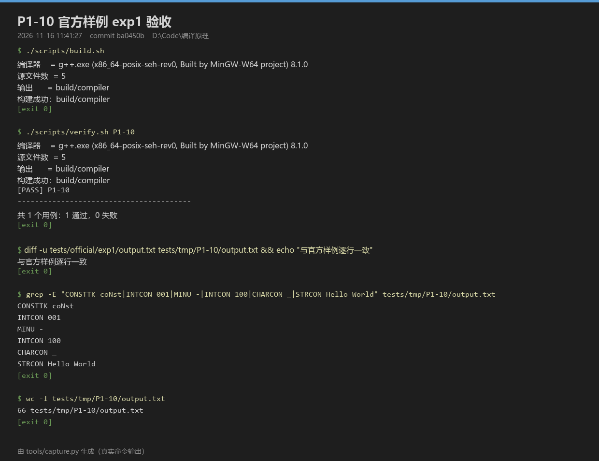

# P1-10 官方样例 exp1 验收

## 1. 目的

把指导书实验一的官方样例接入端到端用例，验证词法分析输出与 `tests/official/exp1/output.txt` **逐行一致**（66 行）。对应 TODO P1-10。

## 2. 环境

- 日期：2026-11-16
- 系统：Windows 11
- 工具链：g++ 8.1.0（MinGW-w64）、Git Bash 2.53.0、Python 3.14
- 代码版本：`ba0450b` 之后的工作区（本功能提交见 `git log --oneline --grep=P1-10`）

## 3. 前置条件

- P1-7 已完成全部 39 个类别码；
- 新增 `tests/cases/P1-10/`：`testfile.txt` 与 `expect.txt` 分别复制自官方 exp1 的输入与输出。

## 4. 复现步骤

1. 构建：

```bash
./scripts/build.sh
```

2. 运行 P1-10 用例：

```bash
./scripts/verify.sh P1-10
```

3. 与官方输出逐行比对：

```bash
diff -u tests/official/exp1/output.txt tests/tmp/P1-10/output.txt && echo "与官方样例逐行一致"
```

4. 抽查关键覆盖点：

```bash
grep -E "CONSTTK coNst|INTCON 001|MINU -|INTCON 100|CHARCON _|STRCON Hello World" tests/tmp/P1-10/output.txt
```

5. 确认行数：

```bash
wc -l tests/tmp/P1-10/output.txt
```

## 5. 预期输出

```text
$ ./scripts/build.sh
编译器    = g++.exe (x86_64-posix-seh-rev0, Built by MinGW-W64 project) 8.1.0
源文件数  = 5
输出      = build/compiler
构建成功：build/compiler
[exit 0]

$ ./scripts/verify.sh P1-10
编译器    = g++.exe (x86_64-posix-seh-rev0, Built by MinGW-W64 project) 8.1.0
源文件数  = 5
输出      = build/compiler
构建成功：build/compiler
[PASS] P1-10
----------------------------------------
共 1 个用例：1 通过，0 失败
[exit 0]

$ diff -u tests/official/exp1/output.txt tests/tmp/P1-10/output.txt && echo "与官方样例逐行一致"
与官方样例逐行一致
[exit 0]

$ grep -E "CONSTTK coNst|INTCON 001|MINU -|INTCON 100|CHARCON _|STRCON Hello World" tests/tmp/P1-10/output.txt
CONSTTK coNst
INTCON 001
MINU -
INTCON 100
CHARCON _
STRCON Hello World
[exit 0]

$ wc -l tests/tmp/P1-10/output.txt
66 tests/tmp/P1-10/output.txt
[exit 0]
```

## 6. 截图



## 7. 备注

### 覆盖点对照（TODO P1-10）

| 要求 | 证据 |
|---|---|
| 官方样例逐行一致 | `diff` 无差异，66 行 |
| 保留字大小写混写 | `CONSTTK coNst` |
| 前导 0 | `INTCON 001` |
| 负数拆分 | `MINU -` + `INTCON 100` |
| 字符常量 | `CHARCON _` |
| 字符串常量 | `STRCON Hello World` |
| 双字符运算符 | 官方样例未包含，由 P1-7 用例与单元测试覆盖（`LEQ/GEQ/EQL/NEQ`） |

### 备注

- `tests/cases/P1-10/` 的 `testfile.txt`、`expect.txt` 复制自官方样例，未修改原文件。
- 官方样例首次运行即通过，未调整任何期望输出。
