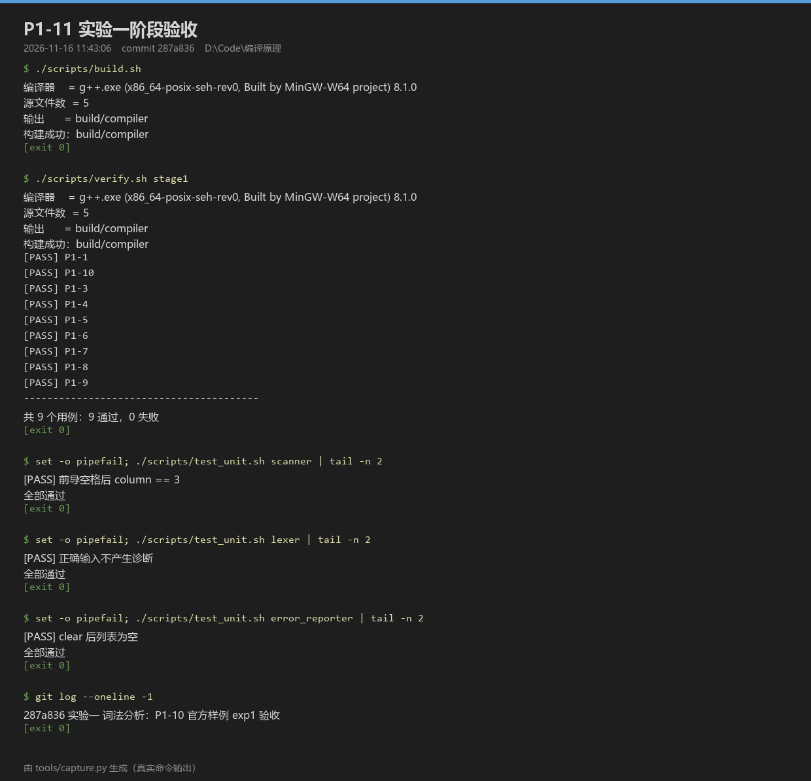

# P1-11 实验一阶段验收

## 1. 目的

按 AGENTS.md §6.2 完成实验一（词法分析）阶段验收：全部 P1 用例与单元测试通过，官方 exp1 逐行一致，并打标签 `stage1`。对应 TODO P1-11。

## 2. 环境

- 日期：2026-11-16
- 系统：Windows 11
- 工具链：g++ 8.1.0（MinGW-w64）、Git Bash 2.53.0、Python 3.14
- 代码版本：`287a836` 之后的工作区（本功能提交见 `git log --oneline --grep=P1-11`）

## 3. 前置条件

- P1-1～P1-10 全部完成；
- 官方样例 `tests/official/exp1/` 已入库。

## 4. 复现步骤

1. 构建：

```bash
./scripts/build.sh
```

2. 运行实验一全部用例：

```bash
./scripts/verify.sh stage1
```

3. 运行三个单元测试套件（截图只展示末尾两行）：

```bash
set -o pipefail; ./scripts/test_unit.sh scanner | tail -n 2
set -o pipefail; ./scripts/test_unit.sh lexer | tail -n 2
set -o pipefail; ./scripts/test_unit.sh error_reporter | tail -n 2
```

4. 查看阶段标签：

```bash
git tag -l 'stage*'
```

## 5. 预期输出

```text
$ ./scripts/build.sh
编译器    = g++.exe (x86_64-posix-seh-rev0, Built by MinGW-W64 project) 8.1.0
源文件数  = 5
输出      = build/compiler
构建成功：build/compiler
[exit 0]

$ ./scripts/verify.sh stage1
编译器    = g++.exe (x86_64-posix-seh-rev0, Built by MinGW-W64 project) 8.1.0
源文件数  = 5
输出      = build/compiler
构建成功：build/compiler
[PASS] P1-1
[PASS] P1-10
[PASS] P1-3
[PASS] P1-4
[PASS] P1-5
[PASS] P1-6
[PASS] P1-7
[PASS] P1-8
[PASS] P1-9
----------------------------------------
共 9 个用例：9 通过，0 失败
[exit 0]

$ set -o pipefail; ./scripts/test_unit.sh scanner | tail -n 2
[PASS] 前导空格后 column == 3
全部通过
[exit 0]

$ set -o pipefail; ./scripts/test_unit.sh lexer | tail -n 2
[PASS] 正确输入不产生诊断
全部通过
[exit 0]

$ set -o pipefail; ./scripts/test_unit.sh error_reporter | tail -n 2
[PASS] clear 后列表为空
全部通过
[exit 0]

$ git log --oneline -1
287a836 实验一 词法分析：P1-10 官方样例 exp1 验收
[exit 0]
```

## 6. 截图




## 7. 备注

### §6.2 阶段验收 checklist

| 条目 | 结果 | 证据 |
|---|---|---|
| 官方 exp1 与样例逐行一致 | ✅ | P1-10，66 行 diff 无差异 |
| 保留字大小写混写 | ✅ | 单元测试 `coNst`→`CONSTTK`、`IF`→`IFTK` |
| 15 个保留字、`coNst1` 为标识符 | ✅ | P1-3 单元测试 |
| `001` 原样、`-100` 拆分 | ✅ | P1-10 输出 `INTCON 001`、`MINU -`、`INTCON 100` |
| 字符常量覆盖 `+ - * / 字母 数字` | ✅ | P1-5 单元测试（含 `_`） |
| 字符串含空格/数字/标点、无引号输出 | ✅ | P1-6 单元测试与用例 |
| 6 种关系运算符、双字符不拆分 | ✅ | P1-7 单元测试与用例 |
| 每行严格 `类别码 原文` | ✅ | 全部用例逐字节比对 |

### 测试规模

- `scanner`：18 项
- `lexer`：91 项（含错误回调）
- `error_reporter`：11 项
- 端到端用例：9 个（P1-1、P1-3～P1-10）

## 8. 结果展示样例运行

- 样例来源：`tests/sample/实验一结果展示样例.txt`
- 可复现用例：`tests/cases/P1-12/`（输入、`--dump-lexer` 配置和完整期望输出）
- 命令：`COMPILER="build/compiler.exe" ./scripts/verify.sh P1-12`
- 结果：通过，生成 467 行 `output.txt`。
- 原始日志：[`sample-run.log`](sample-run.log)
- 截图：

### 阶段标签

验收通过后执行：

```bash
git tag -a stage1 -m "实验一 词法分析 阶段验收通过（P1-1～P1-11）"
git push origin stage1
```

标签指向本功能提交；后续实验二在 `main` 上增量开发。
