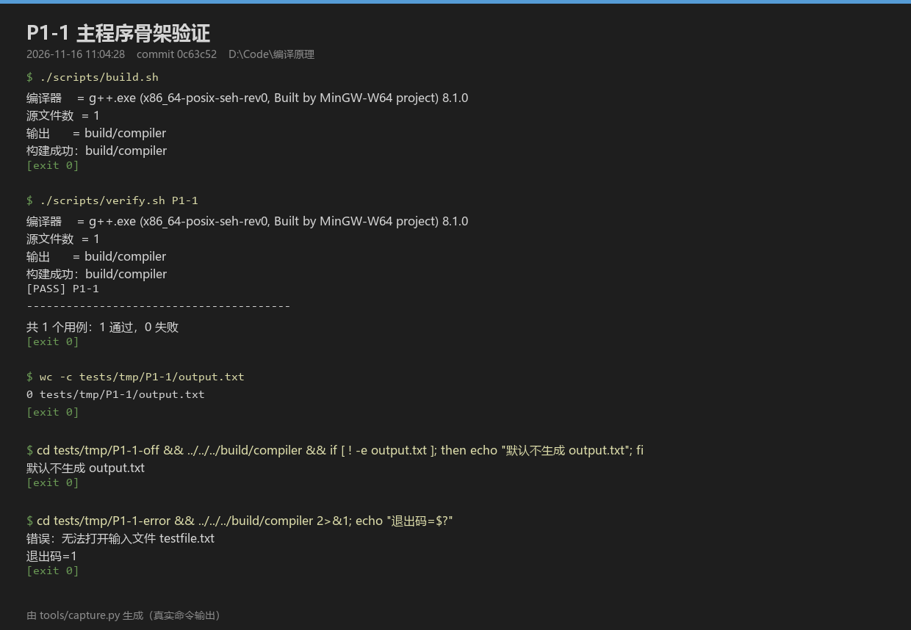

# P1-1 主程序骨架

## 1. 目的

建立编译器主程序骨架：读取当前目录的 `testfile.txt`，在 `--dump-lexer` 打开时创建 `output.txt`，并预留词法分析接入点。对应实验一的前置基础设施与 TODO P1-1。

## 2. 环境

- 日期：2026-11-16
- 系统：Windows 11
- 工具链：g++ 8.1.0（MinGW-w64）、Git Bash 2.53.0、Python 3.14
- 代码版本：`0c63c52` 之后的工作区（本功能提交见 `git log --oneline --grep=P1-1`）

## 3. 前置条件

- 阶段 0 已完成，`scripts/build.sh` 与 `scripts/verify.sh` 可用；
- 用例目录 `tests/cases/P1-1/` 已包含 `testfile.txt`、`expect.txt`、`meta.conf`。

## 4. 复现步骤

1. 构建：

```bash
./scripts/build.sh
```

2. 运行 P1-1 用例（`meta.conf` 指定 `ARGS=--dump-lexer`）：

```bash
./scripts/verify.sh P1-1
```

3. 确认结果文件已创建且为空（词法分析尚未接入）：

```bash
wc -c tests/tmp/P1-1/output.txt
```

4. 验证默认关闭：不带 `--dump-lexer` 时不生成 `output.txt`：

```bash
cd tests/tmp/P1-1-off && ../../../build/compiler && if [ ! -e output.txt ]; then echo "默认不生成 output.txt"; fi
```

5. 验证缺失输入时的错误处理：

```bash
cd tests/tmp/P1-1-error && ../../../build/compiler 2>&1; echo "退出码=$?"
```

## 5. 预期输出

```text
$ ./scripts/build.sh
编译器    = g++.exe (x86_64-posix-seh-rev0, Built by MinGW-W64 project) 8.1.0
源文件数  = 1
输出      = build/compiler
构建成功：build/compiler
[exit 0]

$ ./scripts/verify.sh P1-1
编译器    = g++.exe (x86_64-posix-seh-rev0, Built by MinGW-W64 project) 8.1.0
源文件数  = 1
输出      = build/compiler
构建成功：build/compiler
[PASS] P1-1
----------------------------------------
共 1 个用例：1 通过，0 失败
[exit 0]

$ wc -c tests/tmp/P1-1/output.txt
0 tests/tmp/P1-1/output.txt
[exit 0]

$ cd tests/tmp/P1-1-off && ../../../build/compiler && if [ ! -e output.txt ]; then echo "默认不生成 output.txt"; fi
默认不生成 output.txt
[exit 0]

$ cd tests/tmp/P1-1-error && ../../../build/compiler 2>&1; echo "退出码=$?"
错误：无法打开输入文件 testfile.txt
退出码=1
[exit 0]
```

## 6. 截图



## 7. 备注

- `src/main.cpp` 当前结构：参数解析 → 读取 `testfile.txt`（二进制方式，保留 CRLF）→ 按开关创建 `output.txt` → 词法接入点。
- 命令行选项：`--dump-lexer`（默认关闭）、`-h/--help`；未知参数报错并返回退出码 2。
- 退出码约定：0 成功、1 输入/输出文件错误、2 参数错误。
- `tests/cases/P1-1/` 的 `expect.txt` 为空是预期行为：P1-1 只验证 IO 链路，词法内容由 P1-2/P1-3 填充。
- 截图最后一条命令使用 `2>&1` 合并 stderr，保证错误信息与退出码的先后顺序真实；`tools/capture.py` 默认分别捕获 stdout/stderr，颜色不同但顺序可能与终端不一致。
