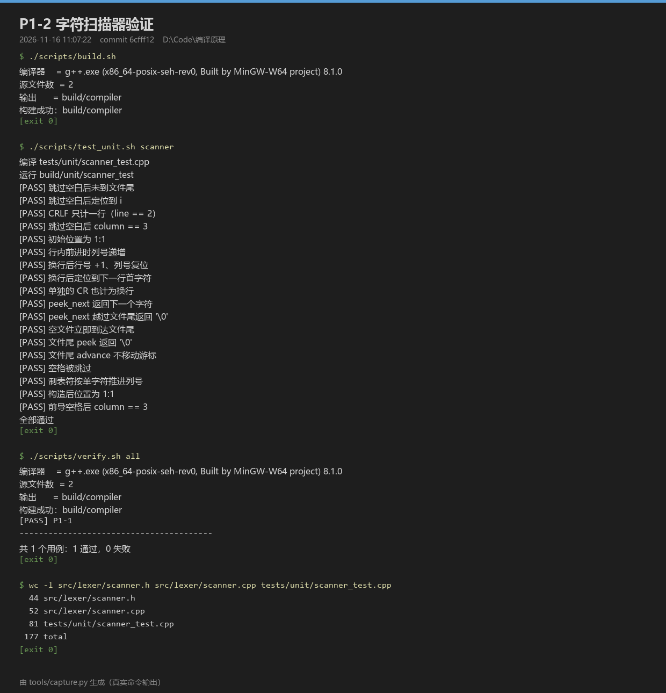

# P1-2 字符扫描器

## 1. 目的

实现字符级扫描器 `lexer::Scanner`：维护游标、行号与列号，跳过空白，判断文件尾，并统一处理 CRLF / CR 换行。对应 TODO P1-2，是词法分析（P1-3）的基础。

## 2. 环境

- 日期：2026-11-16
- 系统：Windows 11
- 工具链：g++ 8.1.0（MinGW-w64）、Git Bash 2.53.0、Python 3.14
- 代码版本：`6cfff12` 之后的工作区（本功能提交见 `git log --oneline --grep=P1-2`）

## 3. 前置条件

- P1-1 已完成，`scripts/build.sh`、`scripts/verify.sh` 可用；
- 新增 `scripts/test_unit.sh` 与 `tests/unit/scanner_test.cpp`（本功能创建）。

## 4. 复现步骤

1. 构建（`src/` 下 2 个 `.cpp`）：

```bash
./scripts/build.sh
```

2. 运行扫描器单元测试：

```bash
./scripts/test_unit.sh scanner
```

3. 运行回归，确认 P1-1 未退化：

```bash
./scripts/verify.sh all
```

4. 查看源码规模（可选）：

```bash
wc -l src/lexer/scanner.h src/lexer/scanner.cpp tests/unit/scanner_test.cpp
```

## 5. 预期输出

```text
$ ./scripts/build.sh
编译器    = g++.exe (x86_64-posix-seh-rev0, Built by MinGW-W64 project) 8.1.0
源文件数  = 2
输出      = build/compiler
构建成功：build/compiler
[exit 0]

$ ./scripts/test_unit.sh scanner
编译 tests/unit/scanner_test.cpp
运行 build/unit/scanner_test
[PASS] 跳过空白后未到文件尾
[PASS] 跳过空白后定位到 i
[PASS] CRLF 只计一行（line == 2）
[PASS] 跳过空白后 column == 3
[PASS] 初始位置为 1:1
[PASS] 行内前进时列号递增
[PASS] 换行后行号 +1、列号复位
[PASS] 换行后定位到下一行首字符
[PASS] 单独的 CR 也计为换行
[PASS] peek_next 返回下一个字符
[PASS] peek_next 越过文件尾返回 '\0'
[PASS] 空文件立即到达文件尾
[PASS] 文件尾 peek 返回 '\0'
[PASS] 文件尾 advance 不移动游标
[PASS] 空格被跳过
[PASS] 制表符按单字符推进列号
[PASS] 构造后位置为 1:1
[PASS] 前导空格后 column == 3
全部通过
[exit 0]

$ ./scripts/verify.sh all
编译器    = g++.exe (x86_64-posix-seh-rev0, Built by MinGW-W64 project) 8.1.0
源文件数  = 2
输出      = build/compiler
构建成功：build/compiler
[PASS] P1-1
----------------------------------------
共 1 个用例：1 通过，0 失败
[exit 0]

$ wc -l src/lexer/scanner.h src/lexer/scanner.cpp tests/unit/scanner_test.cpp
  44 src/lexer/scanner.h
  52 src/lexer/scanner.cpp
  81 tests/unit/scanner_test.cpp
 177 total
[exit 0]
```

## 6. 截图



## 7. 备注

### 接口

| 方法 | 说明 |
|---|---|
| `peek()` | 当前字符，文件尾返回 `'\0'`，不移动游标 |
| `peek_next()` | 下一个字符，越界返回 `'\0'` |
| `advance()` | 返回当前字符并前进；文件尾返回 `'\0'` 且不移动 |
| `skip_whitespace()` | 跳过空格、`\t`、`\n`、`\r`、`\v`、`\f` |
| `line()` / `column()` | 当前位置，均从 1 开始 |
| `offset()` | 基于归一化后源码的字节偏移 |

### 换行与列号

- 构造时把 `\r\n` 和单独的 `\r` 统一成 `\n`，因此 CRLF 只让行号加一次。
- 列号按字节推进：制表符算 1 列，不按制表位展开。源语言限定为 ASCII，暂不需要 UTF-8 列宽处理。
- 位置语义为“**下一个待读字符**所在的行列”；`advance()` 后列号或行号更新到下一个字符。

### 验证方式

- 新增 `scripts/test_unit.sh`：编译 `tests/unit/<名称>_test.cpp` 并链接 `src/` 下除 `main.cpp` 外的全部源文件，然后运行；后续模块（Token、符号表等）可复用。
- 首次运行有 3 项失败，定位为测试期望值差一（换行符本身也需要 `advance()` 一次），扫描器逻辑无误；测试已修正。
- P1-1 回归通过，构建产物仍为 `build/compiler`。
