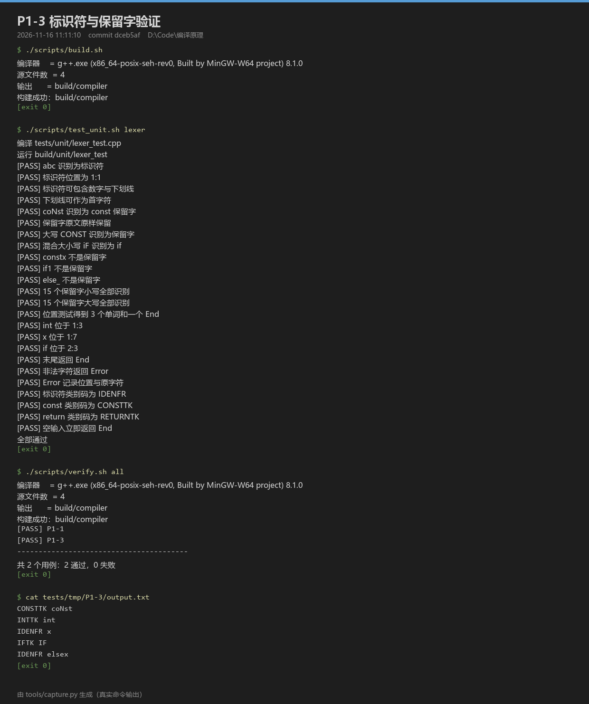

# P1-3 标识符与保留字

## 1. 目的

在字符扫描器之上实现标识符与保留字识别：按 `<字母>{<字母>|<数字>}` 读取标识符，15 个保留字按**不区分大小写**匹配，并保留原文用于输出。对应 TODO P1-3。

## 2. 环境

- 日期：2026-11-16
- 系统：Windows 11
- 工具链：g++ 8.1.0（MinGW-w64）、Git Bash 2.53.0、Python 3.14
- 代码版本：`dceb5af` 之后的工作区（本功能提交见 `git log --oneline --grep=P1-3`）

## 3. 前置条件

- P1-2 扫描器与 `scripts/test_unit.sh` 已完成；
- 新增 `tests/cases/P1-3/`（本功能创建）；
- `tests/cases/P1-1/testfile.txt` 已调整为纯空白行（见备注）。

## 4. 复现步骤

1. 构建（`src/` 下 4 个 `.cpp`）：

```bash
./scripts/build.sh
```

2. 运行词法分析器单元测试：

```bash
./scripts/test_unit.sh lexer
```

3. 运行全部用例（P1-1 与 P1-3）：

```bash
./scripts/verify.sh all
```

4. 查看 P1-3 的实际输出：

```bash
cat tests/tmp/P1-3/output.txt
```

## 5. 预期输出

```text
$ ./scripts/build.sh
编译器    = g++.exe (x86_64-posix-seh-rev0, Built by MinGW-W64 project) 8.1.0
源文件数  = 4
输出      = build/compiler
构建成功：build/compiler
[exit 0]

$ ./scripts/test_unit.sh lexer
编译 tests/unit/lexer_test.cpp
运行 build/unit/lexer_test
[PASS] abc 识别为标识符
[PASS] 标识符位置为 1:1
[PASS] 标识符可包含数字与下划线
[PASS] 下划线可作为首字符
[PASS] coNst 识别为 const 保留字
[PASS] 保留字原文原样保留
[PASS] 大写 CONST 识别为保留字
[PASS] 混合大小写 iF 识别为 if
[PASS] constx 不是保留字
[PASS] if1 不是保留字
[PASS] else_ 不是保留字
[PASS] 15 个保留字小写全部识别
[PASS] 15 个保留字大写全部识别
[PASS] 位置测试得到 3 个单词和一个 End
[PASS] int 位于 1:3
[PASS] x 位于 1:7
[PASS] if 位于 2:3
[PASS] 末尾返回 End
[PASS] 非法字符返回 Error
[PASS] Error 记录位置与原字符
[PASS] 标识符类别码为 IDENFR
[PASS] const 类别码为 CONSTTK
[PASS] return 类别码为 RETURNTK
[PASS] 空输入立即返回 End
全部通过
[exit 0]

$ ./scripts/verify.sh all
编译器    = g++.exe (x86_64-posix-seh-rev0, Built by MinGW-W64 project) 8.1.0
源文件数  = 4
输出      = build/compiler
构建成功：build/compiler
[PASS] P1-1
[PASS] P1-3
----------------------------------------
共 2 个用例：2 通过，0 失败
[exit 0]

$ cat tests/tmp/P1-3/output.txt
CONSTTK coNst
INTTK int
IDENFR x
IFTK IF
IDENFR elsex
[exit 0]
```

## 6. 截图



## 7. 备注

### 实现要点

- 新增 `Token` / `TokenKind` / `token_code()`（`src/lexer/token.h`、`token.cpp`），当前覆盖标识符与 15 个保留字。
- 新增 `Lexer::next_token()`（`src/lexer/lexer.h`、`lexer.cpp`），返回 `End` 表示文件尾，`Error` 表示暂不支持的字符。
- 保留字匹配：先把词素按 ASCII 转为小写再查表；**输出仍用原文**（`coNst` → `CONSTTK coNst`）。
- 标识符规则：首字符为字母或 `_`，后续可接字母、数字、`_`；`constx`、`if1`、`else_` 均为标识符。
- `main.cpp` 在 `--dump-lexer` 下逐行写出 `类别码 原文`；遇到 `Error` 打印行列号并返回 1。

### 关于 P1-1 用例

P1-1 的输入原本是 `void main(){}`，其中括号在 P1-3 阶段尚未支持，会导致回归失败。P1-1 只验证文件 IO，因此把输入改为**纯空白行**，输出仍为空，回归保持全绿。

### 尚未支持

数字、字符常量、字符串常量、运算符与界符将在 P1-4～P1-7 实现；在此之前遇到这些字符会返回 `Error`，属于预期行为。
