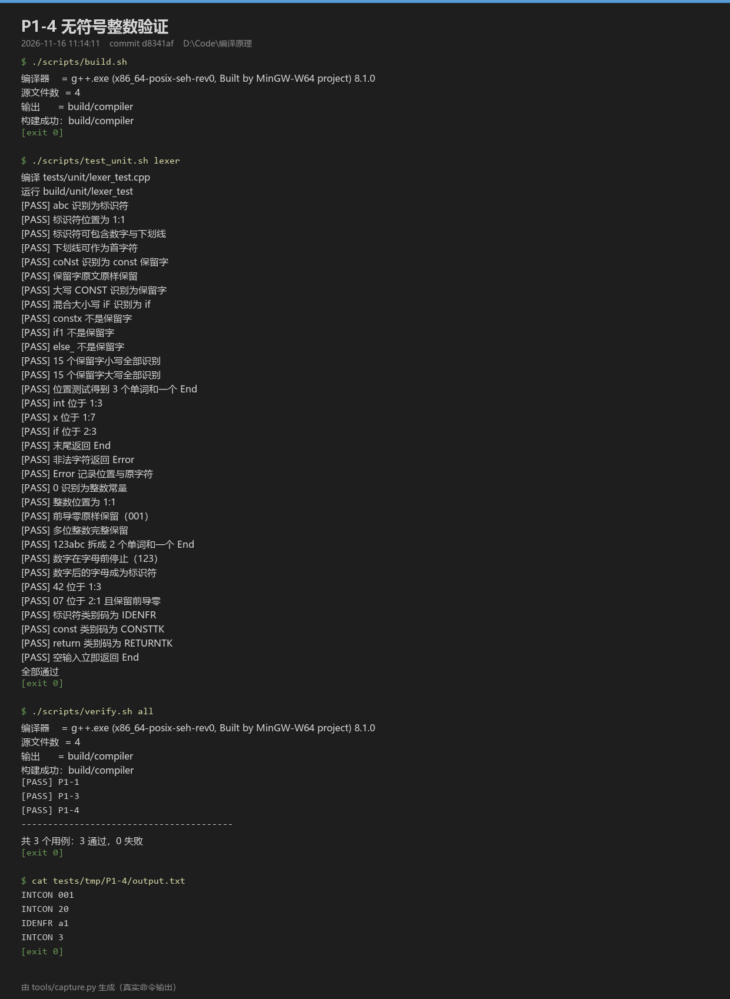

# P1-4 无符号整数

## 1. 目的

实现无符号整数 `INTCON` 的词法识别：连续数字作为一个整数常量，**前导零原样保留**（如 `001`）。对应 TODO P1-4。

## 2. 环境

- 日期：2026-11-16
- 系统：Windows 11
- 工具链：g++ 8.1.0（MinGW-w64）、Git Bash 2.53.0、Python 3.14
- 代码版本：`d8341af` 之后的工作区（本功能提交见 `git log --oneline --grep=P1-4`）

## 3. 前置条件

- P1-3 的 `Lexer` 与 `Token` 已完成；
- 新增 `tests/cases/P1-4/`（本功能创建）。

## 4. 复现步骤

1. 构建：

```bash
./scripts/build.sh
```

2. 运行词法分析器单元测试：

```bash
./scripts/test_unit.sh lexer
```

3. 运行全部用例（P1-1、P1-3、P1-4）：

```bash
./scripts/verify.sh all
```

4. 查看 P1-4 的实际输出：

```bash
cat tests/tmp/P1-4/output.txt
```

## 5. 预期输出

```text
$ ./scripts/build.sh
编译器    = g++.exe (x86_64-posix-seh-rev0, Built by MinGW-W64 project) 8.1.0
源文件数  = 4
输出      = build/compiler
构建成功：build/compiler
[exit 0]

$ ./scripts/test_unit.sh lexer
编译 tests/unit/lexer_test.cpp
运行 build/unit/lexer_test
[PASS] abc 识别为标识符
[PASS] 标识符位置为 1:1
[PASS] 标识符可包含数字与下划线
[PASS] 下划线可作为首字符
[PASS] coNst 识别为 const 保留字
[PASS] 保留字原文原样保留
[PASS] 大写 CONST 识别为保留字
[PASS] 混合大小写 iF 识别为 if
[PASS] constx 不是保留字
[PASS] if1 不是保留字
[PASS] else_ 不是保留字
[PASS] 15 个保留字小写全部识别
[PASS] 15 个保留字大写全部识别
[PASS] 位置测试得到 3 个单词和一个 End
[PASS] int 位于 1:3
[PASS] x 位于 1:7
[PASS] if 位于 2:3
[PASS] 末尾返回 End
[PASS] 非法字符返回 Error
[PASS] Error 记录位置与原字符
[PASS] 0 识别为整数常量
[PASS] 整数位置为 1:1
[PASS] 前导零原样保留（001）
[PASS] 多位整数完整保留
[PASS] 123abc 拆成 2 个单词和一个 End
[PASS] 数字在字母前停止（123）
[PASS] 数字后的字母成为标识符
[PASS] 42 位于 1:3
[PASS] 07 位于 2:1 且保留前导零
[PASS] 标识符类别码为 IDENFR
[PASS] const 类别码为 CONSTTK
[PASS] return 类别码为 RETURNTK
[PASS] 空输入立即返回 End
全部通过
[exit 0]

$ ./scripts/verify.sh all
编译器    = g++.exe (x86_64-posix-seh-rev0, Built by MinGW-W64 project) 8.1.0
源文件数  = 4
输出      = build/compiler
构建成功：build/compiler
[PASS] P1-1
[PASS] P1-3
[PASS] P1-4
----------------------------------------
共 3 个用例：3 通过，0 失败
[exit 0]

$ cat tests/tmp/P1-4/output.txt
INTCON 001
INTCON 20
IDENFR a1
INTCON 3
[exit 0]
```

## 6. 截图



## 7. 备注

### 实现要点

- `TokenKind` 新增 `IntConstant`，`token_code()` 映射为 `INTCON`。
- `Lexer::scan_number()` 连续读取数字，**不解析数值**，`lexeme` 原样保存，因此 `001`、`07` 的前导零不会丢失。
- 数字与标识符的分界：`123abc` 拆为 `INTCON 123` + `IDENFR abc`；`a1` 仍是一个标识符。
- 数字前的 `+`/`-` 不属于整数常量本身；P1-7 实现运算符后会拆成 `PLUS/MINU` + `INTCON`。
- 未做数值溢出检查；后续语义分析与代码生成阶段再处理数值范围。

### 尚未支持

字符常量、字符串常量、运算符与界符将在 P1-5～P1-7 实现；遇到这些字符仍返回 `Error`，属于预期行为。
