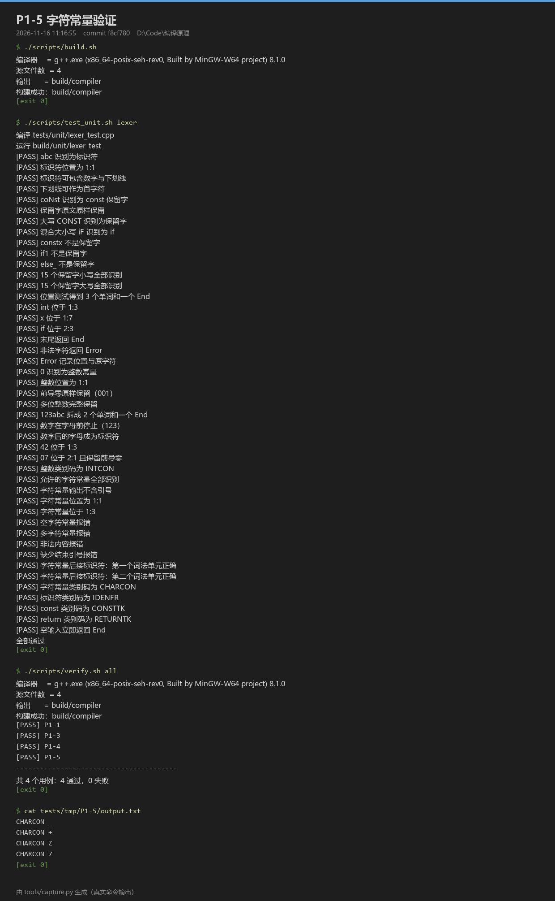

# P1-5 字符常量

## 1. 目的

实现字符常量 `CHARCON` 的词法识别：单引号内只允许一个字符，取值为 `+ - * /`、字母（含 `_`）、数字；输出不含引号。对应 TODO P1-5。

## 2. 环境

- 日期：2026-11-16
- 系统：Windows 11
- 工具链：g++ 8.1.0（MinGW-w64）、Git Bash 2.53.0、Python 3.14
- 代码版本：`f8cf780` 之后的工作区（本功能提交见 `git log --oneline --grep=P1-5`）

## 3. 前置条件

- P1-4 的整数识别已完成；
- 新增 `tests/cases/P1-5/`（本功能创建）。

## 4. 复现步骤

1. 构建：

```bash
./scripts/build.sh
```

2. 运行词法分析器单元测试：

```bash
./scripts/test_unit.sh lexer
```

3. 运行全部用例（P1-1、P1-3、P1-4、P1-5）：

```bash
./scripts/verify.sh all
```

4. 查看 P1-5 的实际输出：

```bash
cat tests/tmp/P1-5/output.txt
```

## 5. 预期输出

```text
$ ./scripts/build.sh
编译器    = g++.exe (x86_64-posix-seh-rev0, Built by MinGW-W64 project) 8.1.0
源文件数  = 4
输出      = build/compiler
构建成功：build/compiler
[exit 0]

$ ./scripts/test_unit.sh lexer
编译 tests/unit/lexer_test.cpp
运行 build/unit/lexer_test
[PASS] abc 识别为标识符
[PASS] 标识符位置为 1:1
[PASS] 标识符可包含数字与下划线
[PASS] 下划线可作为首字符
[PASS] coNst 识别为 const 保留字
[PASS] 保留字原文原样保留
[PASS] 大写 CONST 识别为保留字
[PASS] 混合大小写 iF 识别为 if
[PASS] constx 不是保留字
[PASS] if1 不是保留字
[PASS] else_ 不是保留字
[PASS] 15 个保留字小写全部识别
[PASS] 15 个保留字大写全部识别
[PASS] 位置测试得到 3 个单词和一个 End
[PASS] int 位于 1:3
[PASS] x 位于 1:7
[PASS] if 位于 2:3
[PASS] 末尾返回 End
[PASS] 非法字符返回 Error
[PASS] Error 记录位置与原字符
[PASS] 0 识别为整数常量
[PASS] 整数位置为 1:1
[PASS] 前导零原样保留（001）
[PASS] 多位整数完整保留
[PASS] 123abc 拆成 2 个单词和一个 End
[PASS] 数字在字母前停止（123）
[PASS] 数字后的字母成为标识符
[PASS] 42 位于 1:3
[PASS] 07 位于 2:1 且保留前导零
[PASS] 整数类别码为 INTCON
[PASS] 允许的字符常量全部识别
[PASS] 字符常量输出不含引号
[PASS] 字符常量位置为 1:1
[PASS] 字符常量位于 1:3
[PASS] 空字符常量报错
[PASS] 多字符常量报错
[PASS] 非法内容报错
[PASS] 缺少结束引号报错
[PASS] 字符常量后接标识符：第一个词法单元正确
[PASS] 字符常量后接标识符：第二个词法单元正确
[PASS] 字符常量类别码为 CHARCON
[PASS] 标识符类别码为 IDENFR
[PASS] const 类别码为 CONSTTK
[PASS] return 类别码为 RETURNTK
[PASS] 空输入立即返回 End
全部通过
[exit 0]

$ ./scripts/verify.sh all
编译器    = g++.exe (x86_64-posix-seh-rev0, Built by MinGW-W64 project) 8.1.0
源文件数  = 4
输出      = build/compiler
构建成功：build/compiler
[PASS] P1-1
[PASS] P1-3
[PASS] P1-4
[PASS] P1-5
----------------------------------------
共 4 个用例：4 通过，0 失败
[exit 0]

$ cat tests/tmp/P1-5/output.txt
CHARCON _
CHARCON +
CHARCON Z
CHARCON 7
[exit 0]
```

## 6. 截图



## 7. 备注

### 实现要点

- `TokenKind` 新增 `CharConstant`，类别码 `CHARCON`。
- 允许的单字符集合：`+`、`-`、`*`、`/`、字母（`a-z`/`A-Z`/`_`）、数字（`0-9`）。
- `lexeme` 只保存字符本身，**不包含单引号**；输出形如 `CHARCON _`，与指导书样例一致。
- 位置取开引号所在的行列号。

### 错误处理（本阶段的接口预留）

以下情况返回 `Error`，并在 message 中说明原因：

| 输入 | 原因 |
|---|---|
| `''` | 字符常量不能为空 |
| `'ab'` | 只能包含一个字符 |
| `'@'` | 非法内容字符 |
| `'a` | 缺少结束引号 |

完整的错误码（实验三的 a）将在 P3-3 接入 `error.txt`。

### 尚未支持

字符串常量与运算符/界符将在 P1-6、P1-7 实现；在此之前遇到这些字符仍返回 `Error`。
