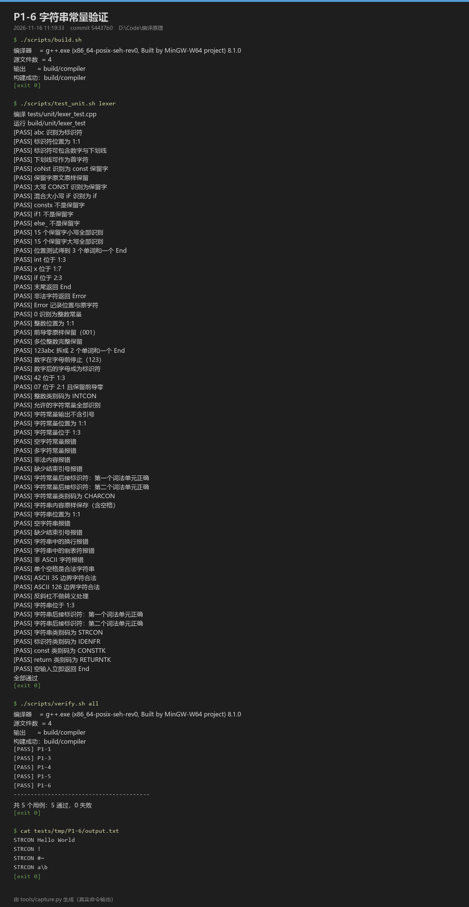

# P1-6 字符串常量

## 1. 目的

实现字符串常量 `STRCON` 的词法识别：双引号内至少一个字符，内容只能是 ASCII 32、33、35–126，**不存在转义**，原样保存且输出不含引号。对应 TODO P1-6。

## 2. 环境

- 日期：2026-11-16
- 系统：Windows 11
- 工具链：g++ 8.1.0（MinGW-w64）、Git Bash 2.53.0、Python 3.14
- 代码版本：`54437b0` 之后的工作区（本功能提交见 `git log --oneline --grep=P1-6`）

## 3. 前置条件

- P1-5 的字符常量已完成；
- 新增 `tests/cases/P1-6/`（本功能创建）。

## 4. 复现步骤

1. 构建：

```bash
./scripts/build.sh
```

2. 运行词法分析器单元测试：

```bash
./scripts/test_unit.sh lexer
```

3. 运行全部用例（P1-1、P1-3～P1-6）：

```bash
./scripts/verify.sh all
```

4. 查看 P1-6 的实际输出：

```bash
cat tests/tmp/P1-6/output.txt
```

## 5. 预期输出

```text
$ ./scripts/build.sh
编译器    = g++.exe (x86_64-posix-seh-rev0, Built by MinGW-W64 project) 8.1.0
源文件数  = 4
输出      = build/compiler
构建成功：build/compiler
[exit 0]

$ ./scripts/test_unit.sh lexer
编译 tests/unit/lexer_test.cpp
运行 build/unit/lexer_test
[PASS] abc 识别为标识符
[PASS] 标识符位置为 1:1
[PASS] 标识符可包含数字与下划线
[PASS] 下划线可作为首字符
[PASS] coNst 识别为 const 保留字
[PASS] 保留字原文原样保留
[PASS] 大写 CONST 识别为保留字
[PASS] 混合大小写 iF 识别为 if
[PASS] constx 不是保留字
[PASS] if1 不是保留字
[PASS] else_ 不是保留字
[PASS] 15 个保留字小写全部识别
[PASS] 15 个保留字大写全部识别
[PASS] 位置测试得到 3 个单词和一个 End
[PASS] int 位于 1:3
[PASS] x 位于 1:7
[PASS] if 位于 2:3
[PASS] 末尾返回 End
[PASS] 非法字符返回 Error
[PASS] Error 记录位置与原字符
[PASS] 0 识别为整数常量
[PASS] 整数位置为 1:1
[PASS] 前导零原样保留（001）
[PASS] 多位整数完整保留
[PASS] 123abc 拆成 2 个单词和一个 End
[PASS] 数字在字母前停止（123）
[PASS] 数字后的字母成为标识符
[PASS] 42 位于 1:3
[PASS] 07 位于 2:1 且保留前导零
[PASS] 整数类别码为 INTCON
[PASS] 允许的字符常量全部识别
[PASS] 字符常量输出不含引号
[PASS] 字符常量位置为 1:1
[PASS] 字符常量位于 1:3
[PASS] 空字符常量报错
[PASS] 多字符常量报错
[PASS] 非法内容报错
[PASS] 缺少结束引号报错
[PASS] 字符常量后接标识符：第一个词法单元正确
[PASS] 字符常量后接标识符：第二个词法单元正确
[PASS] 字符常量类别码为 CHARCON
[PASS] 字符串内容原样保存（含空格）
[PASS] 字符串位置为 1:1
[PASS] 空字符串报错
[PASS] 缺少结束引号报错
[PASS] 字符串中的换行报错
[PASS] 字符串中的制表符报错
[PASS] 非 ASCII 字符报错
[PASS] 单个空格是合法字符串
[PASS] ASCII 35 边界字符合法
[PASS] ASCII 126 边界字符合法
[PASS] 反斜杠不做转义处理
[PASS] 字符串位于 1:3
[PASS] 字符串后接标识符：第一个词法单元正确
[PASS] 字符串后接标识符：第二个词法单元正确
[PASS] 字符串类别码为 STRCON
[PASS] 标识符类别码为 IDENFR
[PASS] const 类别码为 CONSTTK
[PASS] return 类别码为 RETURNTK
[PASS] 空输入立即返回 End
全部通过
[exit 0]

$ ./scripts/verify.sh all
编译器    = g++.exe (x86_64-posix-seh-rev0, Built by MinGW-W64 project) 8.1.0
源文件数  = 4
输出      = build/compiler
构建成功：build/compiler
[PASS] P1-1
[PASS] P1-3
[PASS] P1-4
[PASS] P1-5
[PASS] P1-6
----------------------------------------
共 5 个用例：5 通过，0 失败
[exit 0]

$ cat tests/tmp/P1-6/output.txt
STRCON Hello World
STRCON !
STRCON #~
STRCON a\b
[exit 0]
```

## 6. 截图



## 7. 备注

### 实现要点

- `TokenKind` 新增 `StringConstant`，类别码 `STRCON`。
- 允许的字符：ASCII **32（空格）、33（!）、35–126**；34（双引号）作为结束符，不能出现在内容中。
- 至少一个字符：`""` 报错。
- **不存在转义**：反斜杠按普通字符处理。输入 `"a\"b"` 会被词法分析为 `STRCON a\` + `IDENFR b` + 未结束的字符串，这是按文法直译的结果。
- 输出 `lexeme` 不含双引号，原样保留内容（空格、标点、反斜杠均保留）。
- 字符串不能跨行：换行（ASCII 10）、制表符（ASCII 9）、非 ASCII 字节都会触发 `Error`。

### 错误处理（本阶段接口预留）

| 输入 | 原因 |
|---|---|
| `""` | 字符串不能为空 |
| `"abc` | 缺少结束引号 |
| 内容含换行 / 制表符 / 其他控制字符 | 非法字符 |
| 内容含非 ASCII 字节 | 非法字符 |

完整错误码（实验三的 a）将在 P3-3 接入 `error.txt`。

### 尚未支持

运算符与界符将在 P1-7 实现；在此之前遇到这些字符仍返回 `Error`。
