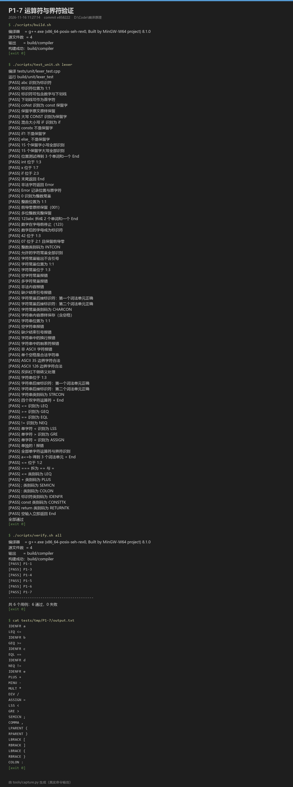

# P1-7 运算符与界符

## 1. 目的

实现全部运算符与界符的词法识别，重点是 `<= >= == !=` 的双字符优先匹配；完成后词法分析覆盖指导书单词表的全部 39 个类别码。对应 TODO P1-7。

## 2. 环境

- 日期：2026-11-16
- 系统：Windows 11
- 工具链：g++ 8.1.0（MinGW-w64）、Git Bash 2.53.0、Python 3.14
- 代码版本：`e858222` 之后的工作区（本功能提交见 `git log --oneline --grep=P1-7`）

## 3. 前置条件

- P1-6 的字符串常量已完成；
- 新增 `tests/cases/P1-7/`（本功能创建）。

## 4. 复现步骤

1. 构建：

```bash
./scripts/build.sh
```

2. 运行词法分析器单元测试：

```bash
./scripts/test_unit.sh lexer
```

3. 运行全部用例（P1-1、P1-3～P1-7）：

```bash
./scripts/verify.sh all
```

4. 查看 P1-7 的实际输出：

```bash
cat tests/tmp/P1-7/output.txt
```

## 5. 预期输出

```text
$ ./scripts/build.sh
编译器    = g++.exe (x86_64-posix-seh-rev0, Built by MinGW-W64 project) 8.1.0
源文件数  = 4
输出      = build/compiler
构建成功：build/compiler
[exit 0]

$ ./scripts/test_unit.sh lexer
编译 tests/unit/lexer_test.cpp
运行 build/unit/lexer_test
[PASS] abc 识别为标识符
[PASS] 标识符位置为 1:1
[PASS] 标识符可包含数字与下划线
[PASS] 下划线可作为首字符
[PASS] coNst 识别为 const 保留字
[PASS] 保留字原文原样保留
[PASS] 大写 CONST 识别为保留字
[PASS] 混合大小写 iF 识别为 if
[PASS] constx 不是保留字
[PASS] if1 不是保留字
[PASS] else_ 不是保留字
[PASS] 15 个保留字小写全部识别
[PASS] 15 个保留字大写全部识别
[PASS] 位置测试得到 3 个单词和一个 End
[PASS] int 位于 1:3
[PASS] x 位于 1:7
[PASS] if 位于 2:3
[PASS] 末尾返回 End
[PASS] 非法字符返回 Error
[PASS] Error 记录位置与原字符
[PASS] 0 识别为整数常量
[PASS] 整数位置为 1:1
[PASS] 前导零原样保留（001）
[PASS] 多位整数完整保留
[PASS] 123abc 拆成 2 个单词和一个 End
[PASS] 数字在字母前停止（123）
[PASS] 数字后的字母成为标识符
[PASS] 42 位于 1:3
[PASS] 07 位于 2:1 且保留前导零
[PASS] 整数类别码为 INTCON
[PASS] 允许的字符常量全部识别
[PASS] 字符常量输出不含引号
[PASS] 字符常量位置为 1:1
[PASS] 字符常量位于 1:3
[PASS] 空字符常量报错
[PASS] 多字符常量报错
[PASS] 非法内容报错
[PASS] 缺少结束引号报错
[PASS] 字符常量后接标识符：第一个词法单元正确
[PASS] 字符常量后接标识符：第二个词法单元正确
[PASS] 字符常量类别码为 CHARCON
[PASS] 字符串内容原样保存（含空格）
[PASS] 字符串位置为 1:1
[PASS] 空字符串报错
[PASS] 缺少结束引号报错
[PASS] 字符串中的换行报错
[PASS] 字符串中的制表符报错
[PASS] 非 ASCII 字符报错
[PASS] 单个空格是合法字符串
[PASS] ASCII 35 边界字符合法
[PASS] ASCII 126 边界字符合法
[PASS] 反斜杠不做转义处理
[PASS] 字符串位于 1:3
[PASS] 字符串后接标识符：第一个词法单元正确
[PASS] 字符串后接标识符：第二个词法单元正确
[PASS] 字符串类别码为 STRCON
[PASS] 四个双字符运算符 + End
[PASS] <= 识别为 LEQ
[PASS] >= 识别为 GEQ
[PASS] == 识别为 EQL
[PASS] != 识别为 NEQ
[PASS] 单字符 < 识别为 LSS
[PASS] 单字符 > 识别为 GRE
[PASS] 单字符 = 识别为 ASSIGN
[PASS] 单独的 ! 报错
[PASS] 全部单字符运算符与界符识别
[PASS] a<=b 得到 3 个词法单元 + End
[PASS] <= 位于 1:2
[PASS] === 拆为 == 与 =
[PASS] <= 类别码为 LEQ
[PASS] + 类别码为 PLUS
[PASS] ; 类别码为 SEMICN
[PASS] : 类别码为 COLON
[PASS] 标识符类别码为 IDENFR
[PASS] const 类别码为 CONSTTK
[PASS] return 类别码为 RETURNTK
[PASS] 空输入立即返回 End
全部通过
[exit 0]

$ ./scripts/verify.sh all
编译器    = g++.exe (x86_64-posix-seh-rev0, Built by MinGW-W64 project) 8.1.0
源文件数  = 4
输出      = build/compiler
构建成功：build/compiler
[PASS] P1-1
[PASS] P1-3
[PASS] P1-4
[PASS] P1-5
[PASS] P1-6
[PASS] P1-7
----------------------------------------
共 6 个用例：6 通过，0 失败
[exit 0]

$ cat tests/tmp/P1-7/output.txt
IDENFR a
LEQ <=
IDENFR b
GEQ >=
IDENFR c
EQL ==
IDENFR d
NEQ !=
IDENFR e
PLUS +
MINU -
MULT *
DIV /
ASSIGN =
LSS <
GRE >
SEMICN ;
COMMA ,
LPARENT (
RPARENT )
LBRACK [
RBRACK ]
LBRACE {
RBRACE }
COLON :
[exit 0]
```

## 6. 截图



## 7. 备注

### 实现要点

- `TokenKind` 新增 20 个运算符/界符：`Plus Minus Star Slash Assign Less LessEqual Greater GreaterEqual Equal NotEqual Colon Semicolon Comma LParen RParen LBracket RBracket LBrace RBrace`。
- 双字符优先：`<=`、`>=`、`==`、`!=` 先尝试第二字符，匹配成功则合成一个词法单元；`<`、`>`、`=` 单独出现时按单字符处理。
- `!` 只有作为 `!=` 才合法；单独的 `!` 返回 `Error`。
- `lexeme` 保存完整符号（如 `<=`），输出形如 `LEQ <=`。
- `COLON` 使用 ASCII 半角 `:`。指导书第 18 页的 `case<常量>: <语句>` 经 300 DPI 渲染核对为半角冒号。
- 未知字符（如 `@`、`#`、反斜杠）现在会明确报“未识别的字符”，不再提示“后续任务支持”。

### 覆盖情况

至此指导书单词表中的 39 个类别码全部实现：4 个基础单词类 + 15 个保留字 + 20 个运算符/界符。

### 验证

- 词法单元测试 77 项全部通过（新增 17 项）。
- 端到端用例 6 个全部通过（新增 P1-7）。
