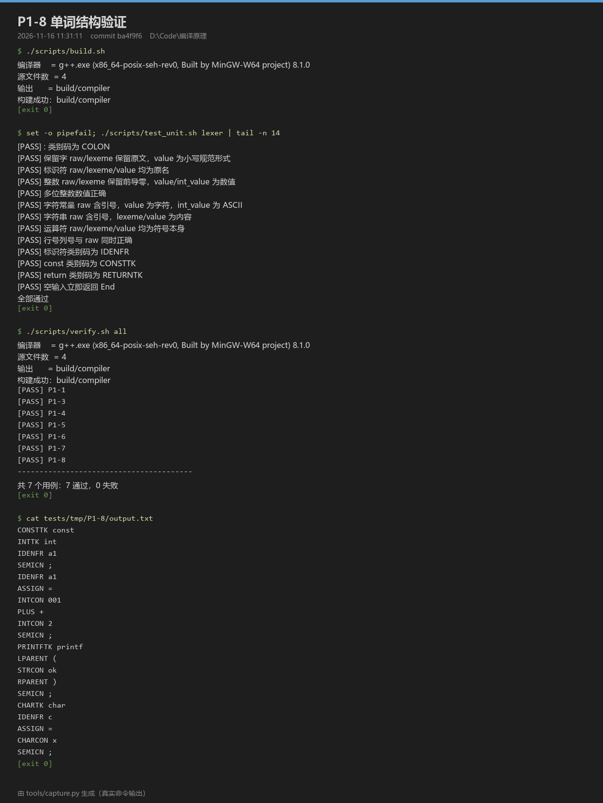

# P1-8 单词结构

## 1. 目的

完善词法单元结构：区分**源码原文 `raw`**、**输出形式 `lexeme`** 与**独立单词值 `value` / `int_value`**，并保留行号列号，供语法分析与语义分析使用。对应 TODO P1-8。

## 2. 环境

- 日期：2026-11-16
- 系统：Windows 11
- 工具链：g++ 8.1.0（MinGW-w64）、Git Bash 2.53.0、Python 3.14
- 代码版本：`ba4f9f6` 之后的工作区（本功能提交见 `git log --oneline --grep=P1-8`）

## 3. 前置条件

- P1-7 的全部类别码已完成；
- 新增 `tests/cases/P1-8/`（本功能创建）。

## 4. 复现步骤

1. 构建：

```bash
./scripts/build.sh
```

2. 运行词法分析器单元测试（完整 85 项，截图仅展示末尾 14 行）：

```bash
set -o pipefail; ./scripts/test_unit.sh lexer | tail -n 14
```

3. 运行全部用例（P1-1、P1-3～P1-8）：

```bash
./scripts/verify.sh all
```

4. 查看 P1-8 的实际输出：

```bash
cat tests/tmp/P1-8/output.txt
```

## 5. 预期输出

```text
$ ./scripts/build.sh
编译器    = g++.exe (x86_64-posix-seh-rev0, Built by MinGW-W64 project) 8.1.0
源文件数  = 4
输出      = build/compiler
构建成功：build/compiler
[exit 0]

$ set -o pipefail; ./scripts/test_unit.sh lexer | tail -n 14
[PASS] : 类别码为 COLON
[PASS] 保留字 raw/lexeme 保留原文，value 为小写规范形式
[PASS] 标识符 raw/lexeme/value 均为原名
[PASS] 整数 raw/lexeme 保留前导零，value/int_value 为数值
[PASS] 多位整数数值正确
[PASS] 字符常量 raw 含引号，value 为字符，int_value 为 ASCII
[PASS] 字符串 raw 含引号，lexeme/value 为内容
[PASS] 运算符 raw/lexeme/value 均为符号本身
[PASS] 行号列号与 raw 同时正确
[PASS] 标识符类别码为 IDENFR
[PASS] const 类别码为 CONSTTK
[PASS] return 类别码为 RETURNTK
[PASS] 空输入立即返回 End
全部通过
[exit 0]

$ ./scripts/verify.sh all
编译器    = g++.exe (x86_64-posix-seh-rev0, Built by MinGW-W64 project) 8.1.0
源文件数  = 4
输出      = build/compiler
构建成功：build/compiler
[PASS] P1-1
[PASS] P1-3
[PASS] P1-4
[PASS] P1-5
[PASS] P1-6
[PASS] P1-7
[PASS] P1-8
----------------------------------------
共 7 个用例：7 通过，0 失败
[exit 0]

$ cat tests/tmp/P1-8/output.txt
CONSTTK const
INTTK int
IDENFR a1
SEMICN ;
IDENFR a1
ASSIGN =
INTCON 001
PLUS +
INTCON 2
SEMICN ;
PRINTFTK printf
LPARENT (
STRCON ok
RPARENT )
SEMICN ;
CHARTK char
IDENFR c
ASSIGN =
CHARCON x
SEMICN ;
[exit 0]
```

## 6. 截图



## 7. 备注

### Token 字段

| 字段 | 含义 |
|---|---|
| `kind` | `TokenKind` 枚举 |
| `raw` | 源码原文；字符/字符串常量**含引号** |
| `lexeme` | 输出形式；字符/字符串常量**不含引号**，与 `output.txt` 一致 |
| `value` | 独立单词值（见下表） |
| `int_value` | `INTCON` 的数值；`CHARCON` 的 ASCII 码 |
| `line` / `column` | 词法单元起始位置，从 1 开始 |
| `message` | 仅 `Error` 使用 |

### 各类单词的取值

| 类别 | 输入 | `raw` | `lexeme` | `value` | `int_value` |
|---|---|---|---|---|---|
| 标识符 | `a1` | `a1` | `a1` | `a1` | — |
| 保留字 | `coNst` | `coNst` | `coNst` | `const` | — |
| 整数 | `001` | `001` | `001` | `1` | `1` |
| 字符 | `'_'` | `'_'` | `_` | `_` | `95` |
| 字符串 | `"Hi"` | `"Hi"` | `Hi` | `Hi` | — |
| 运算符 | `<=` | `<=` | `<=` | `<=` | — |

- 输出文件格式保持不变：`类别码 lexeme`。
- 整数使用 `long long` 保存数值；超出范围时 `int_value` 暂记 0、`value` 退化为原文，原文 `raw` 始终完整保留。
- `raw` 取自扫描器归一化后的源码，因此不会包含 CRLF；词法单元本身也不跨行。

### 验证说明

- 词法单元测试共 85 项，全部通过。截图使用 `tail -n 14` 只展示新增字段检查与汇总；命令前的 `set -o pipefail` 保证管道退出码仍反映测试结果。
- 新增端到端用例 P1-8 覆盖保留字、标识符、整数、字符串、字符与界符，确认结构调整没有改变 `output.txt` 格式。
