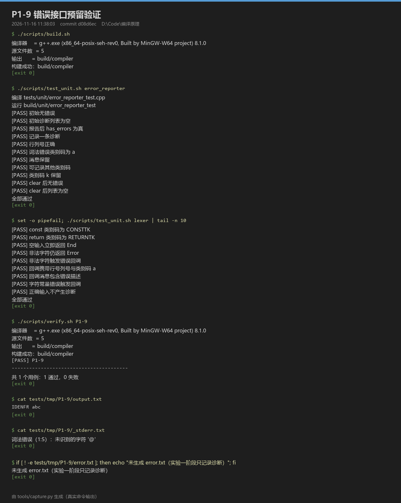

# P1-9 错误接口

## 1. 目的

预留词法错误接口：非法字符或非法字符/字符串常量通过回调上报，诊断信息包含行号、列号、类别码与描述；本阶段只在内存中收集，不输出 `error.txt`。对应 TODO P1-9。

## 2. 环境

- 日期：2026-11-16
- 系统：Windows 11
- 工具链：g++ 8.1.0（MinGW-w64）、Git Bash 2.53.0、Python 3.14
- 代码版本：`d08d6ec` 之后的工作区（本功能提交见 `git log --oneline --grep=P1-9`）

## 3. 前置条件

- P1-8 的 Token 结构已完成；
- 新增 `src/common/` 下的诊断结构与收集器；
- 新增 `tests/cases/P1-9/`（本功能创建）。

## 4. 复现步骤

1. 构建（`src/` 下 5 个 `.cpp`）：

```bash
./scripts/build.sh
```

2. 运行诊断收集器单元测试：

```bash
./scripts/test_unit.sh error_reporter
```

3. 运行词法单元测试（完整 91 项，截图只展示末尾 10 行）：

```bash
set -o pipefail; ./scripts/test_unit.sh lexer | tail -n 10
```

4. 运行 P1-9 用例（输入 `abc @`，属于故意含词法错误的程序）：

```bash
./scripts/verify.sh P1-9
```

5. 查看错误现场：

```bash
cat tests/tmp/P1-9/output.txt
cat tests/tmp/P1-9/_stderr.txt
```

6. 确认本阶段没有生成 `error.txt`：

```bash
if [ ! -e tests/tmp/P1-9/error.txt ]; then echo "未生成 error.txt（实验一阶段只记录诊断）"; fi
```

## 5. 预期输出

```text
$ ./scripts/build.sh
编译器    = g++.exe (x86_64-posix-seh-rev0, Built by MinGW-W64 project) 8.1.0
源文件数  = 5
输出      = build/compiler
构建成功：build/compiler
[exit 0]

$ ./scripts/test_unit.sh error_reporter
编译 tests/unit/error_reporter_test.cpp
运行 build/unit/error_reporter_test
[PASS] 初始无错误
[PASS] 初始诊断列表为空
[PASS] 报告后 has_errors 为真
[PASS] 记录一条诊断
[PASS] 行列号正确
[PASS] 词法错误类别码为 a
[PASS] 消息保留
[PASS] 可记录其他类别码
[PASS] 类别码 k 保留
[PASS] clear 后无错误
[PASS] clear 后列表为空
全部通过
[exit 0]

$ set -o pipefail; ./scripts/test_unit.sh lexer | tail -n 10
[PASS] const 类别码为 CONSTTK
[PASS] return 类别码为 RETURNTK
[PASS] 空输入立即返回 End
[PASS] 非法字符仍返回 Error
[PASS] 非法字符触发错误回调
[PASS] 回调携带行号列号与类别码 a
[PASS] 回调消息包含错误描述
[PASS] 字符常量错误触发回调
[PASS] 正确输入不产生诊断
全部通过
[exit 0]

$ ./scripts/verify.sh P1-9
编译器    = g++.exe (x86_64-posix-seh-rev0, Built by MinGW-W64 project) 8.1.0
源文件数  = 5
输出      = build/compiler
构建成功：build/compiler
[PASS] P1-9
----------------------------------------
共 1 个用例：1 通过，0 失败
[exit 0]

$ cat tests/tmp/P1-9/output.txt
IDENFR abc
[exit 0]

$ cat tests/tmp/P1-9/_stderr.txt
词法错误（1:5）：未识别的字符 '@'
[exit 0]

$ if [ ! -e tests/tmp/P1-9/error.txt ]; then echo "未生成 error.txt（实验一阶段只记录诊断）"; fi
未生成 error.txt（实验一阶段只记录诊断）
[exit 0]
```

## 6. 截图



## 7. 备注

### 新增接口

| 文件 | 内容 |
|---|---|
| `src/common/diagnostic.h` | `Diagnostic { line, column, code, message }` |
| `src/common/error_reporter.h/.cpp` | `ErrorReporter`：`report` / `report_lexical` / `diagnostics` / `has_errors` / `clear` |
| `src/lexer/lexer.h` | `Lexer(source, ErrorCallback)`，回调类型 `std::function<void(const common::Diagnostic&)>` |

- `Lexer` 在 `next_token()` 返回 `Error` 前调用回调，回调携带该词法单元的起始行列、类别码 `'a'` 与错误描述。
- 覆盖词法错误：未识别字符、单独的 `!`、空/多字符/非法内容/未闭合的字符常量、空/未闭合/含非法字符的字符串常量。
- `main.cpp` 把回调接到 `ErrorReporter`，诊断先存入内存；本阶段不写 `error.txt`。
- 控制台仍会输出一行错误到 stderr 并以退出码 1 结束，便于开发调试；这不是实验要求的 `error.txt` 输出。

### 关于 P1-9 用例

- 输入 `abc @`：`abc` 正常输出到 `output.txt`，`@` 触发错误回调与 stderr 提示。
- `meta.conf` 设置 `ALLOW_NONZERO=1`，因为编译器遇到词法错误返回 1；`expect.txt` 为错误前已产出的 `IDENFR abc`。
- 该用例验证了“错误不影响已识别单词的输出”，同时确认没有生成 `error.txt`。

### 后续

实验三（P3-2、P3-3）会复用 `ErrorReporter`，把诊断按 `行号 类别码` 写入 `error.txt`，并补充错误局部化与更多错误类型。
