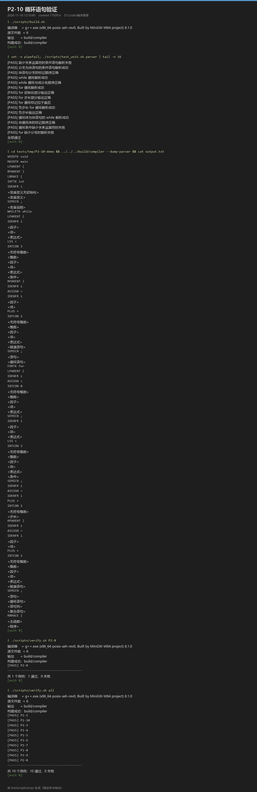

# P2-10 循环语句

## 1. 目的

实现 `while` 与 `for` 循环：`while ( 条件 ) 语句`、`for ( 初始化 ; 条件 ; 更新 ) 语句`，支持 `+`/`-` 步长；输出 `<条件>`、`<步长>`、`<循环语句>`。对应 TODO P2-10。

## 2. 环境

- 日期：2026-11-16
- 系统：Windows 11
- 工具链：g++ 8.1.0（MinGW-w64）、Git Bash 2.53.0、Python 3.14
- 代码版本：`7750f1e` 之后的工作区（本功能提交见 `git log --oneline --grep=P2-10`）

## 3. 前置条件

- P2-9 条件语句已完成；
- 官方 exp2 用例（P2-8）保持通过。

## 4. 复现步骤

1. 构建：

```bash
./scripts/build.sh
```

2. 运行语法分析单元测试（完整 133 项，截图展示末尾 16 行）：

```bash
set -o pipefail; ./scripts/test_unit.sh parser | tail -n 16
```

3. 循环语句演示：

```bash
cd tests/tmp/P2-10-demo && ../../../build/compiler --dump-parser && cat output.txt
```

4. 回归官方 exp2 与全部用例：

```bash
./scripts/verify.sh P2-8
./scripts/verify.sh all
```

## 5. 预期输出

构建与单元测试：

```text
$ ./scripts/build.sh
编译器    = g++.exe (x86_64-posix-seh-rev0, Built by MinGW-W64 project) 8.1.0
源文件数  = 6
输出      = build/compiler
构建成功：build/compiler
[exit 0]

$ set -o pipefail; ./scripts/test_unit.sh parser | tail -n 16
...（133 项断言，末尾 16 行；完整输出见 run.log 与截图）
全部通过
[exit 0]
```

循环演示（95 行，节选关键片段；完整内容见 [run.log](run.log)）：

```text
WHILETK while
LPARENT (
... 条件表达式 ...
<条件>
RPARENT )
... 循环体 ...
<语句>
<循环语句>
FORTK for
LPARENT (
IDENFR i
ASSIGN =
INTCON 0
...
<表达式>
SEMICN ;
... 条件表达式 ...
<条件>
SEMICN ;
IDENFR i
ASSIGN =
IDENFR i
PLUS +
INTCON 1
<无符号整数>
<步长>
RPARENT )
... 循环体 ...
<语句>
<循环语句>
[exit 0]

$ wc -l tests/tmp/P2-10-demo/output.txt
95 tests/tmp/P2-10-demo/output.txt
[exit 0]
```

回归：

```text
$ ./scripts/verify.sh P2-8
[PASS] P2-8
共 1 个用例：1 通过，0 失败
[exit 0]

$ ./scripts/verify.sh all
...
共 10 个用例：10 通过，0 失败
[exit 0]
```

## 6. 截图



## 7. 备注

### 实现要点

| 产生式 | 说明 |
|---|---|
| `while` | `while ( <条件> ) <语句>` |
| `for` | `for ( <标识符> = <表达式> ; <条件> ; <标识符> = <标识符> (+|-) <步长> ) <语句>` |
| `<步长>` | `<无符号整数>`，之后输出 `<步长>` |
| `<循环语句>` | 整个循环结束后输出 |

- for 的初始化部分按完整表达式解析（输出 `<因子>/<项>/<表达式>`）。
- for 的更新部分不是一般表达式：只允许 `标识符 = 标识符 (+|-) 步长`，因此步长前不出现 `<表达式>`，只输出 `<无符号整数>` 与 `<步长>`。
- `+` 与 `-` 两种步长均支持。

### 输出顺序

```
WHILETK while / FORTK for
LPARENT (
... 初始化（for）...
SEMICN ;
... 条件 ...
<条件>
SEMICN ;            // for
... 更新（for）...
<无符号整数>
<步长>
RPARENT )
... 循环体 ...
<语句>
<循环语句>
```

### 回归

- 官方 exp2 用例 `verify.sh P2-8` 仍然通过（样例不含循环语句）。
- 全部 10 个端到端用例通过。

### 测试

- 语法分析单元测试累计 **133 项**，新增 12 项：while、for（正/负步长）、块循环体、缺关系运算符、缺分号。
