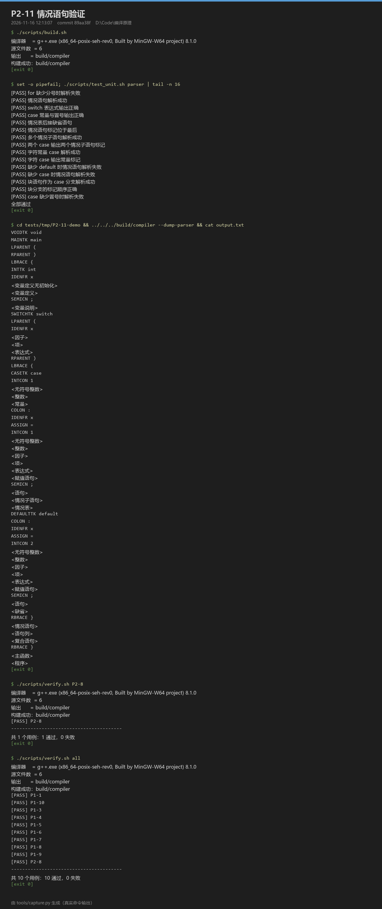

# P2-11 情况语句

## 1. 目的

实现 `switch / case / default`：`switch ( <表达式> ) { <情况表> <缺省> }`，支持多个 case 与必选 default；输出 `<情况子语句>`、`<情况表>`、`<缺省>`、`<情况语句>`。对应 TODO P2-11。

## 2. 环境

- 日期：2026-11-16
- 系统：Windows 11
- 工具链：g++ 8.1.0（MinGW-w64）、Git Bash 2.53.0、Python 3.14
- 代码版本：`89aa38f` 之后的工作区（本功能提交见 `git log --oneline --grep=P2-11`）

## 3. 前置条件

- P2-10 循环语句已完成；
- 官方 exp2 用例（P2-8）保持通过。

## 4. 复现步骤

1. 构建：

```bash
./scripts/build.sh
```

2. 运行语法分析单元测试（完整 147 项，截图展示末尾 16 行）：

```bash
set -o pipefail; ./scripts/test_unit.sh parser | tail -n 16
```

3. 情况语句演示：

```bash
cd tests/tmp/P2-11-demo && ../../../build/compiler --dump-parser && cat output.txt
```

4. 回归官方 exp2 与全部用例：

```bash
./scripts/verify.sh P2-8
./scripts/verify.sh all
```

## 5. 预期输出

构建与单元测试：

```text
$ ./scripts/build.sh
编译器    = g++.exe (x86_64-posix-seh-rev0, Built by MinGW-W64 project) 8.1.0
源文件数  = 6
输出      = build/compiler
构建成功：build/compiler
[exit 0]

$ set -o pipefail; ./scripts/test_unit.sh parser | tail -n 16
...（147 项断言，末尾 16 行；完整输出见 run.log 与截图）
全部通过
[exit 0]
```

情况语句演示（59 行）：

```text
$ cd tests/tmp/P2-11-demo && ../../../build/compiler --dump-parser && cat output.txt
VOIDTK void
MAINTK main
LPARENT (
RPARENT )
LBRACE {
INTTK int
IDENFR x
<变量定义无初始化>
<变量定义>
SEMICN ;
<变量说明>
SWITCHTK switch
LPARENT (
IDENFR x
<因子>
<项>
<表达式>
RPARENT )
LBRACE {
CASETK case
INTCON 1
<无符号整数>
<整数>
<常量>
COLON :
IDENFR x
ASSIGN =
INTCON 1
<无符号整数>
<整数>
<因子>
<项>
<表达式>
<赋值语句>
SEMICN ;
<语句>
<情况子语句>
<情况表>
DEFAULTTK default
COLON :
IDENFR x
ASSIGN =
INTCON 2
<无符号整数>
<整数>
<因子>
<项>
<表达式>
<赋值语句>
SEMICN ;
<语句>
<缺省>
RBRACE }
<情况语句>
<语句列>
<复合语句>
RBRACE }
<主函数>
<程序>
[exit 0]

$ wc -l tests/tmp/P2-11-demo/output.txt
59 tests/tmp/P2-11-demo/output.txt
[exit 0]
```

回归：

```text
$ ./scripts/verify.sh P2-8
[PASS] P2-8
共 1 个用例：1 通过，0 失败
[exit 0]

$ ./scripts/verify.sh all
...
共 10 个用例：10 通过，0 失败
[exit 0]
```

## 6. 截图



## 7. 备注

### 实现要点

| 产生式 | 说明 |
|---|---|
| `<情况语句>` | `switch ( 表达式 ) { <情况表> <缺省> }`，右花括号后输出 |
| `<情况表>` | 一个或多个 `<情况子语句>`，全部结束后输出 |
| `<情况子语句>` | `case <常量> : <语句>`，语句结束后输出 |
| `<缺省>` | `default : <语句>`，语句结束后输出 |

- case 常量复用 `<常量>`（整数或字符）。
- 至少一个 case；缺少 case 或缺少 default 都按语法错误处理。
- case/default 的语句体通过 `parse_statement()` 解析，可以是块语句或其他语句。
- 每个情况子语句执行完**不**继续执行后续子语句，这是语义约定；本阶段只做语法分析。

### 输出顺序

```
SWITCHTK switch
LPARENT (
... 表达式 ...
<表达式>
RPARENT )
LBRACE {
CASETK case
... <常量> ...
COLON :
... case 语句 ...
<语句>
<情况子语句>
...
<情况表>
DEFAULTTK default
COLON :
... default 语句 ...
<语句>
<缺省>
RBRACE }
<情况语句>
```

### 回归

- 官方 exp2 用例 `verify.sh P2-8` 仍然通过（样例不含情况语句）。
- 全部 10 个端到端用例通过。

### 测试

- 语法分析单元测试累计 **147 项**，新增 14 项：单/多 case、字符常量 case、缺 default、缺 case、块分支、缺冒号。
