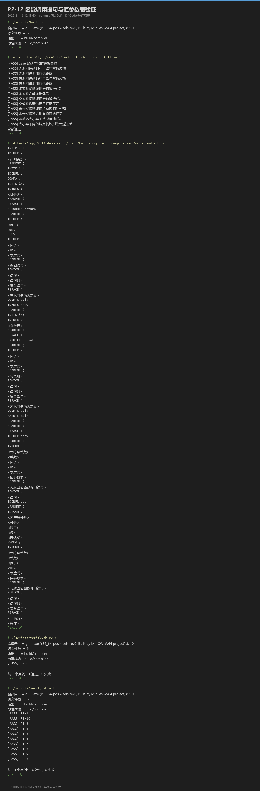

# P2-12 函数调用语句与值参数表

## 1. 目的

实现有/无返回值函数调用语句：`<标识符> ( <值参数表> )`；按已定义函数的返回类型选择 `<有返回值函数调用语句>` 或 `<无返回值函数调用语句>`。对应 TODO P2-12。

## 2. 环境

- 日期：2026-11-16
- 系统：Windows 11
- 工具链：g++ 8.1.0（MinGW-w64）、Git Bash 2.53.0、Python 3.14
- 代码版本：`f7b39e5` 之后的工作区（本功能提交见 `git log --oneline --grep=P2-12`）

## 3. 前置条件

- P2-11 情况语句已完成；
- 官方 exp2 用例（P2-8）保持通过。

## 4. 复现步骤

1. 构建：

```bash
./scripts/build.sh
```

2. 运行语法分析单元测试（完整 159 项，截图展示末尾 14 行）：

```bash
set -o pipefail; ./scripts/test_unit.sh parser | tail -n 14
```

3. 函数调用语句演示：

```bash
cd tests/tmp/P2-12-demo && ../../../build/compiler --dump-parser && cat output.txt
```

4. 回归官方 exp2 与全部用例：

```bash
./scripts/verify.sh P2-8
./scripts/verify.sh all
```

## 5. 预期输出

构建与单元测试：

```text
$ ./scripts/build.sh
编译器    = g++.exe (x86_64-posix-seh-rev0, Built by MinGW-W64 project) 8.1.0
源文件数  = 6
输出      = build/compiler
构建成功：build/compiler
[exit 0]

$ set -o pipefail; ./scripts/test_unit.sh parser | tail -n 14
...（159 项断言，末尾 14 行；完整输出见 run.log 与截图）
全部通过
[exit 0]
```

演示输出（95 行，节选 main 中的调用语句）：

```text
IDENFR show
LPARENT (
INTCON 1
<无符号整数>
<整数>
<因子>
<项>
<表达式>
<值参数表>
RPARENT )
<无返回值函数调用语句>
SEMICN ;
<语句>
IDENFR add
LPARENT (
INTCON 1
<无符号整数>
<整数>
<因子>
<项>
<表达式>
COMMA ,
INTCON 2
<无符号整数>
<整数>
<因子>
<项>
<表达式>
<值参数表>
RPARENT )
<有返回值函数调用语句>
SEMICN ;
<语句>
[exit 0]

$ wc -l tests/tmp/P2-12-demo/output.txt
95 tests/tmp/P2-12-demo/output.txt
[exit 0]
```

回归：

```text
$ ./scripts/verify.sh P2-8
[PASS] P2-8
共 1 个用例：1 通过，0 失败
[exit 0]

$ ./scripts/verify.sh all
...
共 10 个用例，全部通过
[exit 0]
```

## 6. 截图



## 7. 备注

### 返回类型判定

- 解析函数定义时，把函数名（ASCII 小写）与“是否有返回值”记录到解析器内部表：
  - `int/char <名字>` → 有返回值；
  - `void <名字>` → 无返回值。
- 调用语句处按名字查表（大小写不敏感）选择标记；未定义的函数暂按“有返回值”处理。
- 表达式中的函数调用因子始终输出 `<有返回值函数调用语句>`（文法只允许有返回值调用作为因子）。
- 该表是实验三符号表的雏形；P3 会替换为完整的作用域与类型检查。

### 输出顺序

```
IDENFR 函数名
LPARENT (
... 实参表达式 ...（逗号分隔）
<值参数表>
RPARENT )
<有/无返回值函数调用语句>
SEMICN ;
<语句>
```

- 空实参同样输出 `<值参数表>`。

### 回归

- 官方 exp2 用例 `verify.sh P2-8` 仍然通过。
- 全部端到端用例通过。

### 测试

- 语法分析单元测试累计 **159 项**，新增 12 项：有/无返回值调用、多实参、空实参、未定义函数、大小写不敏感查找。
