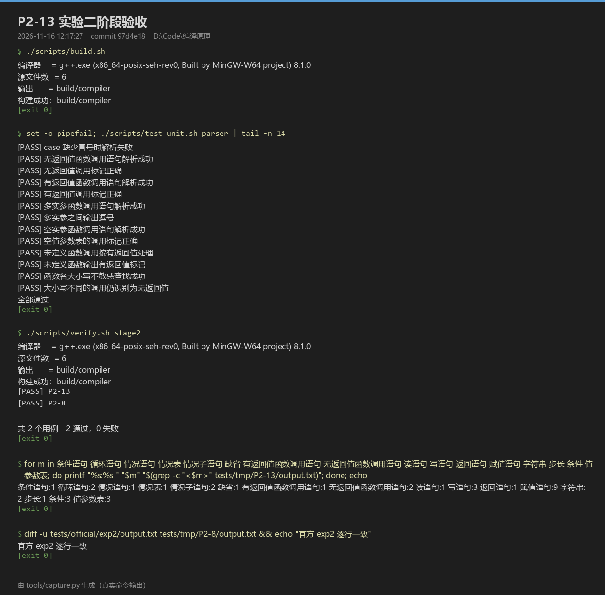

# P2-13 实验二阶段验收

## 1. 目的

按 AGENTS.md §6.2 完成实验二（语法分析）阶段验收：官方 exp2 逐行一致、全语法成分覆盖、11 种语句可解析，并打标签 `stage2`。对应 TODO P2-13。

## 2. 环境

- 日期：2026-11-16
- 系统：Windows 11
- 工具链：g++ 8.1.0（MinGW-w64）、Git Bash 2.53.0、Python 3.14
- 代码版本：`97d4e18` 之后的工作区（本功能提交见 `git log --oneline --grep=P2-13`）

## 3. 前置条件

- P2-1～P2-12 全部完成；
- 官方 exp2 用例（P2-8）与综合用例（P2-13）已入库。

## 4. 复现步骤

1. 构建：

```bash
./scripts/build.sh
```

2. 运行语法分析单元测试（完整 159 项，截图展示末尾 14 行）：

```bash
set -o pipefail; ./scripts/test_unit.sh parser | tail -n 14
```

3. 运行实验二全部用例：

```bash
./scripts/verify.sh stage2
```

4. 统计综合用例中各类成分名的出现次数：

```bash
for m in 条件语句 循环语句 情况语句 情况表 情况子语句 缺省 有返回值函数调用语句 无返回值函数调用语句 读语句 写语句 返回语句 赋值语句 字符串 步长 条件 值参数表; do printf "%s:%s " "$m" "$(grep -c "<$m>" tests/tmp/P2-13/output.txt)"; done; echo
```

5. 与官方 exp2 逐行比对：

```bash
diff -u tests/official/exp2/output.txt tests/tmp/P2-8/output.txt && echo "官方 exp2 逐行一致"
```

## 5. 预期输出

```text
$ ./scripts/build.sh
编译器    = g++.exe (x86_64-posix-seh-rev0, Built by MinGW-W64 project) 8.1.0
源文件数  = 6
输出      = build/compiler
构建成功：build/compiler
[exit 0]

$ set -o pipefail; ./scripts/test_unit.sh parser | tail -n 14
...（159 项断言，末尾 14 行；完整输出见 run.log 与截图）
全部通过
[exit 0]

$ ./scripts/verify.sh stage2
编译器    = g++.exe (x86_64-posix-seh-rev0, Built by MinGW-W64 project) 8.1.0
源文件数  = 6
输出      = build/compiler
构建成功：build/compiler
[PASS] P2-13
[PASS] P2-8
----------------------------------------
共 2 个用例：2 通过，0 失败
[exit 0]

$ for m in 条件语句 循环语句 情况语句 情况表 情况子语句 缺省 有返回值函数调用语句 无返回值函数调用语句 读语句 写语句 返回语句 赋值语句 字符串 步长 条件 值参数表; do printf "%s:%s " "$m" "$(grep -c "<$m>" tests/tmp/P2-13/output.txt)"; done; echo
条件语句:1 循环语句:2 情况语句:1 情况表:1 情况子语句:2 缺省:1 有返回值函数调用语句:1 无返回值函数调用语句:2 读语句:1 写语句:3 返回语句:1 赋值语句:9 字符串:2 步长:1 条件:3 值参数表:3 
[exit 0]

$ diff -u tests/official/exp2/output.txt tests/tmp/P2-8/output.txt && echo "官方 exp2 逐行一致"
官方 exp2 逐行一致
[exit 0]
```

## 6. 截图




## 7. 备注

### §6.2 阶段验收 checklist

| 条目 | 结果 | 证据 |
|---|---|---|
| 官方 exp2 逐行一致 | ✅ | 119 行 diff 无差异（P2-8） |
| 预读单词按序输出 | ✅ | 单词在消费时输出，exp2 中 66 个单词行顺序一致 |
| 所有高亮成分输出 `<成分名>` | ✅ | P2-13 综合程序覆盖条件/循环/情况/调用/读写/返回等全部标记 |
| 11 种语句均可解析 | ✅ | 赋值、读、写、返回、空、块、if、while、for、switch、函数调用 |
| 函数调用有/无返回值区分 | ✅ | 按已定义函数的返回类型选择标记 |

### 综合用例 P2-13

程序覆盖：

- 常量说明（int/char、多个）
- 变量说明（简单变量、二维数组初始化）
- 有/无返回值函数、参数表
- 表达式（含负号、乘除、数组元素、函数调用因子）
- 赋值、读、写（三种形式）、返回语句
- if-else、for（+步长）、while、switch（两个 case + default）
- 有/无返回值函数调用语句

共 447 行输出，各类标记计数见上。

### 阶段标签

```bash
git tag -a stage2 -m "实验二 语法分析 阶段验收通过（P2-1～P2-13）"
git push origin stage2
```

### 测试规模

- 语法分析单元测试：159 项
- 端到端用例：P2-8（官方 exp2）、P2-13（综合）
- 实验一 9 个用例回归通过

## 8. 结果展示样例运行

- 样例来源：`tests/sample/实验二 结果展示样例.txt`
- 可复现用例：`tests/cases/P2-15/`（输入、`--dump-parser` 配置和完整期望输出）
- 命令：`COMPILER="build/compiler.exe" ./scripts/verify.sh P2-15`
- 结果：通过，生成 870 行 `output.txt`。
- 原始日志：[`sample-run.log`](sample-run.log)
- 截图：
