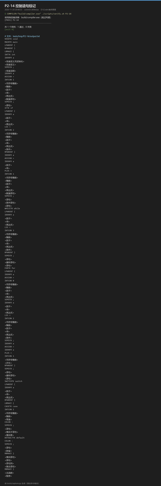

# P2-14 控制语句标记

## 1. 目的
验证 if、while、for、switch 解析完成后，均输出对应的 <语句> 标记，保证语法分析输出包含文法中要求的完整非终结符标记。

## 2. 环境
- 日期：2026-11-20
- 系统：Windows 11
- 工具链：g++ 8.1.0 / Python 3.14
- 代码版本：`d69eeaa 实验四 代码生成：P4-9 函数与控制语句代码生成`

## 3. 前置条件
- 已在仓库根目录完成构建。
- 用例位于 `tests/cases/P2-14/`，运行目录由验证脚本复制创建。
- 输出模式为 `--dump-parser`。

## 4. 复现步骤
1. 构建：`bash ./scripts/build.sh`（本机若 Bash 找不到 g++，可在 PowerShell 直接运行 `scripts/build.sh` 或设置 `CXX`）。
2. 准备输入：验证脚本自动复制 `tests/cases/P2-14/testfile.txt`。
3. 运行：`COMPILER="build/compiler.exe" ./scripts/verify.sh P2-14`。
4. 比对：脚本逐字节比较生成的 `output.txt` 和 `expect.txt`，预期 PASS。

## 5. 预期输出
``text
VOIDTK void
MAINTK main
LPARENT (
RPARENT )
LBRACE {
INTTK int
IDENFR a
<变量定义无初始化>
<变量定义>
SEMICN ;
<变量说明>
IDENFR a
ASSIGN =
INTCON 1
<无符号整数>
<整数>
<因子>
<项>
<表达式>
<赋值语句>
SEMICN ;
<语句>
IFTK if
LPARENT (
IDENFR a
<因子>
<项>
<表达式>
LSS <
INTCON 2
<无符号整数>
<整数>
<因子>
<项>
<表达式>
<条件>
RPARENT )
IDENFR a
ASSIGN =
IDENFR a
<因子>
<项>
PLUS +
INTCON 1
<无符号整数>
<整数>
<因子>
<项>
<表达式>
<赋值语句>
SEMICN ;
<语句>
<条件语句>
<语句>
WHILETK while
LPARENT (
IDENFR a
<因子>
<项>
<表达式>
LSS <
INTCON 3
<无符号整数>
<整数>
<因子>
<项>
<表达式>
<条件>
RPARENT )
SEMICN ;
<语句>
<循环语句>
<语句>
FORTK for
LPARENT (
IDENFR a
ASSIGN =
INTCON 0
<无符号整数>
<整数>
<因子>
<项>
<表达式>
SEMICN ;
IDENFR a
<因子>
<项>
<表达式>
LSS <
INTCON 2
<无符号整数>
<整数>
<因子>
<项>
<表达式>
<条件>
SEMICN ;
IDENFR a
ASSIGN =
IDENFR a
PLUS +
INTCON 1
<无符号整数>
<步长>
RPARENT )
SEMICN ;
<语句>
<循环语句>
<语句>
SWITCHTK switch
LPARENT (
IDENFR a
<因子>
<项>
<表达式>
RPARENT )
LBRACE {
CASETK case
INTCON 1
<无符号整数>
<整数>
<常量>
COLON :
SEMICN ;
<语句>
<情况子语句>
<情况表>
DEFAULTTK default
COLON :
SEMICN ;
<语句>
<缺省>
RBRACE }
<情况语句>
<语句>
<语句列>
<复合语句>
RBRACE }
<主函数>
<程序>
``

## 6. 截图

## 7. 备注
该用例覆盖 if、while、for、switch。控制结构自身的 `<条件语句>`、`<循环语句>`、`<情况语句>` 标记之后，必须再输出其所属的 `<语句>` 标记。

