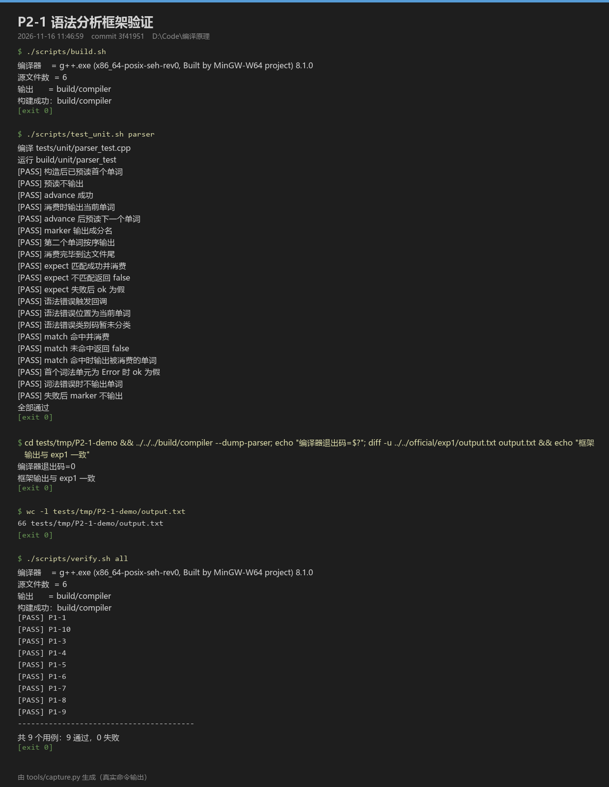

# P2-1 语法分析框架

## 1. 目的

搭建递归下降语法分析框架：单词预读、消费时输出、`<成分名>` 标记输出、语法错误回调，并在 `main` 中接通 `--dump-parser`。对应实验二与 TODO P2-1。

## 2. 环境

- 日期：2026-11-16
- 系统：Windows 11
- 工具链：g++ 8.1.0（MinGW-w64）、Git Bash 2.53.0、Python 3.14
- 代码版本：`3f41951` 之后的工作区（本功能提交见 `git log --oneline --grep=P2-1`）

## 3. 前置条件

- 实验一已完成（标签 `stage1`）；
- 新增 `src/parser/parser.h/.cpp` 与 `tests/unit/parser_test.cpp`。

## 4. 复现步骤

1. 构建（`src/` 下 6 个 `.cpp`）：

```bash
./scripts/build.sh
```

2. 运行语法分析框架单元测试：

```bash
./scripts/test_unit.sh parser
```

3. 用框架消费官方 exp1 输入，确认“消费时输出”的顺序与词法输出一致：

```bash
cd tests/tmp/P2-1-demo && ../../../build/compiler --dump-parser; echo "编译器退出码=$?"; diff -u ../../official/exp1/output.txt output.txt && echo "框架输出与 exp1 一致"
```

4. 确认行数：

```bash
wc -l tests/tmp/P2-1-demo/output.txt
```

5. 回归实验一：

```bash
./scripts/verify.sh all
```

## 5. 预期输出

```text
$ ./scripts/build.sh
编译器    = g++.exe (x86_64-posix-seh-rev0, Built by MinGW-W64 project) 8.1.0
源文件数  = 6
输出      = build/compiler
构建成功：build/compiler
[exit 0]

$ ./scripts/test_unit.sh parser
编译 tests/unit/parser_test.cpp
运行 build/unit/parser_test
[PASS] 构造后已预读首个单词
[PASS] 预读不输出
[PASS] advance 成功
[PASS] 消费时输出当前单词
[PASS] advance 后预读下一个单词
[PASS] marker 输出成分名
[PASS] 第二个单词按序输出
[PASS] 消费完毕到达文件尾
[PASS] expect 匹配成功并消费
[PASS] expect 不匹配返回 false
[PASS] expect 失败后 ok 为假
[PASS] 语法错误触发回调
[PASS] 语法错误位置为当前单词
[PASS] 语法错误类别码暂未分类
[PASS] match 命中并消费
[PASS] match 未命中返回 false
[PASS] match 命中时输出被消费的单词
[PASS] 首个词法单元为 Error 时 ok 为假
[PASS] 词法错误时不输出单词
[PASS] 失败后 marker 不输出
全部通过
[exit 0]

$ cd tests/tmp/P2-1-demo && ../../../build/compiler --dump-parser; echo "编译器退出码=$?"; diff -u ../../official/exp1/output.txt output.txt && echo "框架输出与 exp1 一致"
编译器退出码=0
框架输出与 exp1 一致
[exit 0]

$ wc -l tests/tmp/P2-1-demo/output.txt
66 tests/tmp/P2-1-demo/output.txt
[exit 0]

$ ./scripts/verify.sh all
编译器    = g++.exe (x86_64-posix-seh-rev0, Built by MinGW-W64 project) 8.1.0
源文件数  = 6
输出      = build/compiler
构建成功：build/compiler
[PASS] P1-1
[PASS] P1-10
[PASS] P1-3
[PASS] P1-4
[PASS] P1-5
[PASS] P1-6
[PASS] P1-7
[PASS] P1-8
[PASS] P1-9
----------------------------------------
共 9 个用例：9 通过，0 失败
[exit 0]
```

## 6. 截图



## 7. 备注

### 框架接口

| 接口 | 作用 |
|---|---|
| `Parser(lexer, out, on_error)` | 构造时预读第一个单词，不输出 |
| `advance()` | 输出当前单词，再预读下一个 |
| `match(kind)` | 当前单词匹配则消费 |
| `expect(kind, context)` | 必须匹配，否则报告语法错误 |
| `marker(name)` | 输出 `<name>` |
| `syntax_error(token, message)` | 构造诊断并回调，标记失败 |
| `ok()` / `at_end()` | 状态查询 |

### 输出顺序策略

- **单词在消费时输出**，预读本身不输出。这样 `<成分名>` 可以出现在紧随其后的单词之前，例如 `<常量定义>` 先于 `SEMICN ;`，与官方 exp2 样例一致。
- 预读的单词最终都会被消费（正确程序），因此不会漏输出；文件尾 `End` 不输出。

### 本阶段实现范围

- `parse_program()` 暂为“消费全部单词”的占位实现，因此 `--dump-parser` 的输出与实验一词法结果完全一致（66 行），用于验证框架的输出顺序与接入方式。
- P2-2 起会把 `parse_program()` 替换为真实的常量说明、变量说明、函数与主函数解析，并逐步加入 `<成分名>`。

### 错误接口

- 语法错误通过 `SyntaxErrorCallback` 上报，`Diagnostic.code` 暂为 `'\0'`（未分类），实验三再分配 a–p 类别码。
- 词法错误由 Lexer 回调上报；`main` 会把词法与语法错误分别打印到 stderr，并在失败时返回 1。
- 本阶段只处理正确程序，未做错误恢复。
