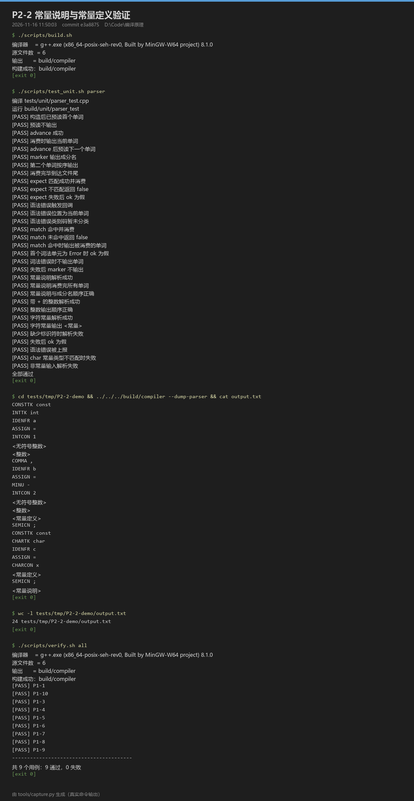

# P2-2 常量说明与常量定义

## 1. 目的

实现常量说明与常量定义的递归下降解析，并输出对应成分名：`<无符号整数>`、`<整数>`、`<常量定义>`、`<常量说明>`；同时实现 `<字符>` 与 `<常量>` 基础产生式，供后续变量初始化与情况语句复用。对应 TODO P2-2。

## 2. 环境

- 日期：2026-11-16
- 系统：Windows 11
- 工具链：g++ 8.1.0（MinGW-w64）、Git Bash 2.53.0、Python 3.14
- 代码版本：`e3a8875` 之后的工作区（本功能提交见 `git log --oneline --grep=P2-2`）

## 3. 前置条件

- P2-1 语法框架已完成；
- `src/parser/parser.h/.cpp` 已包含产生式声明与实现。

## 4. 复现步骤

1. 构建：

```bash
./scripts/build.sh
```

2. 运行语法分析单元测试：

```bash
./scripts/test_unit.sh parser
```

3. 用常量声明程序演示 `--dump-parser`：

```bash
cd tests/tmp/P2-2-demo && ../../../build/compiler --dump-parser && cat output.txt
```

4. 确认输出行数：

```bash
wc -l tests/tmp/P2-2-demo/output.txt
```

5. 回归实验一：

```bash
./scripts/verify.sh all
```

## 5. 预期输出

```text
$ ./scripts/build.sh
编译器    = g++.exe (x86_64-posix-seh-rev0, Built by MinGW-W64 project) 8.1.0
源文件数  = 6
输出      = build/compiler
构建成功：build/compiler
[exit 0]

$ ./scripts/test_unit.sh parser
编译 tests/unit/parser_test.cpp
运行 build/unit/parser_test
[PASS] 构造后已预读首个单词
[PASS] 预读不输出
[PASS] advance 成功
[PASS] 消费时输出当前单词
[PASS] advance 后预读下一个单词
[PASS] marker 输出成分名
[PASS] 第二个单词按序输出
[PASS] 消费完毕到达文件尾
[PASS] expect 匹配成功并消费
[PASS] expect 不匹配返回 false
[PASS] expect 失败后 ok 为假
[PASS] 语法错误触发回调
[PASS] 语法错误位置为当前单词
[PASS] 语法错误类别码暂未分类
[PASS] match 命中并消费
[PASS] match 未命中返回 false
[PASS] match 命中时输出被消费的单词
[PASS] 首个词法单元为 Error 时 ok 为假
[PASS] 词法错误时不输出单词
[PASS] 失败后 marker 不输出
[PASS] 常量说明解析成功
[PASS] 常量说明消费完所有单词
[PASS] 常量说明与成分名顺序正确
[PASS] 带 + 的整数解析成功
[PASS] 整数输出顺序正确
[PASS] 字符常量解析成功
[PASS] 字符常量输出 <常量>
[PASS] 缺少标识符时解析失败
[PASS] 失败后 ok 为假
[PASS] 语法错误被上报
[PASS] char 常量类型不匹配时失败
[PASS] 非常量输入解析失败
全部通过
[exit 0]

$ cd tests/tmp/P2-2-demo && ../../../build/compiler --dump-parser && cat output.txt
CONSTTK const
INTTK int
IDENFR a
ASSIGN =
INTCON 1
<无符号整数>
<整数>
COMMA ,
IDENFR b
ASSIGN =
MINU -
INTCON 2
<无符号整数>
<整数>
<常量定义>
SEMICN ;
CONSTTK const
CHARTK char
IDENFR c
ASSIGN =
CHARCON x
<常量定义>
SEMICN ;
<常量说明>
[exit 0]

$ wc -l tests/tmp/P2-2-demo/output.txt
24 tests/tmp/P2-2-demo/output.txt
[exit 0]

$ ./scripts/verify.sh all
编译器    = g++.exe (x86_64-posix-seh-rev0, Built by MinGW-W64 project) 8.1.0
源文件数  = 6
输出      = build/compiler
构建成功：build/compiler
[PASS] P1-1
[PASS] P1-10
[PASS] P1-3
[PASS] P1-4
[PASS] P1-5
[PASS] P1-6
[PASS] P1-7
[PASS] P1-8
[PASS] P1-9
----------------------------------------
共 9 个用例：9 通过，0 失败
[exit 0]
```

## 6. 截图



## 7. 备注

### 实现的产生式

| 产生式 | 说明 |
|---|---|
| `<常量说明>` | `const <常量定义> ; { const <常量定义> ; }`，最后一个分号后输出 |
| `<常量定义>` | `int` 或 `char` 开头，支持逗号分隔的多个定义；在本产生式结束时输出 |
| `<整数>` | 可选 `+`/`-` + `<无符号整数>` |
| `<无符号整数>` | 单个 `INTCON` |
| `<字符>` | 单个 `CHARCON`，**不输出**成分名（指导书未高亮） |
| `<常量>` | `<整数>` 或 `<字符>`，结束后输出 `<常量>` |

### 输出顺序

- 单词在消费时输出；`<常量定义>` 在分号被 `<常量说明>` 消费前输出，因此官方样例中 `<常量定义>` 出现在 `SEMICN ;` 之前。
- `<常量说明>` 在最后一个分号之后输出。

### 当前 scaffold

`parse_program()` 目前只解析常量说明，随后临时消费剩余单词，因此本阶段的演示输入只包含常量声明。P2-3 会加入变量说明，P2-13 才会对完整程序与官方 exp2 逐行验收。

### 测试

- 语法分析单元测试累计 **32 项**，新增 12 项：常量说明整体输出、带符号整数、`<常量>`、缺少标识符、类型不匹配、非常量输入等。
- 实验一 9 个用例回归全部通过。
