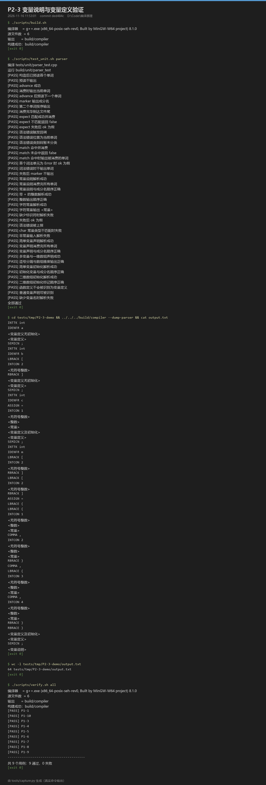

# P2-3 变量说明与变量定义

## 1. 目的

实现变量说明与变量定义：支持简单变量、一维数组、二维数组，以及有/无初始化两种形式；输出 `<无符号整数>`、`<常量>`、`<变量定义无初始化>`、`<变量定义及初始化>`、`<变量定义>`、`<变量说明>`。对应 TODO P2-3。

## 2. 环境

- 日期：2026-11-16
- 系统：Windows 11
- 工具链：g++ 8.1.0（MinGW-w64）、Git Bash 2.53.0、Python 3.14
- 代码版本：`ded484c` 之后的工作区（本功能提交见 `git log --oneline --grep=P2-3`）

## 3. 前置条件

- P2-2 常量说明已完成；
- 解析器已升级为多 token 前瞻（区分“类型 名字 (”函数定义与变量定义）。

## 4. 复现步骤

1. 构建：

```bash
./scripts/build.sh
```

2. 运行语法分析单元测试（完整 44 项）：

```bash
./scripts/test_unit.sh parser
```

3. 用变量声明程序演示：

```bash
cd tests/tmp/P2-3-demo && ../../../build/compiler --dump-parser && cat output.txt
```

4. 确认行数：

```bash
wc -l tests/tmp/P2-3-demo/output.txt
```

5. 回归实验一：

```bash
./scripts/verify.sh all
```

## 5. 预期输出

构建与单元测试：

```text
$ ./scripts/build.sh
编译器    = g++.exe (x86_64-posix-seh-rev0, Built by MinGW-W64 project) 8.1.0
源文件数  = 6
输出      = build/compiler
构建成功：build/compiler
[exit 0]

$ ./scripts/test_unit.sh parser
...（44 项断言，完整输出见 run.log 与截图）
全部通过
[exit 0]
```

变量声明演示（64 行）：

```text
$ cd tests/tmp/P2-3-demo && ../../../build/compiler --dump-parser && cat output.txt
INTTK int
IDENFR a
<变量定义无初始化>
<变量定义>
SEMICN ;
INTTK int
IDENFR b
LBRACK [
INTCON 2
<无符号整数>
RBRACK ]
<变量定义无初始化>
<变量定义>
SEMICN ;
INTTK int
IDENFR c
ASSIGN =
INTCON 1
<无符号整数>
<整数>
<常量>
<变量定义及初始化>
<变量定义>
SEMICN ;
INTTK int
IDENFR m
LBRACK [
INTCON 2
<无符号整数>
RBRACK ]
LBRACK [
INTCON 2
<无符号整数>
RBRACK ]
ASSIGN =
LBRACE {
LBRACE {
INTCON 1
<无符号整数>
<整数>
<常量>
COMMA ,
INTCON 2
<无符号整数>
<整数>
<常量>
RBRACE }
COMMA ,
LBRACE {
INTCON 3
<无符号整数>
<整数>
<常量>
COMMA ,
INTCON 4
<无符号整数>
<整数>
<常量>
RBRACE }
RBRACE }
<变量定义及初始化>
<变量定义>
SEMICN ;
<变量说明>
[exit 0]

$ wc -l tests/tmp/P2-3-demo/output.txt
64 tests/tmp/P2-3-demo/output.txt
[exit 0]
```

回归：

```text
$ ./scripts/verify.sh all
...
共 9 个用例：9 通过，0 失败
[exit 0]
```

## 6. 截图



## 7. 备注

### 实现的产生式

| 产生式 | 说明 |
|---|---|
| `<变量说明>` | `<变量定义> ; { <变量定义> ; }`，最后一个分号后输出 |
| `<变量定义无初始化>` | 类型 + 一个或多个声明符（逗号分隔），支持 `name`、`name[n]`、`name[n][m]` |
| `<变量定义及初始化>` | 类型 + 单个声明符 + `=` + 初始化列表 |
| `<变量定义>` | 在内部标记之后输出 |
| `<类型标识符>` | `int`/`char`，**不输出**成分名 |

### 前瞻增强

- 解析器改为多 token 前瞻缓冲（`peek_token(k)`）。
- 判断“类型 名字 (”时使用第 3 个 token：`int f(` 视为函数定义，不当作变量定义；`int a;`、`int a[2];`、`int a = 1;` 视为变量。
- 该增强会在 P2-4/P2-5 解析函数定义与程序结构时复用。

### 初始化语法

- 简单变量：`= <常量>`。
- 一维数组：`= { 常量, ... }`。
- 二维数组：`= { { 常量, ... }, { ... } }`，每个内层花括号对应一行（行优先）。

### 测试

- 语法分析单元测试累计 **44 项**，新增 12 项：简单/多变量/一维/二维、有/无初始化、函数定义排除、缺少变量名报错。
- 实验一 9 个用例回归通过。
