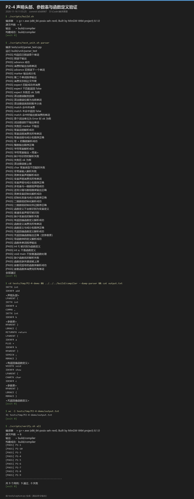

# P2-4 声明头部、参数表与函数定义

## 1. 目的

实现声明头部、参数表、有返回值/无返回值函数定义，输出 `<声明头部>`、`<参数表>`、`<有返回值函数定义>`、`<无返回值函数定义>`。对应 TODO P2-4。

## 2. 环境

- 日期：2026-11-16
- 系统：Windows 11
- 工具链：g++ 8.1.0（MinGW-w64）、Git Bash 2.53.0、Python 3.14
- 代码版本：`b0d8987` 之后的工作区（本功能提交见 `git log --oneline --grep=P2-4`）

## 3. 前置条件

- P2-3 变量说明已完成；
- 解析器已支持 `peek_token(k)` 多 token 前瞻。

## 4. 复现步骤

1. 构建：

```bash
./scripts/build.sh
```

2. 运行语法分析单元测试（完整 58 项）：

```bash
./scripts/test_unit.sh parser
```

3. 用函数定义程序演示：

```bash
cd tests/tmp/P2-4-demo && ../../../build/compiler --dump-parser && cat output.txt
```

4. 确认行数：

```bash
wc -l tests/tmp/P2-4-demo/output.txt
```

5. 回归实验一：

```bash
./scripts/verify.sh all
```

## 5. 预期输出

构建与单元测试：

```text
$ ./scripts/build.sh
编译器    = g++.exe (x86_64-posix-seh-rev0, Built by MinGW-W64 project) 8.1.0
源文件数  = 6
输出      = build/compiler
构建成功：build/compiler
[exit 0]

$ ./scripts/test_unit.sh parser
...（58 项断言，完整输出见 run.log 与截图）
全部通过
[exit 0]
```

函数定义演示（31 行）：

```text
$ cd tests/tmp/P2-4-demo && ../../../build/compiler --dump-parser && cat output.txt
INTTK int
IDENFR add
<声明头部>
LPARENT (
INTTK int
IDENFR a
COMMA ,
INTTK int
IDENFR b
<参数表>
RPARENT )
LBRACE {
RETURNTK return
LPARENT (
IDENFR a
PLUS +
IDENFR b
RPARENT )
SEMICN ;
RBRACE }
<有返回值函数定义>
VOIDTK void
IDENFR show
LPARENT (
CHARTK char
IDENFR c
<参数表>
RPARENT )
LBRACE {
RBRACE }
<无返回值函数定义>
[exit 0]

$ wc -l tests/tmp/P2-4-demo/output.txt
31 tests/tmp/P2-4-demo/output.txt
[exit 0]
```

回归：

```text
$ ./scripts/verify.sh all
...
共 9 个用例：9 通过，0 失败
[exit 0]
```

## 6. 截图



## 7. 备注

### 实现的产生式

| 产生式 | 说明 |
|---|---|
| `<声明头部>` | `int`/`char` + 标识符，在 `(` 前输出 |
| `<参数表>` | 类型 + 标识符的逗号列表；空参数表也会输出该成分名 |
| `<有返回值函数定义>` | 声明头部 `(` 参数表 `)` `{ 复合语句 }`，右花括号后输出 |
| `<无返回值函数定义>` | `void` 标识符 `(` 参数表 `)` `{ 复合语句 }`，右花括号后输出 |

### 主函数排除

- `main` 是保留字 `MAINTK`，不满足“`void` + 标识符”的函数定义条件，因此 `void main()` 不会被当作普通无返回值函数，留给 P2-5 的 `<主函数>` 处理。

### 函数体占位

- 本阶段函数体的 `{ ... }` 由 `parse_compound_statement_body()` 临时消费（支持嵌套花括号），只输出原始单词，不输出 `<复合语句>` 等成分名。
- P2-6 会用真实的 `<复合语句>`/`<语句列>` 解析替换该临时函数。

### 测试

- 语法分析单元测试累计 **58 项**，新增 14 项：有/无返回值函数、空参数表、函数体输出、函数/变量区分、main 排除、缺少函数名、嵌套花括号。
- 实验一 9 个用例回归通过。
