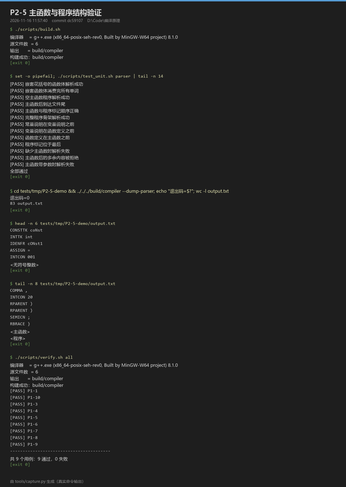

# P2-5 主函数与程序

## 1. 目的

实现 `<主函数>` 与 `<程序>`：程序 = 可选常量说明 + 可选变量说明 + 若干函数定义 + 主函数；主函数结束后输出 `<主函数>`，整个程序结束后输出 `<程序>`，并拒绝主函数后的多余内容。对应 TODO P2-5。

## 2. 环境

- 日期：2026-11-16
- 系统：Windows 11
- 工具链：g++ 8.1.0（MinGW-w64）、Git Bash 2.53.0、Python 3.14
- 代码版本：`dc59107` 之后的工作区（本功能提交见 `git log --oneline --grep=P2-5`）

## 3. 前置条件

- P2-4 函数定义已完成；
- 官方 exp1 输入可直接作为完整程序骨架的演示输入。

## 4. 复现步骤

1. 构建：

```bash
./scripts/build.sh
```

2. 运行语法分析单元测试（完整 69 项，截图展示末尾 14 行）：

```bash
set -o pipefail; ./scripts/test_unit.sh parser | tail -n 14
```

3. 用官方 exp1 输入演示完整程序解析：

```bash
cd tests/tmp/P2-5-demo && ../../../build/compiler --dump-parser; echo "退出码=$?"; wc -l output.txt
```

4. 查看开头与结尾：

```bash
head -n 6 tests/tmp/P2-5-demo/output.txt
tail -n 8 tests/tmp/P2-5-demo/output.txt
```

5. 回归实验一：

```bash
./scripts/verify.sh all
```

## 5. 预期输出

```text
$ ./scripts/build.sh
编译器    = g++.exe (x86_64-posix-seh-rev0, Built by MinGW-W64 project) 8.1.0
源文件数  = 6
输出      = build/compiler
构建成功：build/compiler
[exit 0]

$ set -o pipefail; ./scripts/test_unit.sh parser | tail -n 14
[PASS] 空主函数程序解析成功
[PASS] 主函数后到达文件尾
[PASS] 主函数与程序标记顺序正确
[PASS] 完整程序骨架解析成功
[PASS] 常量说明在变量说明之前
[PASS] 变量说明在函数定义之前
[PASS] 函数定义在主函数之前
[PASS] 程序标记位于最后
[PASS] 缺少主函数时解析失败
[PASS] 主函数后的多余内容被拒绝
[PASS] 主函数带参数时解析失败
全部通过
[exit 0]

$ cd tests/tmp/P2-5-demo && ../../../build/compiler --dump-parser; echo "退出码=$?"; wc -l output.txt
退出码=0
83 output.txt
[exit 0]

$ head -n 6 tests/tmp/P2-5-demo/output.txt
CONSTTK coNst
INTTK int
IDENFR cONst1
ASSIGN =
INTCON 001
<无符号整数>
[exit 0]

$ tail -n 8 tests/tmp/P2-5-demo/output.txt
COMMA ,
INTCON 20
RPARENT )
RPARENT )
SEMICN ;
RBRACE }
<主函数>
<程序>
[exit 0]

$ ./scripts/verify.sh all
...
共 9 个用例：9 通过，0 失败
[exit 0]
```

## 6. 截图



## 7. 备注

### 程序结构

```
<程序> ::= [<常量说明>] [<变量说明>]
           { <有返回值函数定义> | <无返回值函数定义> }
           <主函数>
```

- 依次解析可选常量、可选变量、零个或多个函数定义、主函数。
- 主函数之后必须到达文件尾；有多余内容会报告“主函数之后存在多余内容”。
- `<主函数> ::= void main ( ) { <复合语句> }`，**不使用参数表**，因此 `()` 之间不会输出 `<参数表>`。

### 当前输出规模

- 官方 exp1 输入在 `--dump-parser` 下输出 **83 行**：66 个单词 + 17 个顶层成分名。
- 官方 exp2 是 119 行；差额来自函数体/语句/表达式内部的成分名，将由 P2-6～P2-12 补齐。
- 函数体仍由占位逻辑消费，只输出原始单词；P2-6 会用真实 `<复合语句>` 替换。

### 测试

- 语法分析单元测试累计 **69 项**，新增 11 项：空主函数、完整程序骨架、各段顺序、缺少主函数、多余内容、主函数带参数。
- 实验一 9 个用例回归通过。
