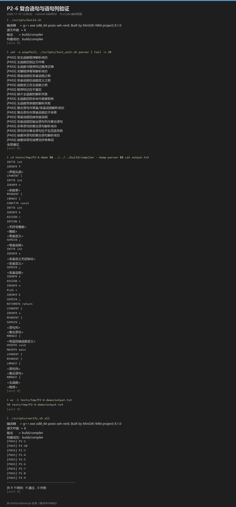

# P2-6 复合语句与语句列

## 1. 目的

实现复合语句与语句列：`<复合语句> ::= [<常量说明>] [<变量说明>] <语句列>`，在函数体与主函数中输出 `<语句列>`、`<复合语句>`。对应 TODO P2-6。

## 2. 环境

- 日期：2026-11-16
- 系统：Windows 11
- 工具链：g++ 8.1.0（MinGW-w64）、Git Bash 2.53.0、Python 3.14
- 代码版本：`b689650` 之后的工作区（本功能提交见 `git log --oneline --grep=P2-6`）

## 3. 前置条件

- P2-5 主函数与程序已完成；
- 函数体改为由 `<复合语句>` 解析，不再整体跳过。

## 4. 复现步骤

1. 构建：

```bash
./scripts/build.sh
```

2. 运行语法分析单元测试（完整 77 项，截图展示末尾 20 行）：

```bash
set -o pipefail; ./scripts/test_unit.sh parser | tail -n 20
```

3. 用函数体演示：

```bash
cd tests/tmp/P2-6-demo && ../../../build/compiler --dump-parser && cat output.txt
```

4. 确认行数：

```bash
wc -l tests/tmp/P2-6-demo/output.txt
```

5. 回归实验一：

```bash
./scripts/verify.sh all
```

## 5. 预期输出

构建与单元测试：

```text
$ ./scripts/build.sh
编译器    = g++.exe (x86_64-posix-seh-rev0, Built by MinGW-W64 project) 8.1.0
源文件数  = 6
输出      = build/compiler
构建成功：build/compiler
[exit 0]

$ set -o pipefail; ./scripts/test_unit.sh parser | tail -n 20
...（77 项断言，末 20 行；完整输出见 run.log 与截图）
全部通过
[exit 0]
```

函数体演示（50 行）：

```text
$ cd tests/tmp/P2-6-demo && ../../../build/compiler --dump-parser && cat output.txt
INTTK int
IDENFR f
<声明头部>
LPARENT (
INTTK int
IDENFR n
<参数表>
RPARENT )
LBRACE {
CONSTTK const
INTTK int
IDENFR k
ASSIGN =
INTCON 1
<无符号整数>
<整数>
<常量定义>
SEMICN ;
<常量说明>
INTTK int
IDENFR x
<变量定义无初始化>
<变量定义>
SEMICN ;
<变量说明>
IDENFR x
ASSIGN =
IDENFR n
PLUS +
IDENFR k
SEMICN ;
RETURNTK return
LPARENT (
IDENFR x
RPARENT )
SEMICN ;
<语句列>
<复合语句>
RBRACE }
<有返回值函数定义>
VOIDTK void
MAINTK main
LPARENT (
RPARENT )
LBRACE {
<语句列>
<复合语句>
RBRACE }
<主函数>
<程序>
[exit 0]

$ wc -l tests/tmp/P2-6-demo/output.txt
50 tests/tmp/P2-6-demo/output.txt
[exit 0]
```

回归：

```text
$ ./scripts/verify.sh all
...
共 9 个用例：9 通过，0 失败
[exit 0]
```

## 6. 截图



## 7. 备注

### 实现要点

- `parse_compound_statement_body()` 现在解析 `{ <复合语句> }`。
- `<复合语句>`：可选常量说明、可选变量说明、语句列；内容结束后输出 `<复合语句>`。
- `<语句列>`：解析完语句后输出；空语句列也会输出。
- 函数定义与主函数在右花括号前依次输出 `<语句列>`、`<复合语句>`，与官方 exp2 顺序一致。

### 语句占位

- 本阶段 `parse_statement_list()` 用 `skip_statement_temporarily()` 粗略跳过一个语句（按分号或花括号平衡），只输出原始单词，不输出 `<语句>` 及表达式成分名。
- P2-8～P2-12 会替换为真实语句解析，补齐 `<语句>`、`<赋值语句>`、`<写语句>`、`<表达式>` 等标记。

### 测试

- 语法分析单元测试累计 **77 项**，新增 8 项：复合语句内常量/变量说明、语句列位置、多语句、嵌套块语句。
- P2-4/P2-5 的空函数体期望值已同步加入 `<语句列>`、`<复合语句>`（新功能使期望输出自然扩展）。
- 实验一 9 个用例回归通过。
