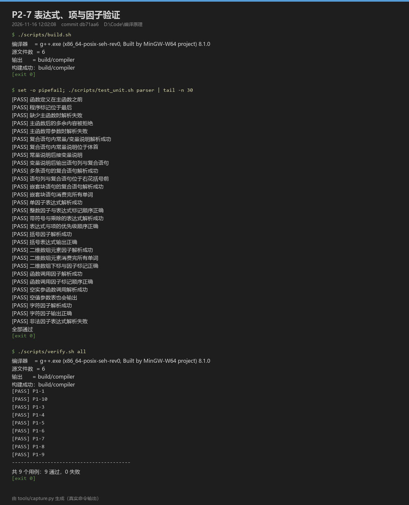

# P2-7 表达式、项与因子

## 1. 目的

实现表达式、项与因子，覆盖 7 种因子（标识符、一维/二维数组元素、括号表达式、整数、字符、有返回值函数调用），输出 `<因子>`、`<项>`、`<表达式>`、`<有返回值函数调用语句>`、`<值参数表>`。对应 TODO P2-7。

## 2. 环境

- 日期：2026-11-16
- 系统：Windows 11
- 工具链：g++ 8.1.0（MinGW-w64）、Git Bash 2.53.0、Python 3.14
- 代码版本：`db71aa6` 之后的工作区（本功能提交见 `git log --oneline --grep=P2-7`）

## 3. 前置条件

- P2-6 复合语句与语句列已完成；
- 表达式解析已可在单元测试中独立调用。

## 4. 复现步骤

1. 构建：

```bash
./scripts/build.sh
```

2. 运行语法分析单元测试（完整 93 项，截图展示末尾 30 行）：

```bash
set -o pipefail; ./scripts/test_unit.sh parser | tail -n 30
```

3. 回归实验一：

```bash
./scripts/verify.sh all
```

## 5. 预期输出

```text
$ ./scripts/build.sh
编译器    = g++.exe (x86_64-posix-seh-rev0, Built by MinGW-W64 project) 8.1.0
源文件数  = 6
输出      = build/compiler
构建成功：build/compiler
[exit 0]

$ set -o pipefail; ./scripts/test_unit.sh parser | tail -n 30
[PASS] 单因子表达式解析成功
[PASS] 整数因子与表达式标记顺序正确
[PASS] 带符号与乘除的表达式解析成功
[PASS] 表达式与项的优先级顺序正确
[PASS] 括号因子解析成功
[PASS] 括号表达式输出正确
[PASS] 二维数组元素因子解析成功
[PASS] 二维数组元素消费完所有单词
[PASS] 二维数组下标与因子标记正确
[PASS] 函数调用因子解析成功
[PASS] 函数调用因子标记顺序正确
[PASS] 空实参函数调用解析成功
[PASS] 空值参数表也会输出
[PASS] 字符因子解析成功
[PASS] 字符因子输出正确
[PASS] 非法因子表达式解析失败
全部通过
[exit 0]

$ ./scripts/verify.sh all
...
共 9 个用例：9 通过，0 失败
[exit 0]
```

## 6. 截图



## 7. 备注

### 实现的产生式

| 产生式 | 说明 |
|---|---|
| `<表达式>` | 可选前导 `+`/`-`，后接 `<项>`，可继续 `+/- <项>`；结束输出 `<表达式>` |
| `<项>` | `<因子>`，可继续 `*`/`/ <因子>`；结束输出 `<项>` |
| `<因子>` | 7 种形式，结束输出 `<因子>` |
| `<值参数表>` | 空，或 `<表达式> {, <表达式>}`；结束输出 `<值参数表>` |
| `<有返回值函数调用语句>` | 标识符 `(` 值参数表 `)`；结束输出 |

### 7 种因子

1. `<标识符>`
2. `<标识符>[<表达式>]`
3. `<标识符>[<表达式>][<表达式>]`
4. `(<表达式>)`
5. `<整数>`（内部输出 `<无符号整数>`、`<整数>`）
6. `<字符>`（不单独输出成分名）
7. `<有返回值函数调用语句>`

### 输出顺序

- `-1 + 2 * 3`：`<因子>/<项>`（1）→ `+` → `<因子>`（2）→ `*` → `<因子>`（3）→ `<项>` → `<表达式>`。
- `f(1, 2)`：参数表达式标记 → `<值参数表>` → `)` → `<有返回值函数调用语句>` → `<因子>` → `<项>` → `<表达式>`。
- 空实参 `f()` 同样输出 `<值参数表>`。

### 当前可见性

- 语句解析仍由占位逻辑跳过，因此表达式标记尚未出现在完整程序的 `--dump-parser` 输出中；P2-8 接入赋值/读写/返回语句后会自然显现。
- 单元测试通过精确字符串比对验证了标记顺序。

### 测试

- 语法分析单元测试累计 **93 项**，新增 16 项：整数/字符/括号/数组/函数调用因子、优先级、空实参、非法因子。
- 实验一 9 个用例回归通过。
