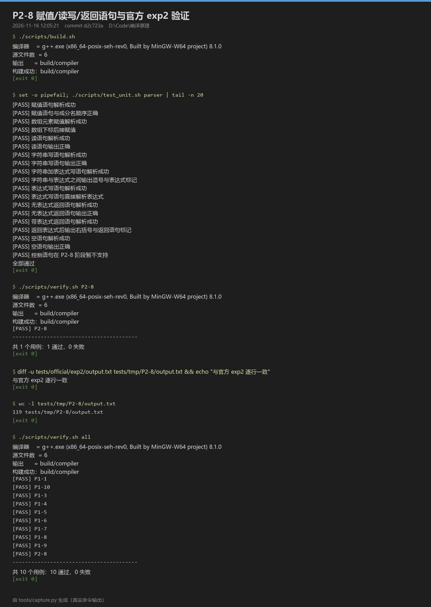

# P2-8 赋值、读、写、返回语句

## 1. 目的

实现语句分发与四类基本语句：赋值语句、读语句、写语句、返回语句；同时支持空语句与块语句。**本阶段解析器输出与官方 exp2 样例 119 行完全一致。** 对应 TODO P2-8。

## 2. 环境

- 日期：2026-11-16
- 系统：Windows 11
- 工具链：g++ 8.1.0（MinGW-w64）、Git Bash 2.53.0、Python 3.14
- 代码版本：`d2c723a` 之后的工作区（本功能提交见 `git log --oneline --grep=P2-8`）

## 3. 前置条件

- P2-7 表达式与因子已完成；
- 新增 `tests/cases/P2-8/`：输入与期望输出复制自官方 exp2。

## 4. 复现步骤

1. 构建：

```bash
./scripts/build.sh
```

2. 运行语法分析单元测试（完整 112 项，截图展示末尾 20 行）：

```bash
set -o pipefail; ./scripts/test_unit.sh parser | tail -n 20
```

3. 运行官方 exp2 用例：

```bash
./scripts/verify.sh P2-8
```

4. 与官方 exp2 逐行比对：

```bash
diff -u tests/official/exp2/output.txt tests/tmp/P2-8/output.txt && echo "与官方 exp2 逐行一致"
```

5. 确认行数并回归：

```bash
wc -l tests/tmp/P2-8/output.txt
./scripts/verify.sh all
```

## 5. 预期输出

```text
$ ./scripts/build.sh
编译器    = g++.exe (x86_64-posix-seh-rev0, Built by MinGW-W64 project) 8.1.0
源文件数  = 6
输出      = build/compiler
构建成功：build/compiler
[exit 0]

$ set -o pipefail; ./scripts/test_unit.sh parser | tail -n 20
[PASS] 赋值语句解析成功
[PASS] 赋值语句与成分名顺序正确
[PASS] 数组元素赋值解析成功
[PASS] 数组下标后接赋值
[PASS] 读语句解析成功
[PASS] 读语句输出正确
[PASS] 字符串写语句解析成功
[PASS] 字符串写语句输出正确
[PASS] 字符串加表达式写语句解析成功
[PASS] 字符串与表达式之间输出逗号与表达式标记
[PASS] 表达式写语句解析成功
[PASS] 表达式写语句直接解析表达式
[PASS] 无表达式返回语句解析成功
[PASS] 无表达式返回语句输出正确
[PASS] 带表达式返回语句解析成功
[PASS] 返回表达式后输出右括号与返回语句标记
[PASS] 空语句解析成功
[PASS] 空语句输出正确
[PASS] 控制语句在 P2-8 阶段暂不支持
全部通过
[exit 0]

$ ./scripts/verify.sh P2-8
编译器    = g++.exe (x86_64-posix-seh-rev0, Built by MinGW-W64 project) 8.1.0
源文件数  = 6
输出      = build/compiler
构建成功：build/compiler
[PASS] P2-8
----------------------------------------
共 1 个用例：1 通过，0 失败
[exit 0]

$ diff -u tests/official/exp2/output.txt tests/tmp/P2-8/output.txt && echo "与官方 exp2 逐行一致"
与官方 exp2 逐行一致
[exit 0]

$ wc -l tests/tmp/P2-8/output.txt
119 tests/tmp/P2-8/output.txt
[exit 0]

$ ./scripts/verify.sh all
...
共 10 个用例：10 通过，0 失败
[exit 0]
```

## 6. 截图



## 7. 备注

### 实现的语句

| 语句 | 产生式要点 | 标记 |
|---|---|---|
| 赋值 | 标识符（可带一维/二维下标）`=` 表达式 | `<赋值语句>` |
| 读 | `scanf ( 标识符 )` | `<读语句>` |
| 写 | `printf ( 字符串[, 表达式] )` 或 `printf ( 表达式 )` | `<字符串>`、`<写语句>` |
| 返回 | `return [ ( 表达式 ) ]` | `<返回语句>` |
| 空语句 | `;` | 仅 `<语句>` |
| 块语句 | `{ <语句列> }` | `<语句列>`、`<语句>` |

- 每条语句的 `;` 由 `<语句>` 层消费；`<语句>` 在分号之后输出。
- 写语句三种形式均已支持，字符串后可选逗号 + 表达式。

### 官方样例

- `tests/cases/P2-8/` 直接复制官方 exp2 输入与 119 行期望输出，`verify.sh P2-8` 通过。
- 由于官方样例不包含控制语句，P2-9～P2-12 的后续实现不会改变该用例结果。

### 尚未实现

- 条件语句（P2-9）、循环语句（P2-10）、情况语句（P2-11）、函数调用语句（P2-12）。
- 这些语句尚未出现在输出中；遇到时会报“暂不支持的语句”。

### 测试

- 语法分析单元测试累计 **112 项**，新增 19 项：赋值、数组赋值、读、三种写语句、两种返回、空语句、控制语句暂不支持。
- 端到端用例累计 10 个，全部通过。
