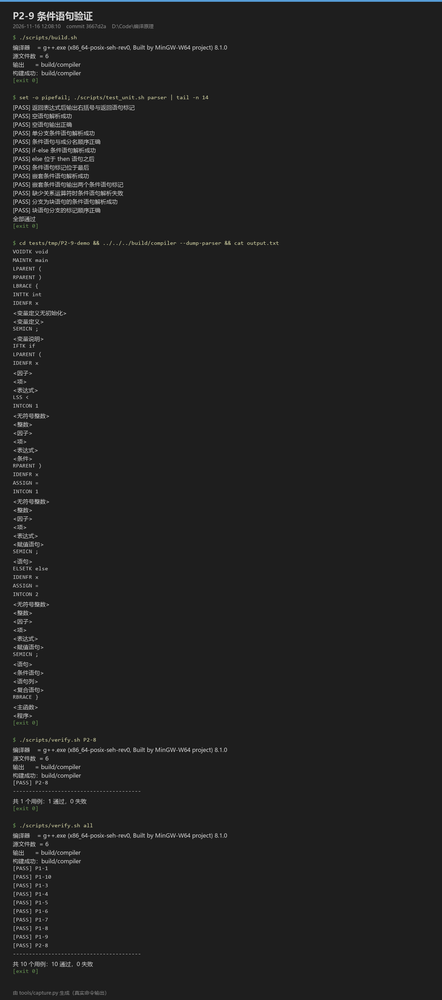

# P2-9 条件语句

## 1. 目的

实现条件语句：`if ( <条件> ) <语句> [ else <语句> ]`，支持 6 种关系运算符与悬空 else 的最近匹配；输出 `<条件>` 与 `<条件语句>`。对应 TODO P2-9。

## 2. 环境

- 日期：2026-11-16
- 系统：Windows 11
- 工具链：g++ 8.1.0（MinGW-w64）、Git Bash 2.53.0、Python 3.14
- 代码版本：`3667d2a` 之后的工作区（本功能提交见 `git log --oneline --grep=P2-9`）

## 3. 前置条件

- P2-8 基本语句已完成；
- 官方 exp2 用例（P2-8）保持通过。

## 4. 复现步骤

1. 构建：

```bash
./scripts/build.sh
```

2. 运行语法分析单元测试（完整 121 项，截图展示末尾 14 行）：

```bash
set -o pipefail; ./scripts/test_unit.sh parser | tail -n 14
```

3. 条件语句演示：

```bash
cd tests/tmp/P2-9-demo && ../../../build/compiler --dump-parser && cat output.txt
```

4. 回归官方 exp2 与全部用例：

```bash
./scripts/verify.sh P2-8
./scripts/verify.sh all
```

## 5. 预期输出

```text
$ ./scripts/build.sh
编译器    = g++.exe (x86_64-posix-seh-rev0, Built by MinGW-W64 project) 8.1.0
源文件数  = 6
输出      = build/compiler
构建成功：build/compiler
[exit 0]

$ set -o pipefail; ./scripts/test_unit.sh parser | tail -n 14
...（121 项断言，末尾 14 行；完整输出见 run.log 与截图）
全部通过
[exit 0]

$ cd tests/tmp/P2-9-demo && ../../../build/compiler --dump-parser && cat output.txt
VOIDTK void
MAINTK main
LPARENT (
RPARENT )
LBRACE {
INTTK int
IDENFR x
<变量定义无初始化>
<变量定义>
SEMICN ;
<变量说明>
IFTK if
LPARENT (
IDENFR x
<因子>
<项>
<表达式>
LSS <
INTCON 1
<无符号整数>
<整数>
<因子>
<项>
<表达式>
<条件>
RPARENT )
IDENFR x
ASSIGN =
INTCON 1
<无符号整数>
<整数>
<因子>
<项>
<表达式>
<赋值语句>
SEMICN ;
<语句>
ELSETK else
IDENFR x
ASSIGN =
INTCON 2
<无符号整数>
<整数>
<因子>
<项>
<表达式>
<赋值语句>
SEMICN ;
<语句>
<条件语句>
<语句列>
<复合语句>
RBRACE }
<主函数>
<程序>
[exit 0]

$ ./scripts/verify.sh P2-8
[PASS] P2-8
共 1 个用例：1 通过，0 失败
[exit 0]

$ ./scripts/verify.sh all
...
共 10 个用例：10 通过，0 失败
[exit 0]
```

## 6. 截图



## 7. 备注

### 实现要点

- `parse_condition()`：`<表达式> <关系运算符> <表达式>`，关系运算符为 `< <= > >= == !=`；第二表达式后输出 `<条件>`。
- `parse_conditional_statement()`：`if` `(` 条件 `)` 语句 [else 语句]；整个语句结束后输出 `<条件语句>`。
- then/else 分支通过 `parse_statement()` 解析，因此分支可以是赋值、读写、返回、块语句或嵌套条件语句。
- 悬空 else 由递归下降自然实现“最近匹配”：`if (a) if (b) x=1; else x=2;` 中 else 属于内层 if。

### 输出顺序

```
IFTK if
LPARENT (
... 条件表达式 ...
<条件>
RPARENT )
... then 语句 ...
<语句>
ELSETK else          // 可选
... else 语句 ...
<语句>
<条件语句>
```

### 回归

- 官方 exp2 用例 `verify.sh P2-8` 仍然通过（样例不含条件语句）。
- 全部 10 个端到端用例通过。

### 测试

- 语法分析单元测试累计 **121 项**，新增 9 项：单分支、if-else、else 位置、嵌套条件、缺少关系运算符、块语句分支。
