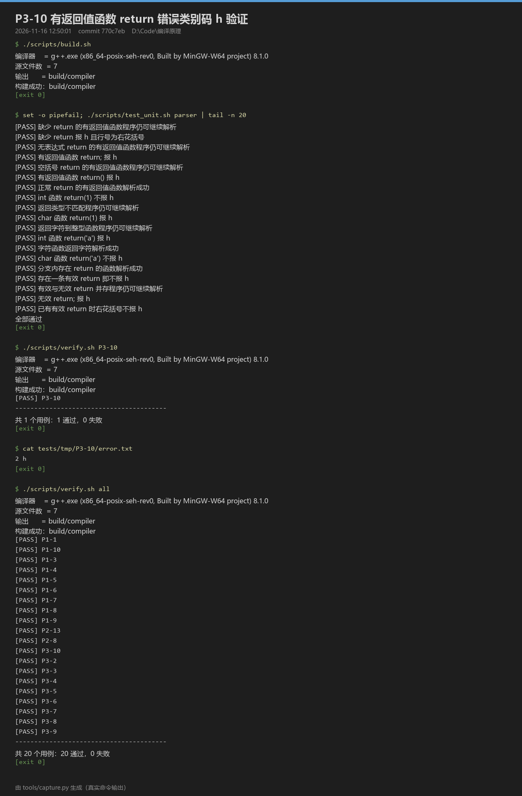

# P3-10 有返回值函数的 return 错误（类别码 h）

## 1. 目的

对有返回值函数检查 return：完全缺少 return、`return;`、`return();`、表达式类型与返回值不一致均报 `h`；缺少 return 的行号取函数末尾 `}` 的行号。对应 TODO P3-10。

## 2. 环境

- 日期：2026-11-16
- 系统：Windows 11
- 工具链：g++ 8.1.0（MinGW-w64）、Git Bash 2.53.0、Python 3.14
- 代码版本：`770c7eb` 之后的工作区（本功能提交见 `git log --oneline --grep=P3-10`）

## 3. 前置条件

- P3-9 无返回值 return 检查已完成；
- 新增 `tests/cases/P3-10/`（int 函数没有 return）。

## 4. 复现步骤

1. 构建：

```bash
./scripts/build.sh
```

2. 运行语法/语义单元测试（完整 254 项，截图展示末尾 20 行）：

```bash
set -o pipefail; ./scripts/test_unit.sh parser | tail -n 20
```

3. 运行 P3-10 用例：

```bash
./scripts/verify.sh P3-10
```

4. 查看 `error.txt`：

```bash
cat tests/tmp/P3-10/error.txt
```

5. 回归：

```bash
./scripts/verify.sh all
```

## 5. 预期输出

```text
$ ./scripts/build.sh
编译器    = g++.exe (x86_64-posix-seh-rev0, Built by MinGW-W64 project) 8.1.0
源文件数  = 7
输出      = build/compiler
构建成功：build/compiler
[exit 0]

$ set -o pipefail; ./scripts/test_unit.sh parser | tail -n 20
...（254 项断言，末尾 20 行；完整输出见 run.log 与截图）
全部通过
[exit 0]

$ ./scripts/verify.sh P3-10
...
[PASS] P3-10
共 1 个用例：1 通过，0 失败
[exit 0]

$ cat tests/tmp/P3-10/error.txt
2 h
[exit 0]

$ ./scripts/verify.sh all
...
共 20 个用例：20 通过，0 失败
[exit 0]
```

## 6. 截图



## 7. 备注

### 检查规则

| 情况 | 结果 |
|---|---|
| 有返回值函数没有任何 return | h，行号取函数末尾 `}` |
| `return;` | h，行号取 `return` |
| `return();` | h，行号取 `return` |
| `return(表达式)` 类型与返回值不一致 | h，行号取 `return` |
| 至少出现一条带表达式的 `return` | 不报缺少 return 的 h |

- 只要函数体中出现任意 return 语句，就不再报“缺少 return”，避免同一问题重复两次。
- 类型比较遵循 P3-7 的表达式类型规则（括号内字符视为整型）。
- 无返回值函数不受影响（P3-9 的 g 规则）。

### 用例

```c
int f(){
}
void main(){
}
```

`f` 有返回值但没有 return，`error.txt` 为 `2 h`（`}` 所在行）。

### 测试

- 新增 19 项单元测试：缺少 return、`return;`、`return();`、类型匹配/不匹配、分支内 return、多 return 并存。
- 语法/语义单元测试累计 254 项；端到端用例 20 个。
