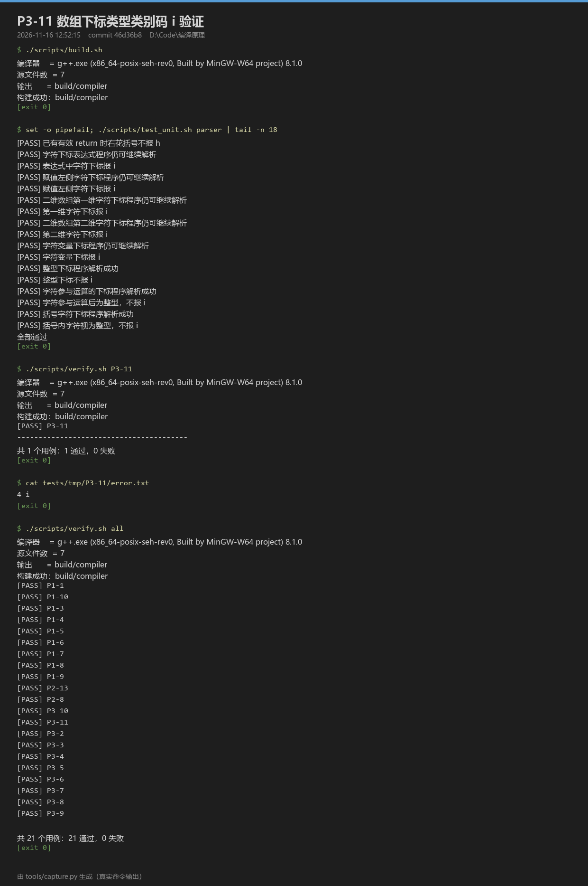

# P3-11 数组下标类型（类别码 i）

## 1. 目的

数组元素的一维/二维下标表达式必须是整型；字符型下标输出类别码 `i`。对应 TODO P3-11。

## 2. 环境

- 日期：2026-11-16
- 系统：Windows 11
- 工具链：g++ 8.1.0（MinGW-w64）、Git Bash 2.53.0、Python 3.14
- 代码版本：`46d36b8` 之后的工作区（本功能提交见 `git log --oneline --grep=P3-11`）

## 3. 前置条件

- P3-10 有返回值函数 return 检查已完成；
- 新增 `tests/cases/P3-11/`（字符下标）。

## 4. 复现步骤

1. 构建：

```bash
./scripts/build.sh
```

2. 运行语法/语义单元测试（完整 270 项，截图展示末尾 18 行）：

```bash
set -o pipefail; ./scripts/test_unit.sh parser | tail -n 18
```

3. 运行 P3-11 用例：

```bash
./scripts/verify.sh P3-11
```

4. 查看 `error.txt`：

```bash
cat tests/tmp/P3-11/error.txt
```

5. 回归：

```bash
./scripts/verify.sh all
```

## 5. 预期输出

```text
$ ./scripts/build.sh
编译器    = g++.exe (x86_64-posix-seh-rev0, Built by MinGW-W64 project) 8.1.0
源文件数  = 7
输出      = build/compiler
构建成功：build/compiler
[exit 0]

$ set -o pipefail; ./scripts/test_unit.sh parser | tail -n 18
...（270 项断言，末尾 18 行；完整输出见 run.log 与截图）
全部通过
[exit 0]

$ ./scripts/verify.sh P3-11
...
[PASS] P3-11
共 1 个用例：1 通过，0 失败
[exit 0]

$ cat tests/tmp/P3-11/error.txt
4 i
[exit 0]

$ ./scripts/verify.sh all
...
共 21 个用例：21 通过，0 失败
[exit 0]
```

## 6. 截图



## 7. 备注

### 检查位置

- 表达式因子中的数组元素（一维/二维）。
- 赋值语句左侧的数组元素（一维/二维）。
- 每个下标分别检查，类型取 P3-7 的表达式类型规则。

### 规则

| 下标表达式 | 结果 |
|---|---|
| 整型变量/整数/整型运算 | 合法 |
| 字符变量、字符字面量、char 函数调用 | `i` |
| 字符参与算术运算（`'x' + 1`） | 合法（结果为 int） |
| 括号内字符（`(c)`） | 合法（结果为 int） |

- 行号取下标的 `[` 所在行。

### 用例

```c
int a[2];
void main(){
    int x;
    x = a['x'];
}
```

字符字面量作为下标，`error.txt` 为 `4 i`。

### 测试

- 新增 16 项单元测试：表达式/赋值左侧、一维/二维两维、字符变量、整型下标、字符运算与括号转换。
- 语法/语义单元测试累计 270 项；端到端用例 21 个。
