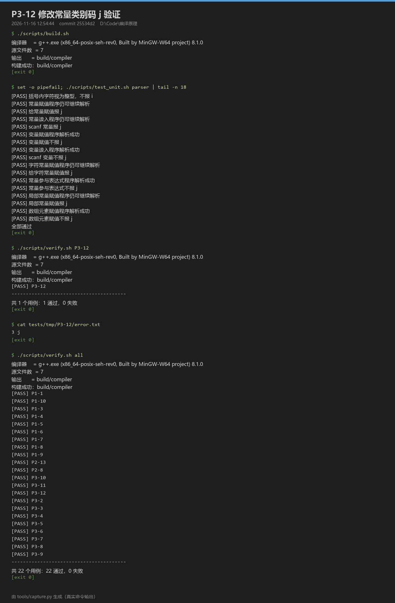

# P3-12 修改常量（类别码 j）

## 1. 目的

对声明为 `const` 的标识符检测修改行为：赋值或 `scanf` 读取常量输出类别码 `j`。对应 TODO P3-12。

## 2. 环境

- 日期：2026-11-16
- 系统：Windows 11
- 工具链：g++ 8.1.0（MinGW-w64）、Git Bash 2.53.0、Python 3.14
- 代码版本：`25534d2` 之后的工作区（本功能提交见 `git log --oneline --grep=P3-12`）

## 3. 前置条件

- P3-11 数组下标检查已完成；
- 新增 `tests/cases/P3-12/`（给全局常量赋值）。

## 4. 复现步骤

1. 构建：

```bash
./scripts/build.sh
```

2. 运行语法/语义单元测试（完整 286 项，截图展示末尾 18 行）：

```bash
set -o pipefail; ./scripts/test_unit.sh parser | tail -n 18
```

3. 运行 P3-12 用例：

```bash
./scripts/verify.sh P3-12
```

4. 查看 `error.txt`：

```bash
cat tests/tmp/P3-12/error.txt
```

5. 回归：

```bash
./scripts/verify.sh all
```

## 5. 预期输出

```text
$ ./scripts/build.sh
编译器    = g++.exe (x86_64-posix-seh-rev0, Built by MinGW-W64 project) 8.1.0
源文件数  = 7
输出      = build/compiler
构建成功：build/compiler
[exit 0]

$ set -o pipefail; ./scripts/test_unit.sh parser | tail -n 18
...（286 项断言，末尾 18 行；完整输出见 run.log 与截图）
全部通过
[exit 0]

$ ./scripts/verify.sh P3-12
...
[PASS] P3-12
共 1 个用例：1 通过，0 失败
[exit 0]

$ cat tests/tmp/P3-12/error.txt
3 j
[exit 0]

$ ./scripts/verify.sh all
...
共 22 个用例：22 通过，0 失败
[exit 0]
```

## 6. 截图



## 7. 备注

### 检查位置

| 位置 | 处理 |
|---|---|
| 赋值语句左侧 | 符号为 `Constant` → j |
| `scanf` 参数 | 符号为 `Constant` → j |
| 表达式中的常量使用 | 合法，不报 j |

- 未定义的名字先报 `c`，不再报 `j`。
- 行号取常量名所在行。

### 用例

```c
const int N = 1;
void main(){
    N = 2;
}
```

`error.txt` 为 `3 j`。

### 测试

- 新增 17 项单元测试：全局/局部常量赋值、scanf 常量、变量与数组元素不报错、常量参与表达式。
- 语法/语义单元测试累计 286 项；端到端用例 22 个。
