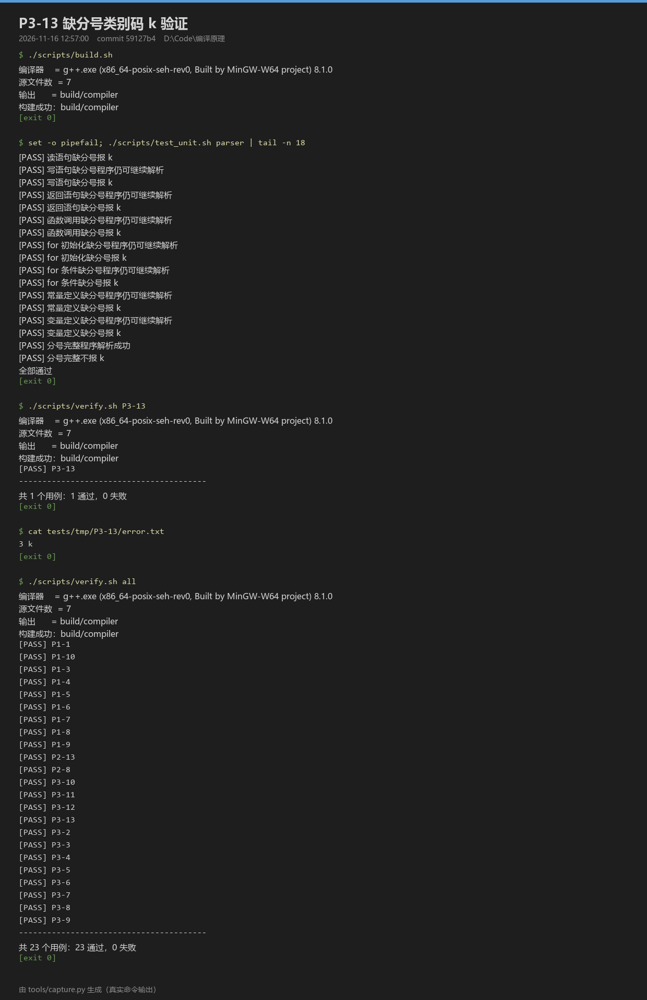

# P3-13 缺分号（类别码 k）

## 1. 目的

覆盖所有要求分号的上下文：常量/变量定义末尾、赋值/读/写/返回/函数调用语句末尾、for 的初始化与条件之后；缺少分号输出类别码 `k`。对应 TODO P3-13。

## 2. 环境

- 日期：2026-11-16
- 系统：Windows 11
- 工具链：g++ 8.1.0（MinGW-w64）、Git Bash 2.53.0、Python 3.14
- 代码版本：`59127b4` 之后的工作区（本功能提交见 `git log --oneline --grep=P3-13`）

## 3. 前置条件

- P3-12 修改常量检查已完成；
- 新增 `tests/cases/P3-13/`（赋值语句缺分号）。

## 4. 复现步骤

1. 构建：

```bash
./scripts/build.sh
```

2. 运行语法/语义单元测试（完整 304 项，截图展示末尾 18 行）：

```bash
set -o pipefail; ./scripts/test_unit.sh parser | tail -n 18
```

3. 运行 P3-13 用例：

```bash
./scripts/verify.sh P3-13
```

4. 查看 `error.txt`：

```bash
cat tests/tmp/P3-13/error.txt
```

5. 回归：

```bash
./scripts/verify.sh all
```

## 5. 预期输出

```text
$ ./scripts/build.sh
编译器    = g++.exe (x86_64-posix-seh-rev0, Built by MinGW-W64 project) 8.1.0
源文件数  = 7
输出      = build/compiler
构建成功：build/compiler
[exit 0]

$ set -o pipefail; ./scripts/test_unit.sh parser | tail -n 18
...（304 项断言，末尾 18 行；完整输出见 run.log 与截图）
全部通过
[exit 0]

$ ./scripts/verify.sh P3-13
...
[PASS] P3-13
共 1 个用例：1 通过，0 失败
[exit 0]

$ cat tests/tmp/P3-13/error.txt
3 k
[exit 0]

$ ./scripts/verify.sh all
...
共 23 个用例：23 通过，0 失败
[exit 0]
```

## 6. 截图



## 7. 备注

### 覆盖的上下文

| 上下文 | 示例 |
|---|---|
| 常量定义末尾 | `const int A = 1` 后缺 `;` |
| 变量定义末尾 | `int x` 后缺 `;` |
| 赋值语句 | `x = 1` 后缺 `;` |
| 读语句 | `scanf(x)` 后缺 `;` |
| 写语句 | `printf(x)` 后缺 `;` |
| 返回语句 | `return(1)` 后缺 `;` |
| 函数调用语句 | `g()` 后缺 `;` |
| for 初始化 | `for (i = 0 i < 3; ...)` |
| for 条件 | `for (i = 0; i < 3 i = i + 1)` |

### 行号规则

- `k` 的行号取**前一个已消费单词**所在行，即缺少分号处的语句末尾。
- 报告后“假装分号存在”继续解析，避免级联。

### 用例

```c
void main(){
    int x;
    x = 1
    x = 2;
}
```

第 3 行赋值缺少分号，`error.txt` 为 `3 k`。

### 测试

- 新增 18 项单元测试：9 种上下文 + 完整分号不报错。
- 语法/语义单元测试累计 304 项；端到端用例 23 个。
