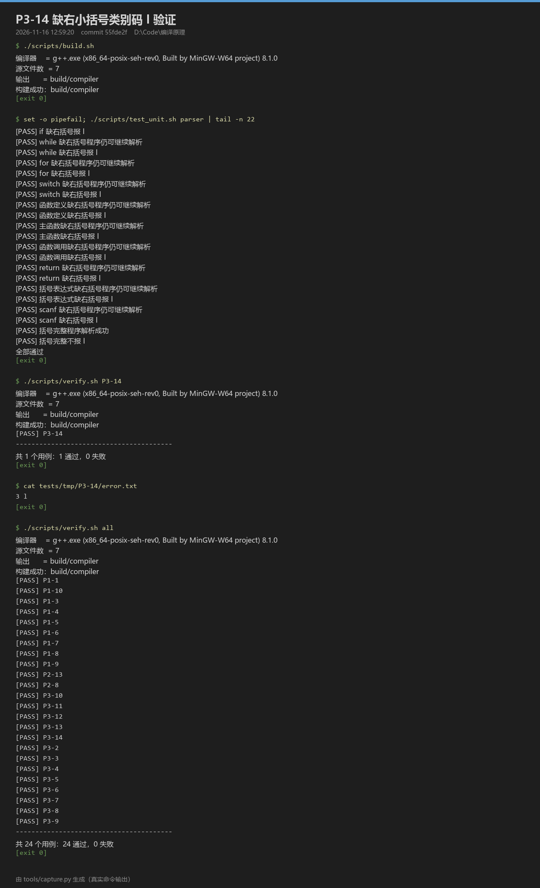

# P3-14 缺右小括号（类别码 l）

## 1. 目的

覆盖所有需要右小括号的上下文：函数/主函数定义、括号表达式、if/while/for/switch、函数调用、读写与 return；缺少 `)` 输出类别码 `l`。对应 TODO P3-14。

## 2. 环境

- 日期：2026-11-16
- 系统：Windows 11
- 工具链：g++ 8.1.0（MinGW-w64）、Git Bash 2.53.0、Python 3.14
- 代码版本：`55fde2f` 之后的工作区（本功能提交见 `git log --oneline --grep=P3-14`）

## 3. 前置条件

- P3-13 缺分号检查已完成；
- 新增 `tests/cases/P3-14/`（printf 缺右括号）。

## 4. 复现步骤

1. 构建：

```bash
./scripts/build.sh
```

2. 运行语法/语义单元测试（完整 326 项，截图展示末尾 22 行）：

```bash
set -o pipefail; ./scripts/test_unit.sh parser | tail -n 22
```

3. 运行 P3-14 用例：

```bash
./scripts/verify.sh P3-14
```

4. 查看 `error.txt`：

```bash
cat tests/tmp/P3-14/error.txt
```

5. 回归：

```bash
./scripts/verify.sh all
```

## 5. 预期输出

```text
$ ./scripts/build.sh
编译器    = g++.exe (x86_64-posix-seh-rev0, Built by MinGW-W64 project) 8.1.0
源文件数  = 7
输出      = build/compiler
构建成功：build/compiler
[exit 0]

$ set -o pipefail; ./scripts/test_unit.sh parser | tail -n 22
...（326 项断言，末尾 22 行；完整输出见 run.log 与截图）
全部通过
[exit 0]

$ ./scripts/verify.sh P3-14
...
[PASS] P3-14
共 1 个用例：1 通过，0 失败
[exit 0]

$ cat tests/tmp/P3-14/error.txt
3 l
[exit 0]

$ ./scripts/verify.sh all
...
共 24 个用例：24 通过，0 失败
[exit 0]
```

## 6. 截图



## 7. 备注

### 覆盖的上下文

| 上下文 | 示例 |
|---|---|
| 有/无返回值函数定义 | `int f(int a {` |
| 主函数 | `void main( {` |
| 括号表达式 | `x = (1 + 2;` |
| if / while / for / switch | `if (x < 1 {` 等 |
| 函数调用 | `g(1;` |
| 读/写语句 | `scanf(x;`、`printf(x;` |
| return | `return(1;` |

### 行号与恢复

- `l` 的行号取**前一个已消费单词**所在行。
- 报告后假装 `)` 存在并继续解析，避免级联。

### 用例

```c
void main(){
    int x;
    printf(x;
}
```

`printf` 缺少右括号，`error.txt` 为 `3 l`。

### 测试

- 新增 22 项单元测试：函数/主函数、控制语句、调用、读写、return、括号表达式与完整括号对照。
- 语法/语义单元测试累计 326 项；端到端用例 24 个。
