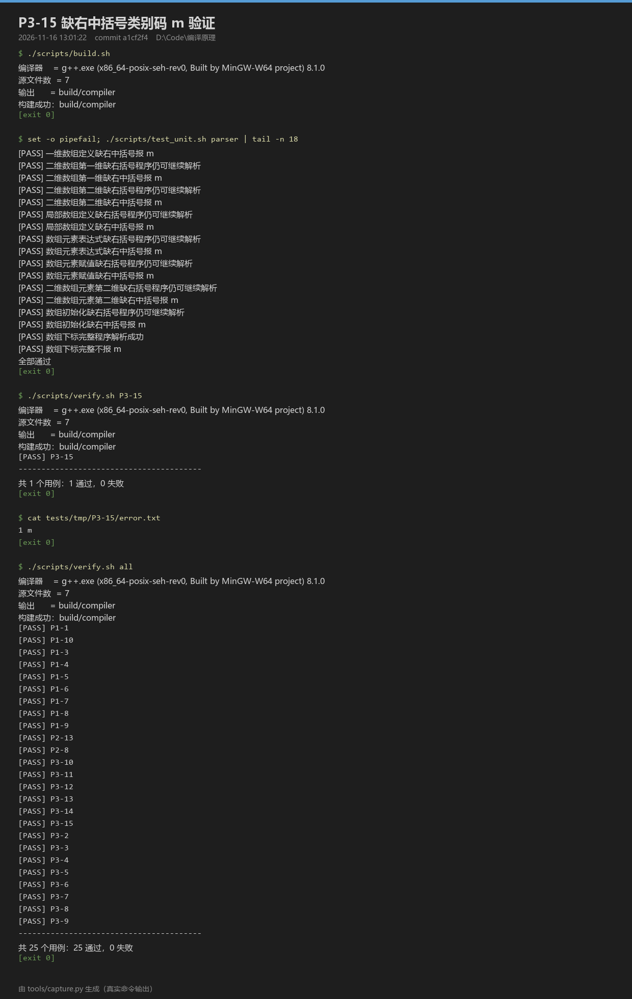

# P3-15 缺右中括号（类别码 m）

## 1. 目的

覆盖数组相关上下文中缺少 `]` 的情况：一维/二维数组定义（含初始化、局部/全局）与数组元素（表达式因子、赋值左侧、二维第二维），输出类别码 `m`。对应 TODO P3-15。

## 2. 环境

- 日期：2026-11-16
- 系统：Windows 11
- 工具链：g++ 8.1.0（MinGW-w64）、Git Bash 2.53.0、Python 3.14
- 代码版本：`a1cf2f4` 之后的工作区（本功能提交见 `git log --oneline --grep=P3-15`）

## 3. 前置条件

- P3-14 缺右小括号检查已完成；
- 新增 `tests/cases/P3-15/`（全局数组定义缺 `]`）。

## 4. 复现步骤

1. 构建：

```bash
./scripts/build.sh
```

2. 运行语法/语义单元测试（完整 344 项，截图展示末尾 18 行）：

```bash
set -o pipefail; ./scripts/test_unit.sh parser | tail -n 18
```

3. 运行 P3-15 用例：

```bash
./scripts/verify.sh P3-15
```

4. 查看 `error.txt`：

```bash
cat tests/tmp/P3-15/error.txt
```

5. 回归：

```bash
./scripts/verify.sh all
```

## 5. 预期输出

```text
$ ./scripts/build.sh
编译器    = g++.exe (x86_64-posix-seh-rev0, Built by MinGW-W64 project) 8.1.0
源文件数  = 7
输出      = build/compiler
构建成功：build/compiler
[exit 0]

$ set -o pipefail; ./scripts/test_unit.sh parser | tail -n 18
...（344 项断言，末尾 18 行；完整输出见 run.log 与截图）
全部通过
[exit 0]

$ ./scripts/verify.sh P3-15
...
[PASS] P3-15
共 1 个用例：1 通过，0 失败
[exit 0]

$ cat tests/tmp/P3-15/error.txt
1 m
[exit 0]

$ ./scripts/verify.sh all
...
共 25 个用例：25 通过，0 失败
[exit 0]
```

## 6. 截图



## 7. 备注

### 覆盖的上下文

| 上下文 | 示例 |
|---|---|
| 一维数组定义 | `int a[2;` |
| 二维数组第一维 | `int a[2[3];` |
| 二维数组第二维 | `int a[2][3;` |
| 局部数组定义 | 函数体内同上 |
| 数组元素（表达式） | `x = a[1;` |
| 数组元素（赋值左侧） | `a[1 = 2;` |
| 二维数组元素第二维 | `x = a[1][2;` |
| 数组初始化定义 | `int a[2 = {1, 2};` |

### 行号与恢复

- `m` 的行号取**前一个已消费单词**所在行。
- 报告后假装 `]` 存在并继续解析，避免级联。

### 用例

```c
int a[2;
void main(){
}
```

`error.txt` 为 `1 m`。

### 测试

- 新增 18 项单元测试：全局/局部数组、一维/二维、初始化、元素表达式与赋值、完整下标对照。
- 语法/语义单元测试累计 344 项；端到端用例 25 个。
