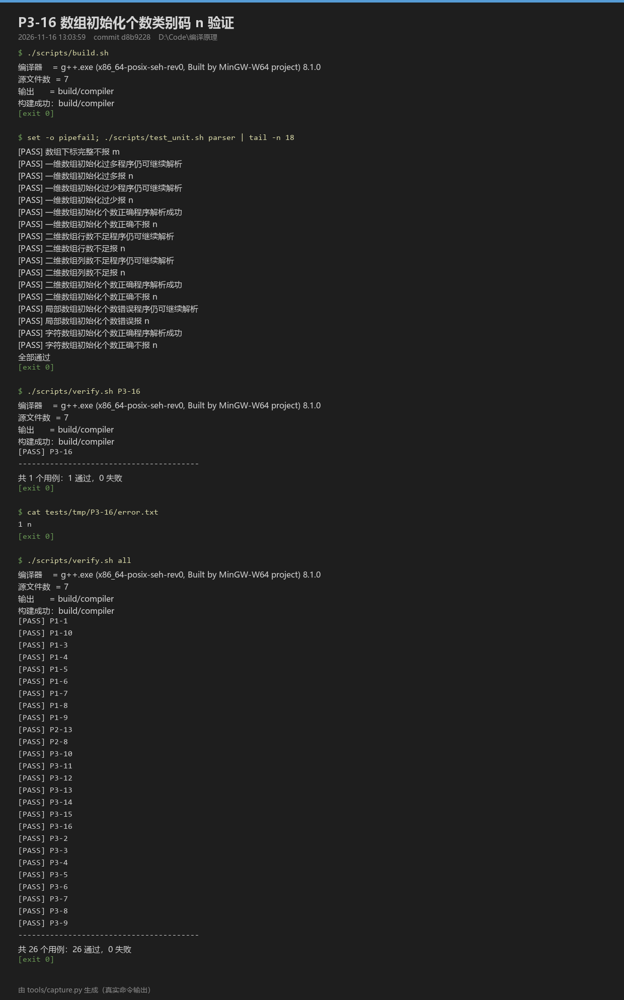

# P3-16 数组初始化个数不匹配（类别码 n）

## 1. 目的

记录数组各维声明的大小，检查初始化列表中每一维的元素个数；不匹配输出类别码 `n`。对应 TODO P3-16。

## 2. 环境

- 日期：2026-11-16
- 系统：Windows 11
- 工具链：g++ 8.1.0（MinGW-w64）、Git Bash 2.53.0、Python 3.14
- 代码版本：`d8b9228` 之后的工作区（本功能提交见 `git log --oneline --grep=P3-16`）

## 3. 前置条件

- P3-15 缺右中括号检查已完成；
- 新增 `tests/cases/P3-16/`（一维数组初始化过多）。

## 4. 复现步骤

1. 构建：

```bash
./scripts/build.sh
```

2. 运行语法/语义单元测试（完整 360 项，截图展示末尾 18 行）：

```bash
set -o pipefail; ./scripts/test_unit.sh parser | tail -n 18
```

3. 运行 P3-16 用例：

```bash
./scripts/verify.sh P3-16
```

4. 查看 `error.txt`：

```bash
cat tests/tmp/P3-16/error.txt
```

5. 回归：

```bash
./scripts/verify.sh all
```

## 5. 预期输出

```text
$ ./scripts/build.sh
编译器    = g++.exe (x86_64-posix-seh-rev0, Built by MinGW-W64 project) 8.1.0
源文件数  = 7
输出      = build/compiler
构建成功：build/compiler
[exit 0]

$ set -o pipefail; ./scripts/test_unit.sh parser | tail -n 18
...（360 项断言，末尾 18 行；完整输出见 run.log 与截图）
全部通过
[exit 0]

$ ./scripts/verify.sh P3-16
...
[PASS] P3-16
共 1 个用例：1 通过，0 失败
[exit 0]

$ cat tests/tmp/P3-16/error.txt
1 n
[exit 0]

$ ./scripts/verify.sh all
...
共 26 个用例：26 通过，0 失败
[exit 0]
```

## 6. 截图



## 7. 备注

### 检查规则

- 解析数组声明时记录每一维的大小（`<无符号整数>` 的数值）。
- 一维初始化：`{ 常量, ... }` 的元素个数必须等于声明大小。
- 二维初始化：外层行数等于第一维，每个内层 `{ ... }` 的元素个数等于第二维。
- 任一维度不匹配只报一次 `n`，行号取数组名所在行。

### 用例

```c
int a[2] = {1, 2, 3};
void main(){
}
```

声明 2 个元素却初始化 3 个，`error.txt` 为 `1 n`。

### 测试

- 新增 17 项单元测试：一维过多/过少/正确、二维行数/列数/正确、局部数组、字符数组。
- 语法/语义单元测试累计 360 项；端到端用例 26 个。
