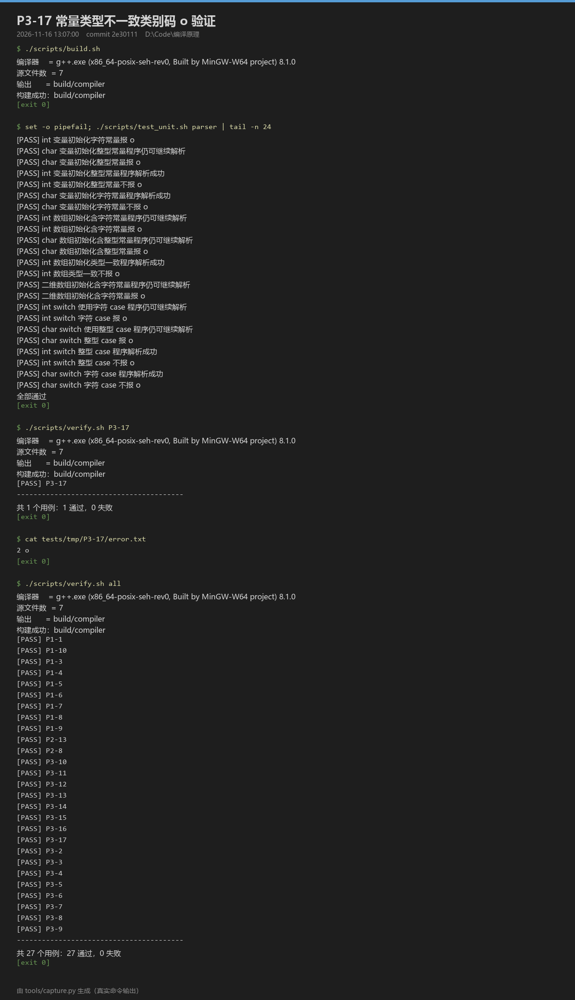

# P3-17 `<常量>` 类型不一致（类别码 o）

## 1. 目的

检查变量/数组初始化中常量的类型是否与声明类型一致，以及 switch 的 case 常量类型是否与 switch 表达式类型一致；不一致输出类别码 `o`。对应 TODO P3-17。

## 2. 环境

- 日期：2026-11-16
- 系统：Windows 11
- 工具链：g++ 8.1.0（MinGW-w64）、Git Bash 2.53.0、Python 3.14
- 代码版本：`2e30111` 之后的工作区（本功能提交见 `git log --oneline --grep=P3-17`）

## 3. 前置条件

- P3-16 数组初始化个数检查已完成；
- 新增 `tests/cases/P3-17/`（int 变量用字符常量初始化）。

## 4. 复现步骤

1. 构建：

```bash
./scripts/build.sh
```

2. 运行语法/语义单元测试（完整 384 项，截图展示末尾 24 行）：

```bash
set -o pipefail; ./scripts/test_unit.sh parser | tail -n 24
```

3. 运行 P3-17 用例：

```bash
./scripts/verify.sh P3-17
```

4. 查看 `error.txt`：

```bash
cat tests/tmp/P3-17/error.txt
```

5. 回归：

```bash
./scripts/verify.sh all
```

## 5. 预期输出

```text
$ ./scripts/build.sh
编译器    = g++.exe (x86_64-posix-seh-rev0, Built by MinGW-W64 project) 8.1.0
源文件数  = 7
输出      = build/compiler
构建成功：build/compiler
[exit 0]

$ set -o pipefail; ./scripts/test_unit.sh parser | tail -n 24
...（384 项断言，末尾 24 行；完整输出见 run.log 与截图）
全部通过
[exit 0]

$ ./scripts/verify.sh P3-17
...
[PASS] P3-17
共 1 个用例：1 通过，0 失败
[exit 0]

$ cat tests/tmp/P3-17/error.txt
2 o
[exit 0]

$ ./scripts/verify.sh all
...
共 27 个用例：27 通过，0 失败
[exit 0]
```

## 6. 截图



## 7. 备注

### 检查位置

| 位置 | 规则 |
|---|---|
| 简单变量初始化 | 常量类型必须等于变量声明类型 |
| 一维/二维数组初始化 | 每个常量类型必须等于数组元素类型 |
| switch 的 case 常量 | 常量类型必须等于 switch 表达式类型 |

- `parse_constant()` 记录常量类型（整数 → int，字符 → char）。
- 变量初始化检查在声明处；switch 检查在 `case` 行。
- 类型未知（表达式本身有错误）时跳过。

### 用例

```c
void main(){
    int x = 'a';
}
```

int 变量用字符常量初始化，`error.txt` 为 `2 o`。

### 测试

- 新增 25 项单元测试：简单变量/一维/二维数组、双向类型不匹配、switch int/char 双向与一致情况。
- 语法/语义单元测试累计 384 项；端到端用例 27 个。
