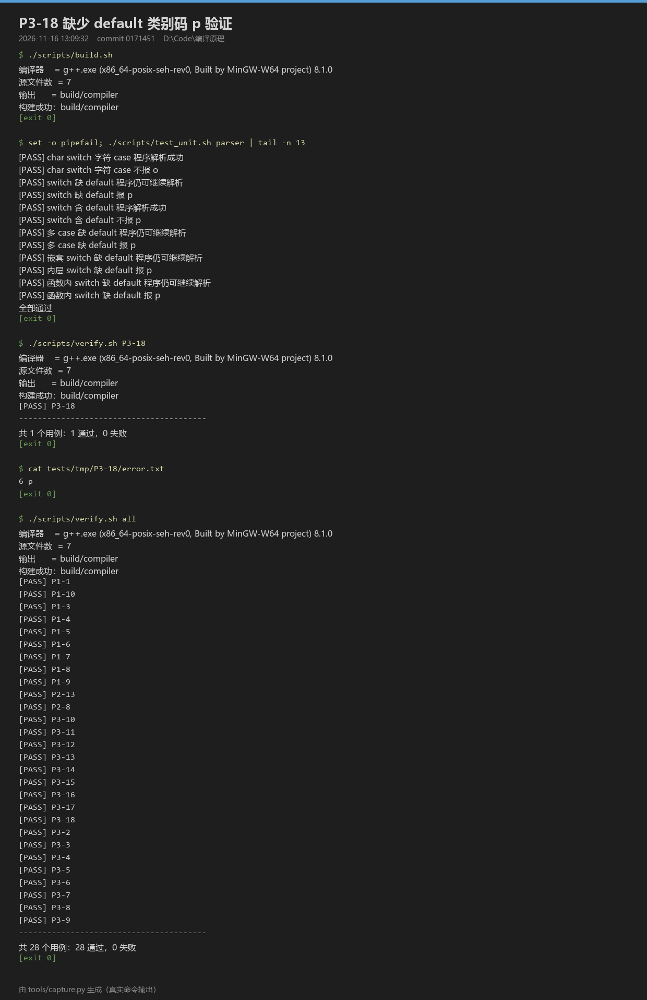

# P3-18 缺少缺省语句（类别码 p）

## 1. 目的

检测 switch 语句缺少 `default` 子句的情况，输出类别码 `p`。对应 TODO P3-18。

## 2. 环境

- 日期：2026-11-16
- 系统：Windows 11
- 工具链：g++ 8.1.0（MinGW-w64）、Git Bash 2.53.0、Python 3.14
- 代码版本：`0171451` 之后的工作区（本功能提交见 `git log --oneline --grep=P3-18`）

## 3. 前置条件

- P3-17 常量类型检查已完成；
- 新增 `tests/cases/P3-18/`（switch 缺少 default）。

## 4. 复现步骤

1. 构建：

```bash
./scripts/build.sh
```

2. 运行语法/语义单元测试（完整 394 项，截图展示末尾 13 行）：

```bash
set -o pipefail; ./scripts/test_unit.sh parser | tail -n 13
```

3. 运行 P3-18 用例：

```bash
./scripts/verify.sh P3-18
```

4. 查看 `error.txt`：

```bash
cat tests/tmp/P3-18/error.txt
```

5. 回归：

```bash
./scripts/verify.sh all
```

## 5. 预期输出

```text
$ ./scripts/build.sh
编译器    = g++.exe (x86_64-posix-seh-rev0, Built by MinGW-W64 project) 8.1.0
源文件数  = 7
输出      = build/compiler
构建成功：build/compiler
[exit 0]

$ set -o pipefail; ./scripts/test_unit.sh parser | tail -n 13
...（394 项断言，末尾 13 行；完整输出见 run.log 与截图）
全部通过
[exit 0]

$ ./scripts/verify.sh P3-18
...
[PASS] P3-18
共 1 个用例：1 通过，0 失败
[exit 0]

$ cat tests/tmp/P3-18/error.txt
6 p
[exit 0]

$ ./scripts/verify.sh all
...
共 28 个用例：28 通过，0 失败
[exit 0]
```

## 6. 截图



## 7. 备注

### 实现要点

- `parse_switch_statement()` 在解析完 `<情况表>` 后检查当前单词：
  - 是 `default` → 正常解析 `<缺省>`；
  - 不是 `default` 且处于检查模式 → 报 `p`（行号取 switch 的右花括号行），随后继续解析 `}`。
- 支持嵌套 switch：每个 switch 独立检查自己的 default。

### 用例

```c
void main(){
    int x;
    switch (x) {
        case 1:
            x = 1;
    }
}
```

缺少 `default`，`error.txt` 为 `6 p`。

### 测试

- 新增 10 项单元测试：单/多 case 缺 default、含 default、嵌套 switch、函数内 switch。
- 语法/语义单元测试累计 394 项；端到端用例 28 个。
