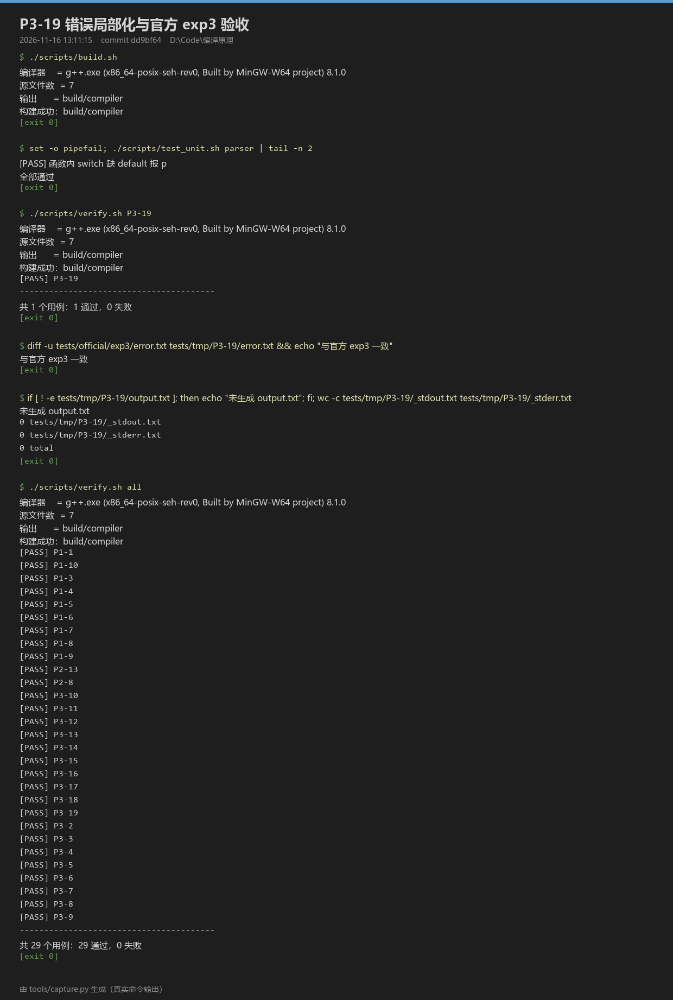

# P3-19 错误局部化与官方 exp3

## 1. 目的

验证错误局部化能力，并用指导书官方 exp3 样例验收：`error.txt` 恰为 `2 a` 与 `6 k`，不输出词法/语法调试信息。对应 TODO P3-19。

## 2. 环境

- 日期：2026-11-16
- 系统：Windows 11
- 工具链：g++ 8.1.0（MinGW-w64）、Git Bash 2.53.0、Python 3.14
- 代码版本：`dd9bf64` 之后的工作区（本功能提交见 `git log --oneline --grep=P3-19`）

## 3. 前置条件

- P3-2～P3-18 已实现错误码 a–p 与恢复机制；
- 新增 `tests/cases/P3-19/`：输入与期望输出复制自官方 exp3。

## 4. 复现步骤

1. 构建：

```bash
./scripts/build.sh
```

2. 运行 P3-19 用例：

```bash
./scripts/verify.sh P3-19
```

3. 与官方错误输出比对：

```bash
diff -u tests/official/exp3/error.txt tests/tmp/P3-19/error.txt && echo "与官方 exp3 一致"
```

4. 确认没有调试输出：

```bash
if [ ! -e tests/tmp/P3-19/output.txt ]; then echo "未生成 output.txt"; fi
wc -c tests/tmp/P3-19/_stdout.txt tests/tmp/P3-19/_stderr.txt
```

5. 回归：

```bash
./scripts/verify.sh all
```

## 5. 预期输出

```text
$ ./scripts/build.sh
编译器    = g++.exe (x86_64-posix-seh-rev0, Built by MinGW-W64 project) 8.1.0
源文件数  = 7
输出      = build/compiler
构建成功：build/compiler
[exit 0]

$ set -o pipefail; ./scripts/test_unit.sh parser | tail -n 2
[PASS] 函数内 switch 缺 default 报 p
全部通过
[exit 0]

$ ./scripts/verify.sh P3-19
...
[PASS] P3-19
共 1 个用例：1 通过，0 失败
[exit 0]

$ diff -u tests/official/exp3/error.txt tests/tmp/P3-19/error.txt && echo "与官方 exp3 一致"
与官方 exp3 一致
[exit 0]

$ if [ ! -e tests/tmp/P3-19/output.txt ]; then echo "未生成 output.txt"; fi; wc -c tests/tmp/P3-19/_stdout.txt tests/tmp/P3-19/_stderr.txt
未生成 output.txt
0 tests/tmp/P3-19/_stdout.txt
0 tests/tmp/P3-19/_stderr.txt
0 total
[exit 0]

$ ./scripts/verify.sh all
...
共 29 个用例：29 通过，0 失败
[exit 0]
```

## 6. 截图



## 7. 备注

### 官方样例

```c
const int const1 = 1, const2 = -100;
const char const3 = '?';
int change1;
char change3;
int gets1(int var1,int var2){
   change1 = var1 + var2          return (change1);
}
void main(){
   change1 = 10;
   printf("Hello World");
   printf(gets1(10, 20));
}
```

- 第 2 行 `'?'`：词法错误 `a`；
- 第 6 行赋值缺少分号：`k`；
- 输出恰为：

```text
2 a
6 k
```

### 错误局部化

- 词法错误单元被丢弃，语法错误报告后继续解析。
- 后续语句（`return`、`main` 等）仍被完整分析，未产生级联错误。
- 错误按行号排序、每行去重。

### 调试输出

- `--check` 模式只写 `error.txt`。
- 不生成 `output.txt`，stdout/stderr 均为空。

### 用例来源

`tests/cases/P3-19/` 的 `testfile.txt` 与 `expect.txt` 均复制自官方 exp3，未修改。
