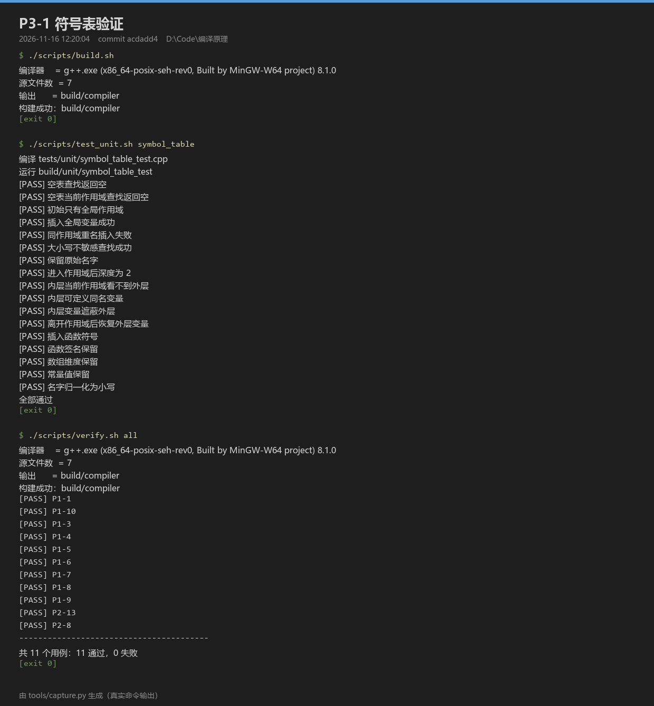

# P3-1 符号表

## 1. 目的

为实验三提供符号表基础设施：作用域栈、种类（常量/变量/数组/函数）、类型（int/char/void）、数组维度、常量值与函数参数类型；名字查找**不区分大小写**。对应 TODO P3-1。

## 2. 环境

- 日期：2026-11-16
- 系统：Windows 11
- 工具链：g++ 8.1.0（MinGW-w64）、Git Bash 2.53.0、Python 3.14
- 代码版本：`acdadd4` 之后的工作区（本功能提交见 `git log --oneline --grep=P3-1`）

## 3. 前置条件

- 实验二已完成（标签 `stage2`）；
- 新增 `src/semantic/symbol_table.h/.cpp` 与单元测试。

## 4. 复现步骤

1. 构建（`src/` 下 7 个 `.cpp`）：

```bash
./scripts/build.sh
```

2. 运行符号表单元测试：

```bash
./scripts/test_unit.sh symbol_table
```

3. 回归全部端到端用例：

```bash
./scripts/verify.sh all
```

## 5. 预期输出

```text
$ ./scripts/build.sh
编译器    = g++.exe (x86_64-posix-seh-rev0, Built by MinGW-W64 project) 8.1.0
源文件数  = 7
输出      = build/compiler
构建成功：build/compiler
[exit 0]

$ ./scripts/test_unit.sh symbol_table
编译 tests/unit/symbol_table_test.cpp
运行 build/unit/symbol_table_test
[PASS] 空表查找返回空
[PASS] 空表当前作用域查找返回空
[PASS] 初始只有全局作用域
[PASS] 插入全局变量成功
[PASS] 同作用域重名插入失败
[PASS] 大小写不敏感查找成功
[PASS] 保留原始名字
[PASS] 进入作用域后深度为 2
[PASS] 内层当前作用域看不到外层
[PASS] 内层可定义同名变量
[PASS] 内层变量遮蔽外层
[PASS] 离开作用域后恢复外层变量
[PASS] 插入函数符号
[PASS] 函数签名保留
[PASS] 数组维度保留
[PASS] 常量值保留
[PASS] 名字归一化为小写
全部通过
[exit 0]

$ ./scripts/verify.sh all
...
共 11 个用例：11 通过，0 失败
[exit 0]
```

## 6. 截图



## 7. 备注

### 数据结构

| 类型 | 取值 |
|---|---|
| `SymbolKind` | Constant / Variable / Array / Function |
| `DataType` | Unknown / Int / Char / Void |
| `Symbol` | 原名、小写 key、种类、类型、维度、常量值、函数参数类型 |

### 接口

| 方法 | 作用 |
|---|---|
| `enter_scope()` / `leave_scope()` | 进入/退出作用域；全局作用域不可退出 |
| `insert(symbol)` | 插入当前作用域；同作用域重名返回 false |
| `lookup(name)` | 从内向外查找，名字不区分大小写 |
| `lookup_current_scope(name)` | 只在当前作用域查找 |
| `normalize(name)` | ASCII 小写归一化 |

### 作用域策略

- 全局作用域保存常量、变量、函数。
- 函数定义时为参数与函数体建立新作用域；函数名本身记录在全局。
- 内层同名变量可以遮蔽外层；离开作用域后恢复。

### 当前状态

- 本阶段只建立数据结构与单元测试，尚未接入语法分析器。
- P3-2 起会把符号表与错误收集接入 `--check` 模式，输出 `error.txt`。
