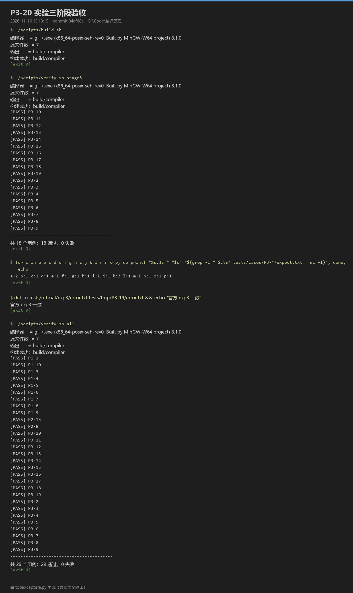

# P3-20 实验三阶段验收

## 1. 目的

按 AGENTS.md §6.2 完成实验三（错误处理）阶段验收：官方 exp3 逐行一致、a–p 每类至少一个用例、错误局部化且无调试输出，并打标签 `stage3`。对应 TODO P3-20。

## 2. 环境

- 日期：2026-11-16
- 系统：Windows 11
- 工具链：g++ 8.1.0（MinGW-w64）、Git Bash 2.53.0、Python 3.14
- 代码版本：`04af68a` 之后的工作区（本功能提交见 `git log --oneline --grep=P3-20`）

## 3. 前置条件

- P3-1～P3-19 全部完成；
- 各错误码用例已入库（P3-2～P3-19）。

## 4. 复现步骤

1. 构建：

```bash
./scripts/build.sh
```

2. 运行实验三全部用例：

```bash
./scripts/verify.sh stage3
```

3. 统计 a–p 每类错误的用例数：

```bash
for c in a b c d e f g h i j k l m n o p; do printf "%s:%s " "$c" "$(grep -l " $c\$" tests/cases/P3-*/expect.txt | wc -l)"; done; echo
```

4. 与官方 exp3 比对：

```bash
diff -u tests/official/exp3/error.txt tests/tmp/P3-19/error.txt && echo "官方 exp3 一致"
```

5. 全量回归：

```bash
./scripts/verify.sh all
```

## 5. 预期输出

```text
$ ./scripts/build.sh
编译器    = g++.exe (x86_64-posix-seh-rev0, Built by MinGW-W64 project) 8.1.0
源文件数  = 7
输出      = build/compiler
构建成功：build/compiler
[exit 0]

$ ./scripts/verify.sh stage3
...
[PASS] P3-10
...
[PASS] P3-19
[PASS] P3-2
...
[PASS] P3-9
----------------------------------------
共 18 个用例：18 通过，0 失败
[exit 0]

$ for c in a b c d e f g h i j k l m n o p; do printf "%s:%s " "$c" "$(grep -l " $c\$" tests/cases/P3-*/expect.txt | wc -l)"; done; echo
a:2 b:1 c:1 d:1 e:1 f:1 g:1 h:1 i:1 j:1 k:3 l:1 m:1 n:1 o:1 p:1
[exit 0]

$ diff -u tests/official/exp3/error.txt tests/tmp/P3-19/error.txt && echo "官方 exp3 一致"
官方 exp3 一致
[exit 0]

$ ./scripts/verify.sh all
...
共 29 个用例：29 通过，0 失败
[exit 0]
```

## 6. 截图



## 7. 备注

### §6.2 阶段验收 checklist

| 条目 | 结果 | 证据 |
|---|---|---|
| 官方 exp3 输出 `2 a` / `6 k` | ✅ | P3-19，diff 无差异 |
| a–p 每类至少 1 个用例 | ✅ | 覆盖统计 a:2，k:3，其余各 1 |
| 行号正确 | ✅ | 各用例按行号断言 |
| 每行最多一个错误 | ✅ | 按行排序去重 |
| 错误局部化、不崩溃 | ✅ | 18 个错误用例均继续解析完成 |
| 不输出词法/语法调试内容 | ✅ | `--check` 不生成 output.txt，stdout/stderr 为空 |

### 错误码与用例

| 码 | 含义 | 用例 |
|---|---|---|
| a | 非法符号/词法 | P3-3 |
| b | 名字重定义 | P3-4 |
| c | 未定义名字 | P3-5 |
| d | 参数个数不匹配 | P3-6 |
| e | 参数类型不匹配 | P3-7 |
| f | 条件类型不合法 | P3-8 |
| g | 无返回值函数 return 错误 | P3-9 |
| h | 有返回值函数 return 错误 | P3-10 |
| i | 数组下标非整型 | P3-11 |
| j | 修改常量 | P3-12 |
| k | 缺分号 | P3-2、P3-13 |
| l | 缺右小括号 | P3-14 |
| m | 缺右中括号 | P3-15 |
| n | 数组初始化个数不匹配 | P3-16 |
| o | 常量类型不一致 | P3-17 |
| p | 缺少 default | P3-18 |

### 阶段标签

```bash
git tag -a stage3 -m "实验三 错误处理 阶段验收通过（P3-1～P3-20）"
git push origin stage3
```

### 测试规模

- 语法/语义单元测试：394 项
- 实验三端到端用例：18 个
- 全量端到端用例：29 个
