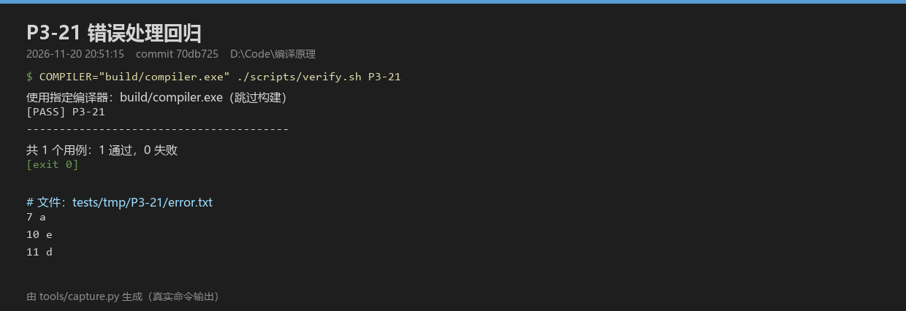

# P3-21 错误诊断与恢复回归

## 1. 目的
验证嵌套函数调用的参数个数和类型诊断、char 数组元素的类型推导、缺右括号的错误类别，以及非法字符后继续分析声明的能力。

## 2. 环境
- 日期：2026-11-20
- 系统：Windows 11
- 工具链：g++ 8.1.0 / Python 3.14
- 代码版本：`70db725 修复提交`

## 3. 前置条件
- 已在仓库根目录完成构建。
- 用例位于 `tests/cases/P3-21/`；输出设为 `error.txt`，允许编译器以非零状态报告输入错误。
- 错误输出仅保留错误行号与类别码。

## 4. 复现步骤
1. 构建：`bash ./scripts/build.sh`。
2. 准备输入：验证脚本自动复制 `tests/cases/P3-21/testfile.txt`。
3. 运行：`COMPILER="build/compiler.exe" ./scripts/verify.sh P3-21`。
4. 比对：脚本检查生成的 `error.txt` 与期望一致，预期 PASS。

## 5. 预期输出
``text
7 a
10 e
11 d
``

## 6. 截图

## 7. 备注
本用例含三处有意错误：非法字符常量（a）、把 char 返回值传给 int 参数（e）、函数实参个数不匹配（d）。char 数组元素返回不应产生 h 错误；有效嵌套调用不应污染外层的参数计数。

