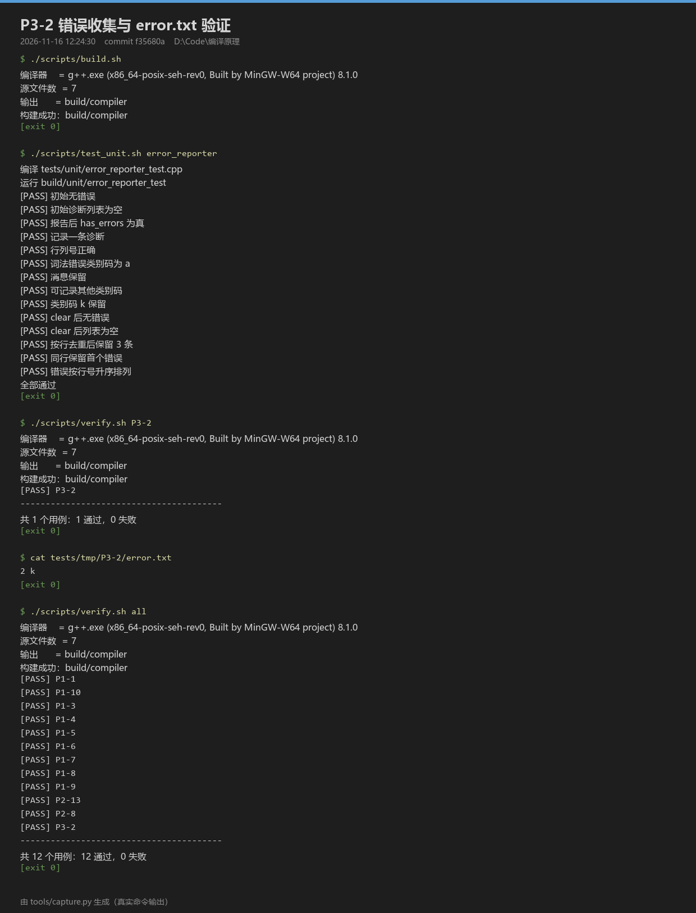

# P3-2 错误收集与 error.txt

## 1. 目的

接入实验三的错误输出：新增 `--check` 模式，收集词法/语法错误并按 `行号 类别码` 写入 `error.txt`；实现错误局部化（报告后继续解析）与每行去重。对应 TODO P3-2。

## 2. 环境

- 日期：2026-11-16
- 系统：Windows 11
- 工具链：g++ 8.1.0（MinGW-w64）、Git Bash 2.53.0、Python 3.14
- 代码版本：`f35680a` 之后的工作区（本功能提交见 `git log --oneline --grep=P3-2`）

## 3. 前置条件

- P3-1 符号表已完成；
- 新增 `tests/cases/P3-2/`（故意缺少分号的程序）。

## 4. 复现步骤

1. 构建：

```bash
./scripts/build.sh
```

2. 运行错误收集器单元测试：

```bash
./scripts/test_unit.sh error_reporter
```

3. 运行 P3-2 用例（`--check` 模式）：

```bash
./scripts/verify.sh P3-2
```

4. 查看 `error.txt`：

```bash
cat tests/tmp/P3-2/error.txt
```

5. 回归：

```bash
./scripts/verify.sh all
```

## 5. 预期输出

```text
$ ./scripts/build.sh
编译器    = g++.exe (x86_64-posix-seh-rev0, Built by MinGW-W64 project) 8.1.0
源文件数  = 7
输出      = build/compiler
构建成功：build/compiler
[exit 0]

$ ./scripts/test_unit.sh error_reporter
编译 tests/unit/error_reporter_test.cpp
运行 build/unit/error_reporter_test
[PASS] 初始无错误
[PASS] 初始诊断列表为空
[PASS] 报告后 has_errors 为真
[PASS] 记录一条诊断
[PASS] 行列号正确
[PASS] 词法错误类别码为 a
[PASS] 消息保留
[PASS] 可记录其他类别码
[PASS] 类别码 k 保留
[PASS] clear 后无错误
[PASS] clear 后列表为空
[PASS] 按行去重后保留 3 条
[PASS] 同行保留首个错误
[PASS] 错误按行号升序排列
全部通过
[exit 0]

$ ./scripts/verify.sh P3-2
...
[PASS] P3-2
共 1 个用例：1 通过，0 失败
[exit 0]

$ cat tests/tmp/P3-2/error.txt
2 k
[exit 0]

$ ./scripts/verify.sh all
...
共 12 个用例：12 通过，0 失败
[exit 0]
```

## 6. 截图



## 7. 备注

### `--check` 模式

- 读取 `testfile.txt`，运行词法与语法分析，只写 `error.txt`。
- 不生成 `output.txt`，不输出词法/语法调试信息，也不向 stderr 打印错误。
- 有错误时退出码 1；无错误时退出码 0。错误信息本身即输出。

### 错误格式

- 每行 `行号 类别码`，中间一个空格，类别码小写。
- 按行号升序输出；同一行只保留首个错误。
- 词法错误类别码为 `a`；缺少分号/右小括号/右中括号分别映射为 `k`/`l`/`m`。
- 其他未分类语法错误暂用 `a` 兜底（后续按实验三类别细化）。

### 错误局部化

- Parser 新增 `recovery` 模式：词法错误单元被丢弃（已由 Lexer 回调上报），语法错误报告后继续解析。
- `expect` 失败时报告错误并“假装成功”，让调用方继续；同一位置重复报错会强制前进，避免死循环。
- 分隔符缺失的报错行取**前一个已消费单词**的行号（与官方 exp3 样例的缺分号行号规则一致）。

### P3-2 用例

```c
void main(){
    int x
    x = 1;
}
```

第 2 行 `int x` 缺少分号，`error.txt` 为 `2 k`。

### 当前限制

- 语义检查（b–j、n–p）尚未实现，本阶段只覆盖词法错误与分隔符语法错误。
- 其他语法错误的恢复策略会在 P3-19 继续完善。
