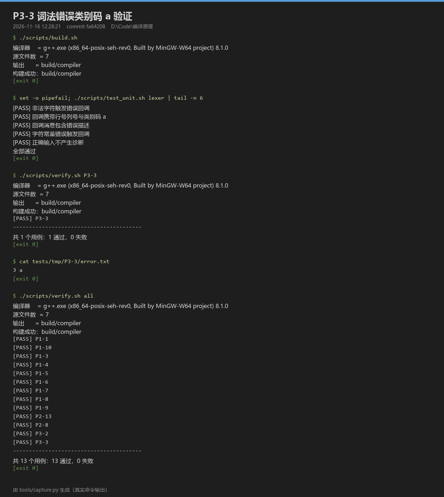

# P3-3 词法错误（类别码 a）

## 1. 目的

覆盖错误类别 `a`：非法字符、非法字符常量、空/未闭合字符串等词法错误，按行号写入 `error.txt`，并保证错误局部化不吞掉后续语句。对应 TODO P3-3。

## 2. 环境

- 日期：2026-11-16
- 系统：Windows 11
- 工具链：g++ 8.1.0（MinGW-w64）、Git Bash 2.53.0、Python 3.14
- 代码版本：`fa64208` 之后的工作区（本功能提交见 `git log --oneline --grep=P3-3`）

## 3. 前置条件

- P3-2 错误收集与 `error.txt` 已完成；
- 新增 `tests/cases/P3-3/`（字符常量 `'?'` 非法）。

## 4. 复现步骤

1. 构建：

```bash
./scripts/build.sh
```

2. 运行词法单元测试：

```bash
set -o pipefail; ./scripts/test_unit.sh lexer | tail -n 6
```

3. 运行 P3-3 用例：

```bash
./scripts/verify.sh P3-3
```

4. 查看 `error.txt`：

```bash
cat tests/tmp/P3-3/error.txt
```

5. 回归：

```bash
./scripts/verify.sh all
```

## 5. 预期输出

```text
$ ./scripts/build.sh
编译器    = g++.exe (x86_64-posix-seh-rev0, Built by MinGW-W64 project) 8.1.0
源文件数  = 7
输出      = build/compiler
构建成功：build/compiler
[exit 0]

$ set -o pipefail; ./scripts/test_unit.sh lexer | tail -n 6
...（词法测试末尾若干项，完整输出见 run.log 与截图）
全部通过
[exit 0]

$ ./scripts/verify.sh P3-3
...
[PASS] P3-3
共 1 个用例：1 通过，0 失败
[exit 0]

$ cat tests/tmp/P3-3/error.txt
3 a
[exit 0]

$ ./scripts/verify.sh all
...
共 13 个用例：13 通过，0 失败
[exit 0]
```

## 6. 截图



## 7. 备注

### 覆盖的错误

| 输入 | 错误 |
|---|---|
| `'?'` | 字符常量中出现非法字符（ASCII 63） |
| `'@'`、`' '` 等 | 字符常量非法内容 |
| `''` | 空字符常量 |
| `"abc` | 字符串缺少结束引号 |
| 字符串内含换行/制表符/非 ASCII | 字符串非法字符 |
| `@`、`#`、`\` 等 | 未识别字符 |

以上均由 Lexer 回调上报，类别码固定为 `a`。

### 错误恢复修正

- 字符/字符常量出错后，Lexer 会跳到**闭合引号或换行**，不再把后续 `;` 吞进错误单元。
- Parser 在恢复模式下丢弃 Error 单元；因子解析失败时，不吞掉 `;`、`}`、`)`、`]` 等上层同步点。
- 这样 `x = '?';` 只产生 `3 a`，不会级联到下一行。

### 用例

```c
void main(){
    int x;
    x = '?';
}
```

`error.txt` 为 `3 a`。

### 测试

- 词法单元测试 91 项、语法单元测试 159 项全部通过。
- 端到端用例 13 个全部通过。
