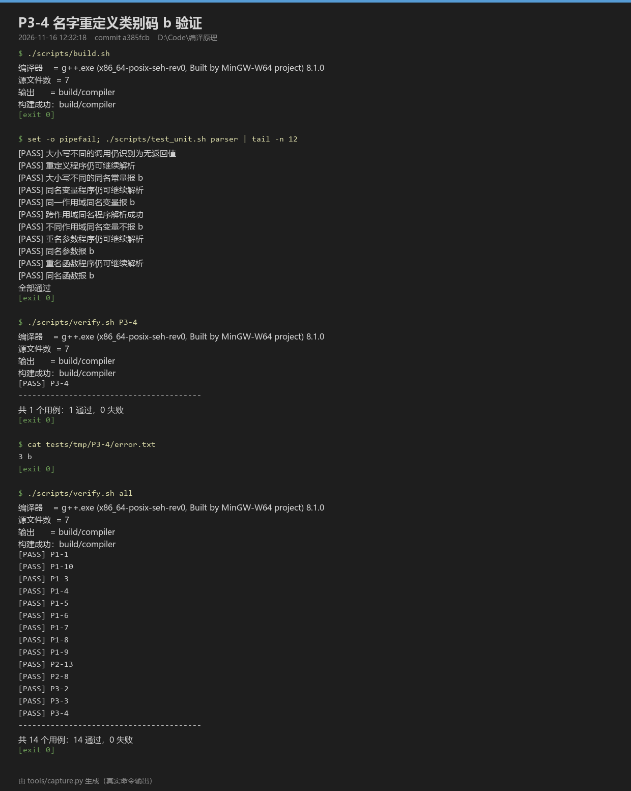

# P3-4 名字重定义（类别码 b）

## 1. 目的

把符号表接入常量、变量与函数的声明解析，在**同一作用域**内检测名字重定义（不区分大小写），输出类别码 `b`。对应 TODO P3-4。

## 2. 环境

- 日期：2026-11-16
- 系统：Windows 11
- 工具链：g++ 8.1.0（MinGW-w64）、Git Bash 2.53.0、Python 3.14
- 代码版本：`a385fcb` 之后的工作区（本功能提交见 `git log --oneline --grep=P3-4`）

## 3. 前置条件

- P3-1 符号表、P3-3 词法错误已完成；
- 新增 `tests/cases/P3-4/`（同名变量）。

## 4. 复现步骤

1. 构建：

```bash
./scripts/build.sh
```

2. 运行语法/语义单元测试（完整 169 项，截图展示末尾 12 行）：

```bash
set -o pipefail; ./scripts/test_unit.sh parser | tail -n 12
```

3. 运行 P3-4 用例：

```bash
./scripts/verify.sh P3-4
```

4. 查看 `error.txt`：

```bash
cat tests/tmp/P3-4/error.txt
```

5. 回归：

```bash
./scripts/verify.sh all
```

## 5. 预期输出

```text
$ ./scripts/build.sh
编译器    = g++.exe (x86_64-posix-seh-rev0, Built by MinGW-W64 project) 8.1.0
源文件数  = 7
输出      = build/compiler
构建成功：build/compiler
[exit 0]

$ set -o pipefail; ./scripts/test_unit.sh parser | tail -n 12
...（169 项断言，末尾 12 行；完整输出见 run.log 与截图）
全部通过
[exit 0]

$ ./scripts/verify.sh P3-4
...
[PASS] P3-4
共 1 个用例：1 通过，0 失败
[exit 0]

$ cat tests/tmp/P3-4/error.txt
3 b
[exit 0]

$ ./scripts/verify.sh all
...
共 14 个用例：14 通过，0 失败
[exit 0]
```

## 6. 截图



## 7. 备注

### 实现要点

- Parser 内置 `semantic::SymbolTable`。
- 常量定义：每个名字插入 `Constant`（类型 int/char）。
- 变量定义：每个声明符插入 `Variable`（0 维）或 `Array`（1/2 维）。
- 函数定义：函数名插入外层作用域（`Function` + 参数类型），随后进入函数作用域，插入参数。
- 主函数进入独立作用域。
- 插入失败（同作用域已存在，名字不区分大小写）→ 报 `b`，行号取声明名字所在行。

### 作用域

- 全局作用域：常量、全局变量、函数。
- 每个函数/主函数一个作用域：参数与函数体内声明的常量/变量。
- 嵌套复合语句暂时不新建作用域（与本课程常见实现一致）；如后续需要块级作用域再扩展。
- 内层可与外层同名（遮蔽），不报 `b`。

### 用例

```c
void main(){
    int x;
    int X;
    x = 1;
}
```

`int X` 与 `int x` 在同一作用域、大小写不敏感地重名，`error.txt` 为 `3 b`。

### 测试

- 新增 10 项单元测试：全局常量/变量、函数参数、函数名重定义；跨作用域同名不报错。
- 语法/语义单元测试累计 169 项；端到端用例 14 个。
