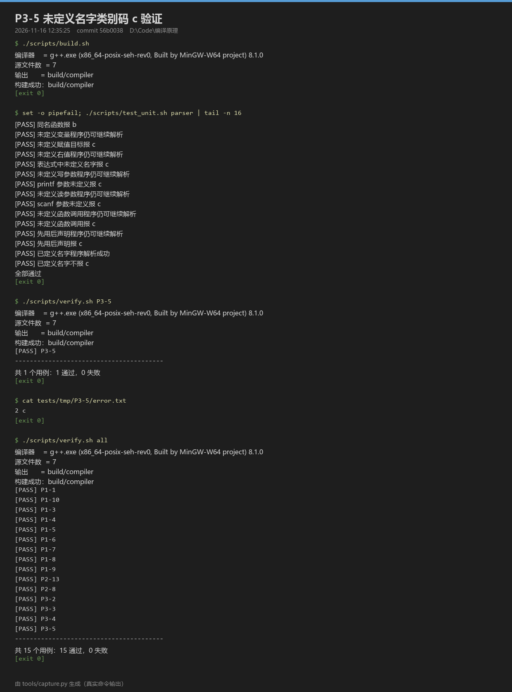

# P3-5 未定义名字（类别码 c）

## 1. 目的

在变量/常量使用、赋值、读语句与函数调用处查找符号表；未定义名字输出类别码 `c`。对应 TODO P3-5。

## 2. 环境

- 日期：2026-11-16
- 系统：Windows 11
- 工具链：g++ 8.1.0（MinGW-w64）、Git Bash 2.53.0、Python 3.14
- 代码版本：`56b0038` 之后的工作区（本功能提交见 `git log --oneline --grep=P3-5`）

## 3. 前置条件

- P3-4 名字重定义已完成；
- 新增 `tests/cases/P3-5/`（未定义变量赋值）。

## 4. 复现步骤

1. 构建：

```bash
./scripts/build.sh
```

2. 运行语法/语义单元测试（完整 183 项，截图展示末尾 16 行）：

```bash
set -o pipefail; ./scripts/test_unit.sh parser | tail -n 16
```

3. 运行 P3-5 用例：

```bash
./scripts/verify.sh P3-5
```

4. 查看 `error.txt`：

```bash
cat tests/tmp/P3-5/error.txt
```

5. 回归：

```bash
./scripts/verify.sh all
```

## 5. 预期输出

```text
$ ./scripts/build.sh
编译器    = g++.exe (x86_64-posix-seh-rev0, Built by MinGW-W64 project) 8.1.0
源文件数  = 7
输出      = build/compiler
构建成功：build/compiler
[exit 0]

$ set -o pipefail; ./scripts/test_unit.sh parser | tail -n 16
...（183 项断言，末尾 16 行；完整输出见 run.log 与截图）
全部通过
[exit 0]

$ ./scripts/verify.sh P3-5
...
[PASS] P3-5
共 1 个用例：1 通过，0 失败
[exit 0]

$ cat tests/tmp/P3-5/error.txt
2 c
[exit 0]

$ ./scripts/verify.sh all
...
共 15 个用例：15 通过，0 失败
[exit 0]
```

## 6. 截图



## 7. 备注

### 查找位置

| 位置 | 处理 |
|---|---|
| 赋值左侧标识符 | 查找；未定义 → c |
| 表达式中的标识符因子/数组元素 | 查找；未定义 → c |
| `printf` 表达式参数 | 经表达式因子查找 |
| `scanf` 参数 | 查找；未定义 → c |
| 函数调用（语句/因子） | 查找且必须为函数；未定义或非函数 → c |

### 顺序与作用域

- 符号按声明顺序插入，因此“先用后声明”按未定义处理（c）。
- 作用域查找从内向外，函数参数与局部变量可见。
- 仅在 `--check` 模式启用语义检查；`--dump-lexer`/`--dump-parser` 不受影响。

### 用例

```c
void main(){
    x = 1;
}
```

`x` 未定义，`error.txt` 为 `2 c`。

### 测试

- 新增 14 项单元测试：赋值左右值、printf/scanf 参数、函数调用、先用后声明、已定义名字不报 c。
- 语法/语义单元测试累计 183 项；端到端用例 15 个。
