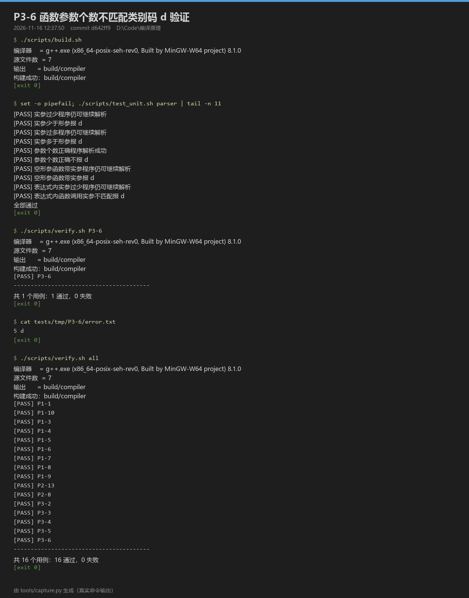

# P3-6 函数参数个数不匹配（类别码 d）

## 1. 目的

利用符号表中的函数签名，在函数调用处比较实参个数与形参个数；不一致输出类别码 `d`。对应 TODO P3-6。

## 2. 环境

- 日期：2026-11-16
- 系统：Windows 11
- 工具链：g++ 8.1.0（MinGW-w64）、Git Bash 2.53.0、Python 3.14
- 代码版本：`d642ff9` 之后的工作区（本功能提交见 `git log --oneline --grep=P3-6`）

## 3. 前置条件

- P3-5 未定义名字已完成；
- 新增 `tests/cases/P3-6/`（实参少于形参）。

## 4. 复现步骤

1. 构建：

```bash
./scripts/build.sh
```

2. 运行语法/语义单元测试（完整 193 项，截图展示末尾 11 行）：

```bash
set -o pipefail; ./scripts/test_unit.sh parser | tail -n 11
```

3. 运行 P3-6 用例：

```bash
./scripts/verify.sh P3-6
```

4. 查看 `error.txt`：

```bash
cat tests/tmp/P3-6/error.txt
```

5. 回归：

```bash
./scripts/verify.sh all
```

## 5. 预期输出

```text
$ ./scripts/build.sh
编译器    = g++.exe (x86_64-posix-seh-rev0, Built by MinGW-W64 project) 8.1.0
源文件数  = 7
输出      = build/compiler
构建成功：build/compiler
[exit 0]

$ set -o pipefail; ./scripts/test_unit.sh parser | tail -n 11
...（193 项断言，末尾 11 行；完整输出见 run.log 与截图）
全部通过
[exit 0]

$ ./scripts/verify.sh P3-6
...
[PASS] P3-6
共 1 个用例：1 通过，0 失败
[exit 0]

$ cat tests/tmp/P3-6/error.txt
5 d
[exit 0]

$ ./scripts/verify.sh all
...
共 16 个用例：16 通过，0 失败
[exit 0]
```

## 6. 截图



## 7. 备注

### 实现要点

- 函数定义时把参数类型列表存入函数符号（`parameter_types`）。
- `<值参数表>` 解析时统计实参个数（空表为 0）。
- 函数调用（语句形式与表达式因子）在解析完实参后比较：
  - 已定义函数且数量不一致 → `d`；
  - 未定义函数只报 `c`，不再报 `d`。
- 错误行号取函数名所在行。

### 用例

```c
int add(int a, int b){
    return(a + b);
}
void main(){
    add(1);
}
```

`add` 需要 2 个实参，调用只给 1 个，`error.txt` 为 `5 d`。

### 测试

- 新增 10 项单元测试：实参过少/过多、数量正确、空形参带实参、表达式内调用。
- 语法/语义单元测试累计 193 项；端到端用例 16 个。
